# 展示图片标签索引

先按回答指令组织文字，再选择主图；展开某个子主题时调用相应备选图。所有配图为写实生成的场景示意。

## AG-IMG-001｜番茄田水土现场
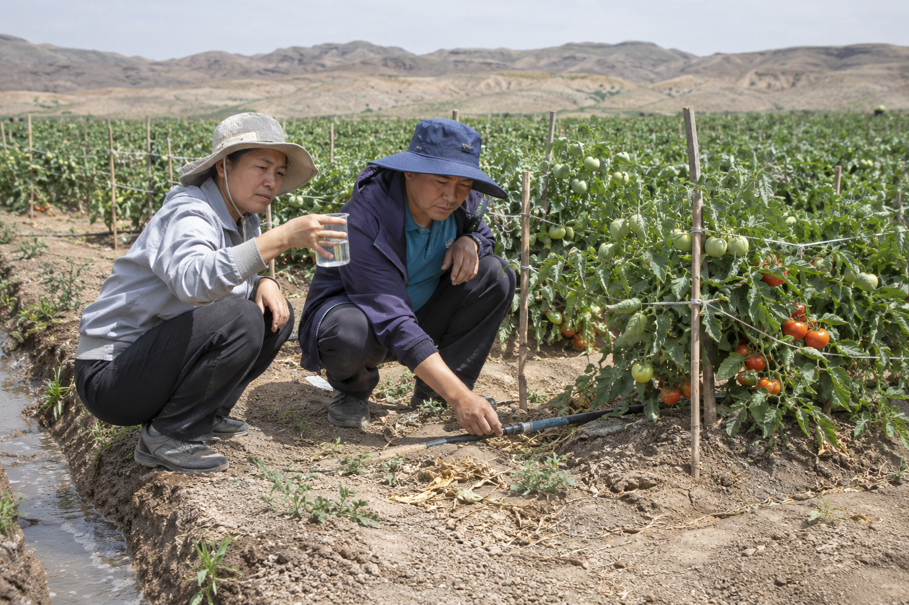
含义：番茄田、灌溉渠与农技人员水土检查，展示番茄生产中的水土管理。
标签：番茄、田间检查、灌溉、水质检测、滴灌
对应问答：DQA-001, DQA-007

## AG-IMG-002｜番茄田水质与土壤取样
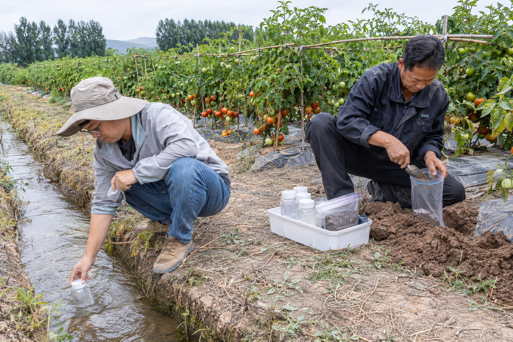
含义：番茄田边采集灌溉水与土壤样本，解释检测对象与采样工作。
标签：番茄、取样、EC、SAR、土壤监测、灌溉水质
对应问答：DQA-004, DQA-045

## AG-IMG-003｜番茄滴灌水质检测
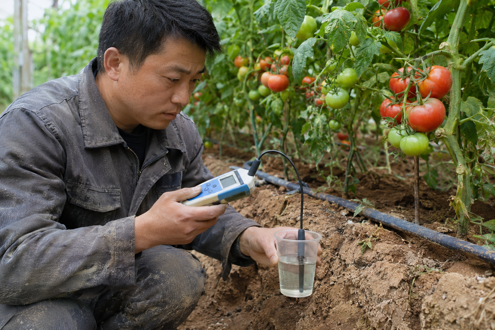
含义：番茄种植垄旁的手持检测仪、水样与滴灌带，解释灌溉水质检查。
标签：番茄、水质检测、滴灌、电导率、根区
对应问答：DQA-002

## AG-IMG-004｜番茄田装备与田间作业
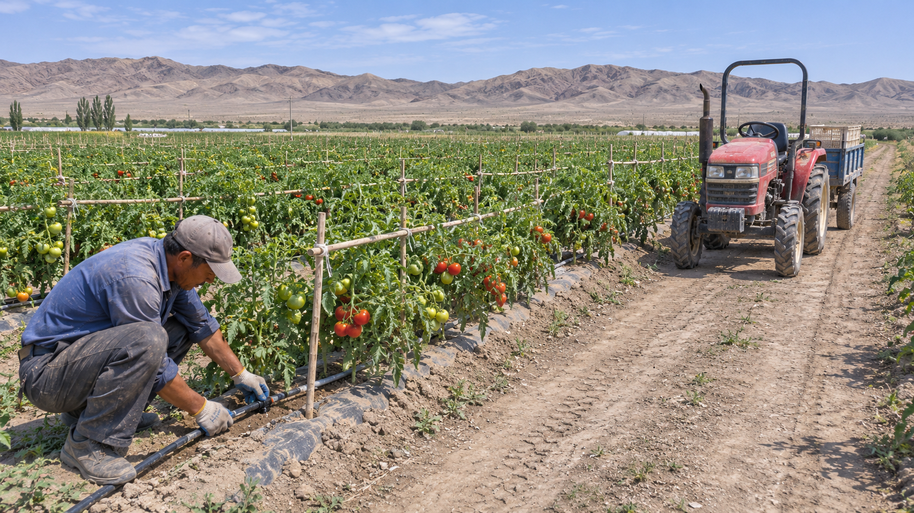
含义：番茄田车道上的拖拉机、滴灌设备与作业人员，解释田间管理环节。
标签：番茄、农业装备、拖拉机、滴灌、田间管理
对应问答：DQA-001, DQA-004, DQA-005, DQA-006, DQA-044, DQA-046

## AG-IMG-005｜番茄田灌溉阀门操作

含义：工人在番茄田边操作灌溉阀门，解释灌溉执行环节。
标签：番茄、灌溉、阀门、滴灌、田间管理
对应问答：DQA-002, DQA-006, DQA-008, DQA-044

## AG-IMG-006｜灌溉水土样品检测
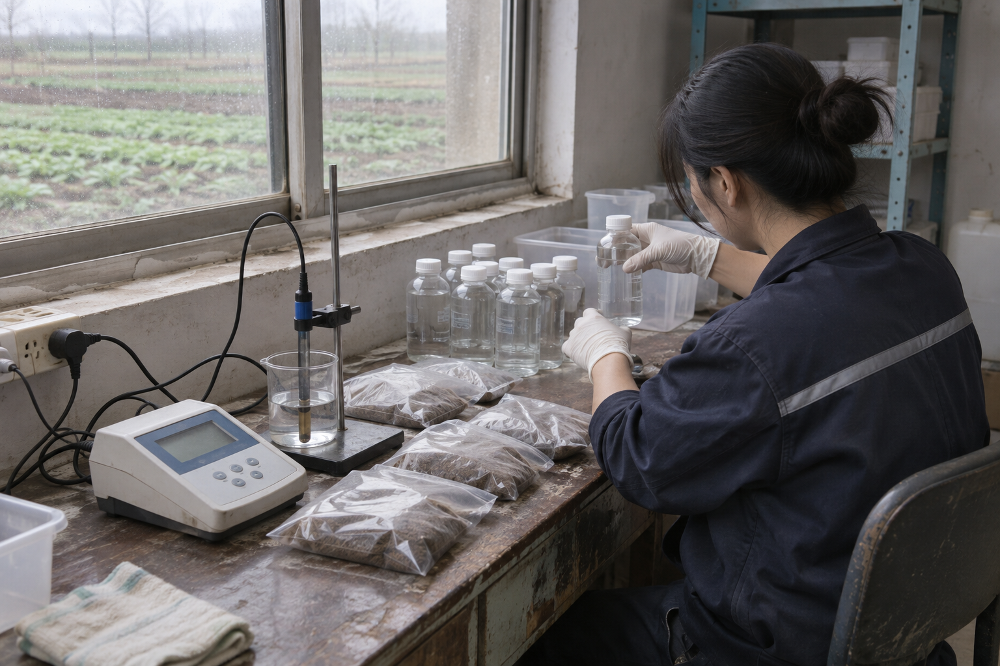
含义：样品瓶、土壤样本和台式仪器；解释水土评价所需检测工作。
标签：水质、电导率、样本、土壤、检测
对应问答：DQA-002, DQA-003, DQA-005, DQA-008, DQA-040, DQA-041, DQA-045, DQA-073

## AG-IMG-007｜农业水处理设备巡检
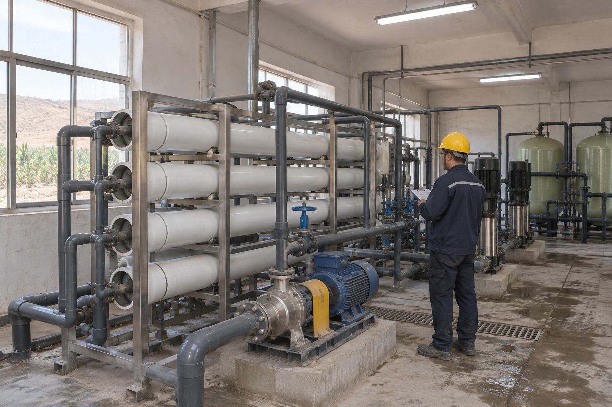
含义：水处理站的膜组件与管路巡检；不代表特定iFS结构或2000吨/小时产能。
标签：淡化、水处理、膜组件、泵、巡检
对应问答：DQA-003, DQA-006, DQA-007, DQA-043, DQA-072, DQA-077

## AG-IMG-008｜番茄采后分选与周转
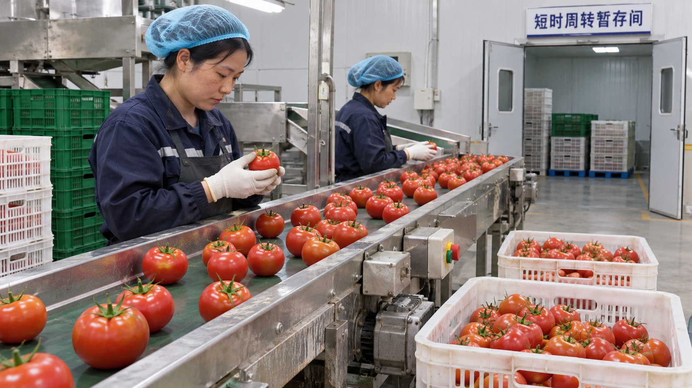
含义：红番茄输送带、人工检查与周转筐，解释采后分选和批次交接，不表示特定储藏温度或实际项目设备。
标签：番茄、采收、分选、周转、批次、质量分级
对应问答：DQA-043, DQA-046, DQA-078

## EDU-IMG-001｜普通终端汉服文化体验
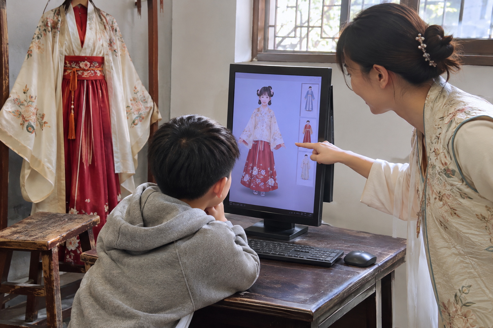
含义：儿童在实体显示器前观察二维换装画面；解释少儿文化体验，不使用全息场馆表现。
标签：汉服、普通显示器、文化体验、教师讲解
对应问答：DQA-034, DQA-035

## EDU-IMG-002｜光影镜面探索
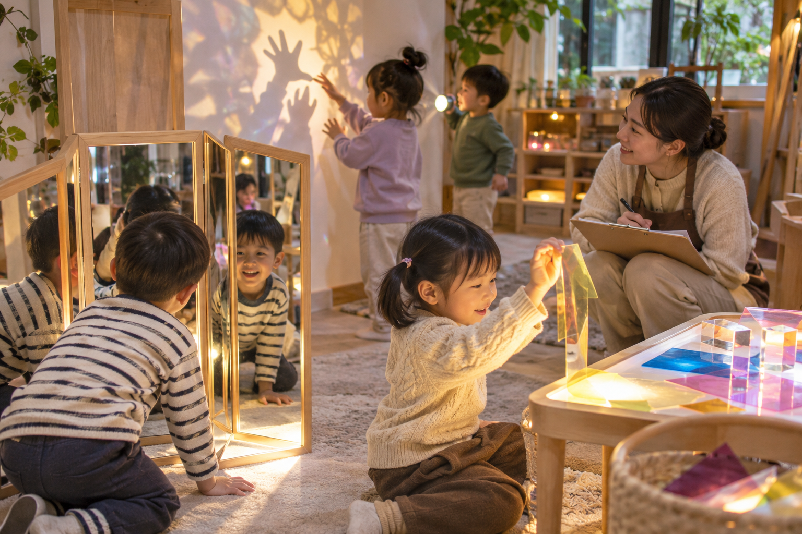
含义：儿童通过镜子、透明材料和影子探索光学现象。
标签：镜面、反射、光影、儿童探索
对应问答：DQA-036, DQA-037, DQA-064

## EDU-IMG-003｜服饰纹样互动讲解

含义：教师带领儿童观察服饰纹样与墙面投影，解释文化内容与参与。
标签：服饰、纹样、汉服、教师指导
对应问答：DQA-035

## EDU-IMG-004｜服饰纹样手作课堂
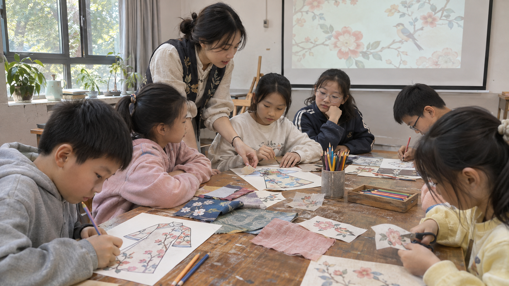
含义：日常服装的儿童用纸卡和布样完成纹样拼贴；解释体验向课程任务转化。
标签：手作、纹样、传统文化、课程、创作
对应问答：DQA-034, DQA-035, DQA-038, DQA-039, DQA-064, DQA-065, DQA-066, DQA-076

## EDU-IMG-005｜镜面与透光材料探索
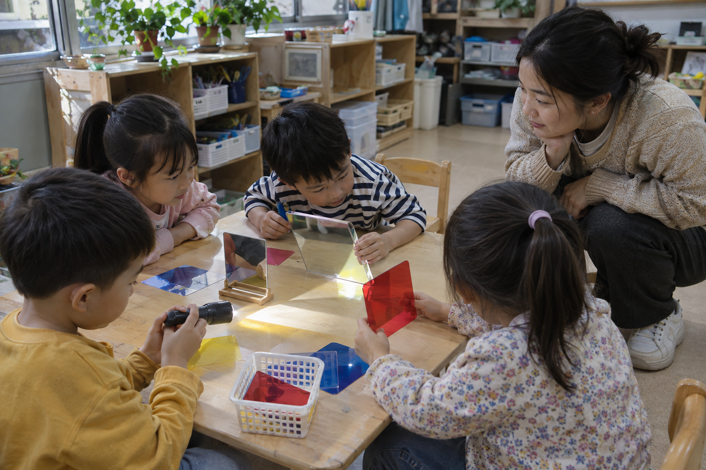
含义：儿童用镜子、手电和透明片观察反射；解释动作、反馈和再次观察。
标签：反射、镜面、透明材料、科学教育、观察
对应问答：DQA-034, DQA-036, DQA-037, DQA-039, DQA-063, DQA-065

## EDU-IMG-006｜传感与机械花操作课堂
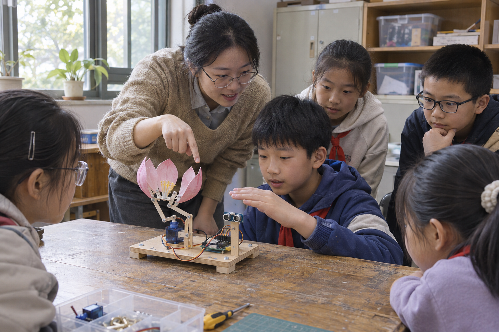
含义：儿童和教师观察小型机械花的接近触发与开合，解释输入—控制—输出；不是少年宫实际交付记录。
标签：机械花、传感、控制、反馈、科学教育、舵机
对应问答：DQA-063, DQA-065, DQA-066, DQA-077

## FAS-IMG-001｜样衣缝线质量检查
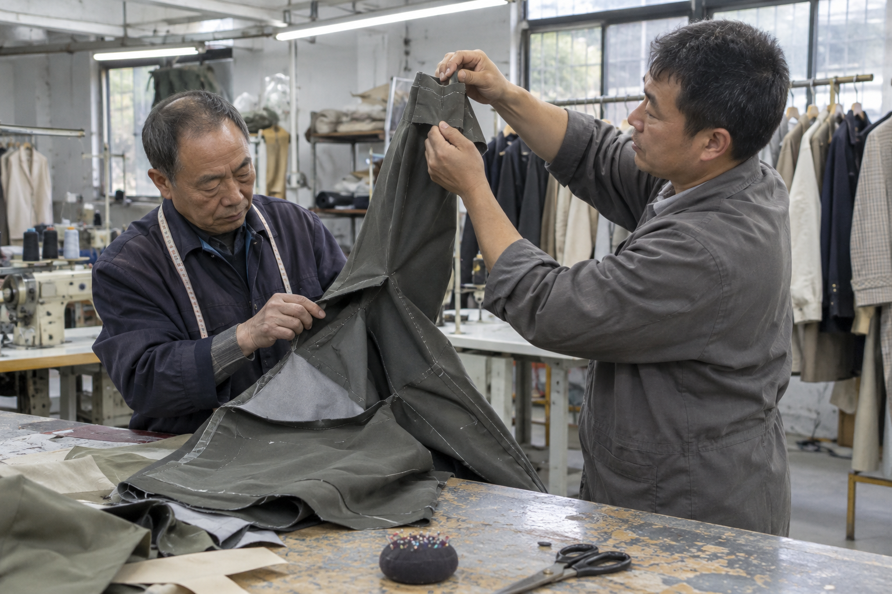
含义：普通样衣间的工艺检查；替换此前广告感较强的设计师画面。
标签：样衣、缝线、质检、生产、面料
对应问答：DQA-021, DQA-052

## FAS-IMG-002｜服装打版与纸样
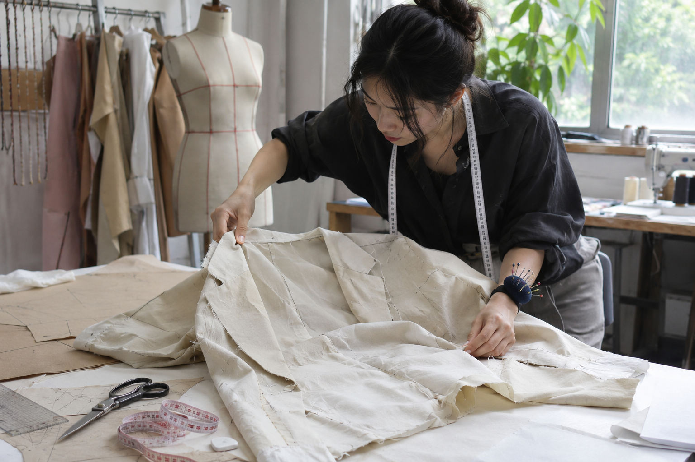
含义：展示打版师在工作台检查半成品版型和纸样
标签：服装线稿、版型、打版、样衣、纸样
对应问答：DQA-016, DQA-017, DQA-018

## FAS-IMG-003｜服装试衣与量体
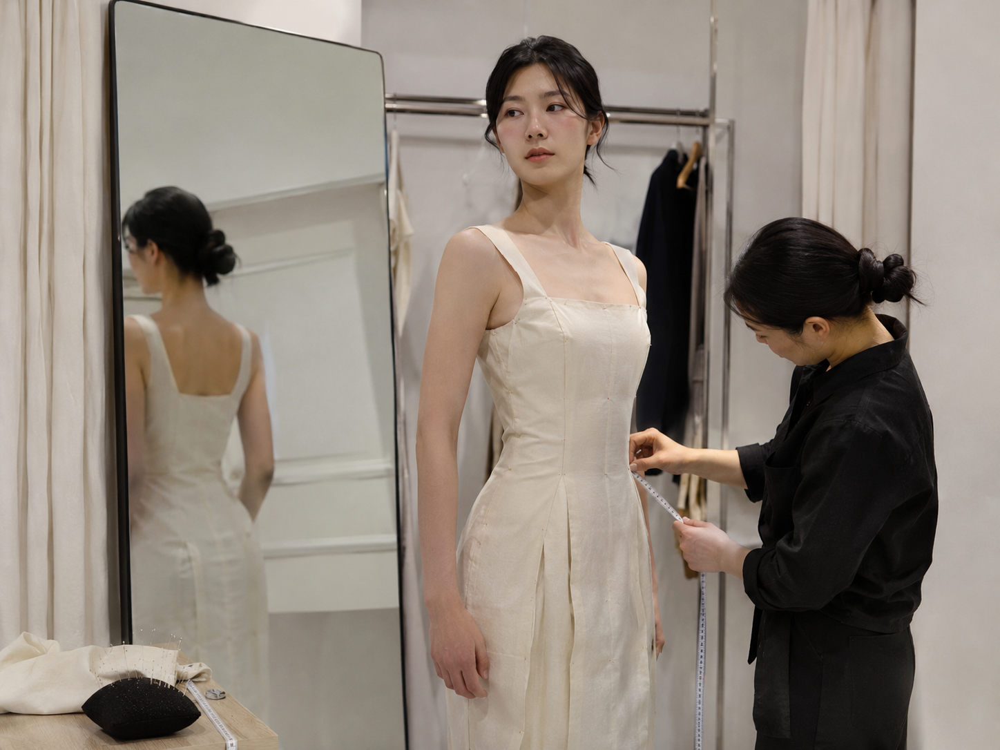
含义：展示设计师给模特量体并检查样衣合体度
标签：虚拟换装、真实试衣、尺码、版型合体
对应问答：DQA-018

## FAS-IMG-004｜服装面料检查
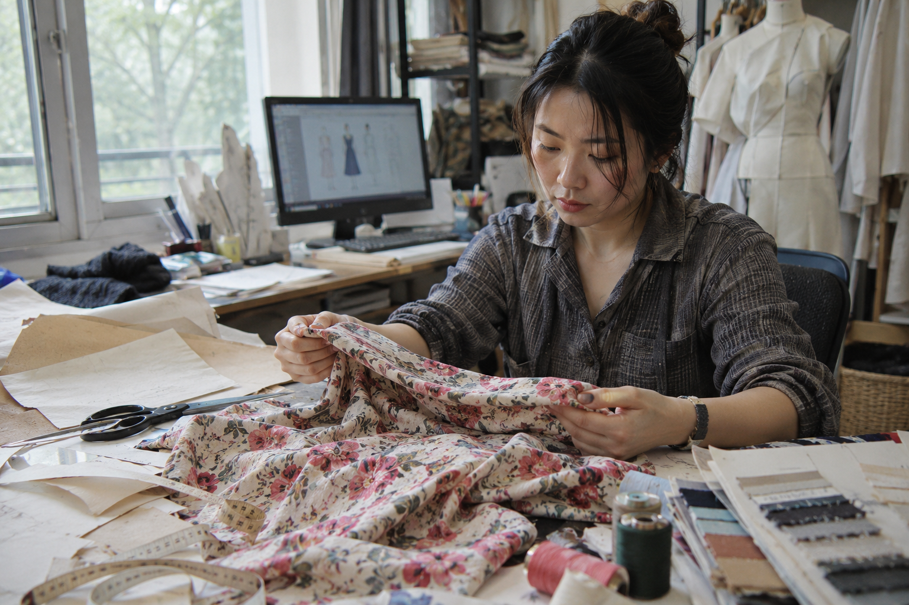
含义：展示设计师检查真实面料、样本和纹理
标签：面料理解、花型、材质、生产前检查
对应问答：DQA-016, DQA-019, DQA-021, DQA-051, DQA-053

## FAS-IMG-005｜裁剪与纸样细节

含义：手部、剪刀、纸样和面料的近景；说明数字设计仍需打版裁剪与工艺落实。
标签：裁剪、纸样、面料、打版、生产
对应问答：DQA-017, DQA-021, DQA-052

## FAS-IMG-006｜钮扣光学采集与尺寸检查
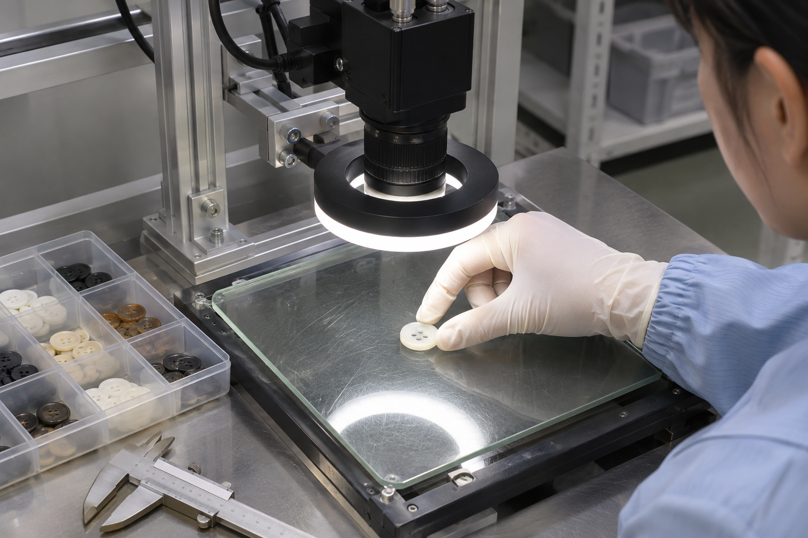
含义：工业相机、环形灯、检测台和钮扣样本；说明辅料数字化工位。
标签：钮扣、工业相机、采图、尺寸、标定
对应问答：DQA-019, DQA-020, DQA-054, DQA-072

## FAS-IMG-007｜数字设计与实体样衣核对
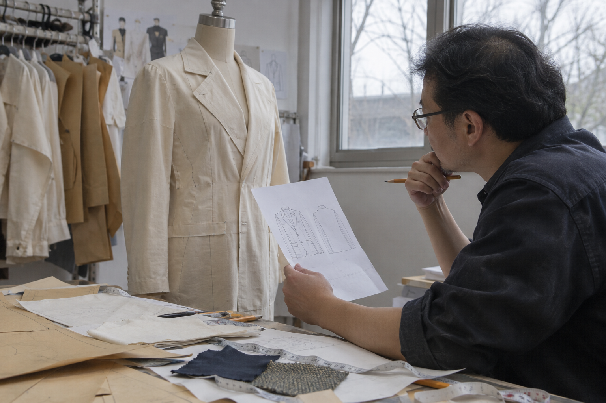
含义：打版师比较设计稿与人台样衣，解释视觉设计和实体工艺的衔接。
标签：线稿、生成控制、样衣、版型、工艺、设计验证
对应问答：DQA-051, DQA-052, DQA-053, DQA-069, DQA-070, DQA-073, DQA-075

## LOG-IMG-001｜物流仓库与运输调度

含义：展示仓库、箱货、运输车辆和工作人员核对单据
标签：凯鸿物流、订单、仓储、运输、箱货关系
对应问答：DQA-023, DQA-024

## LOG-IMG-002｜物流单据与运输状态
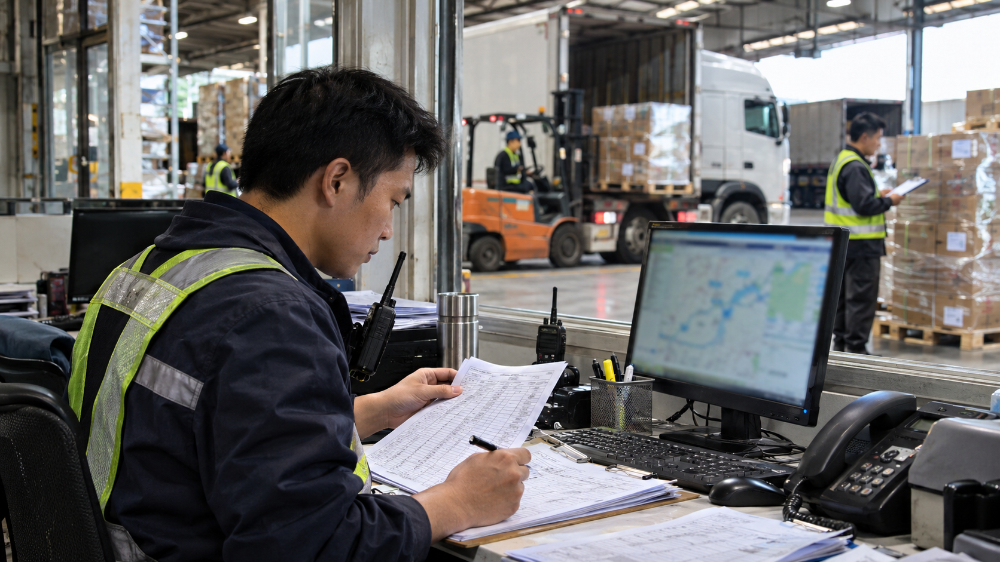
含义：展示物流调度人员核对运输单据和车辆状态
标签：订单、运段、运输节点、费用、回单
对应问答：DQA-022, DQA-025, DQA-027, DQA-055, DQA-056, DQA-058

## LOG-IMG-003｜集装箱箱号扫描
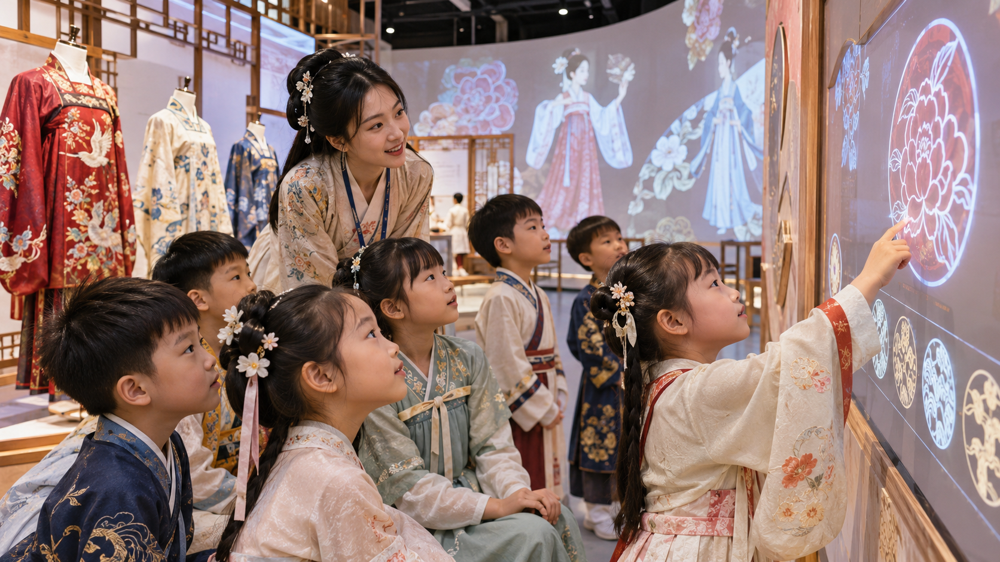
含义：工作人员手持扫描终端检查集装箱表面标识；解释箱管与业务事件。
标签：集装箱、箱号、装运、提还箱、节点事件
对应问答：DQA-023, DQA-026, DQA-057

## LOG-IMG-004｜电话协调车辆调度
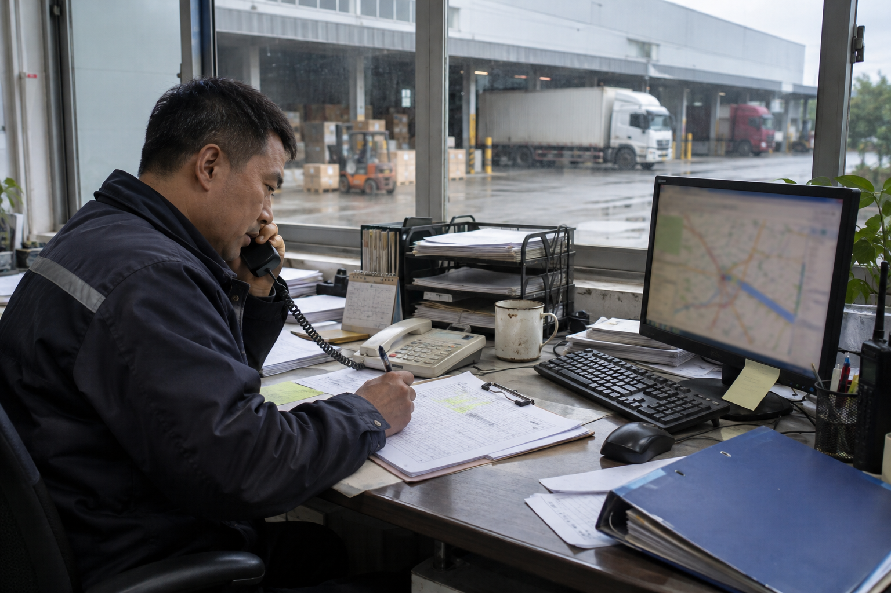
含义：电话、纸单、电脑与装卸区组合；解释跨系统协调和运输组织。
标签：调度、电话、运段、运输、单据
对应问答：DQA-022, DQA-024, DQA-025, DQA-027, DQA-055, DQA-067, DQA-070, DQA-075

## LOG-IMG-005｜仓库托盘入库核对
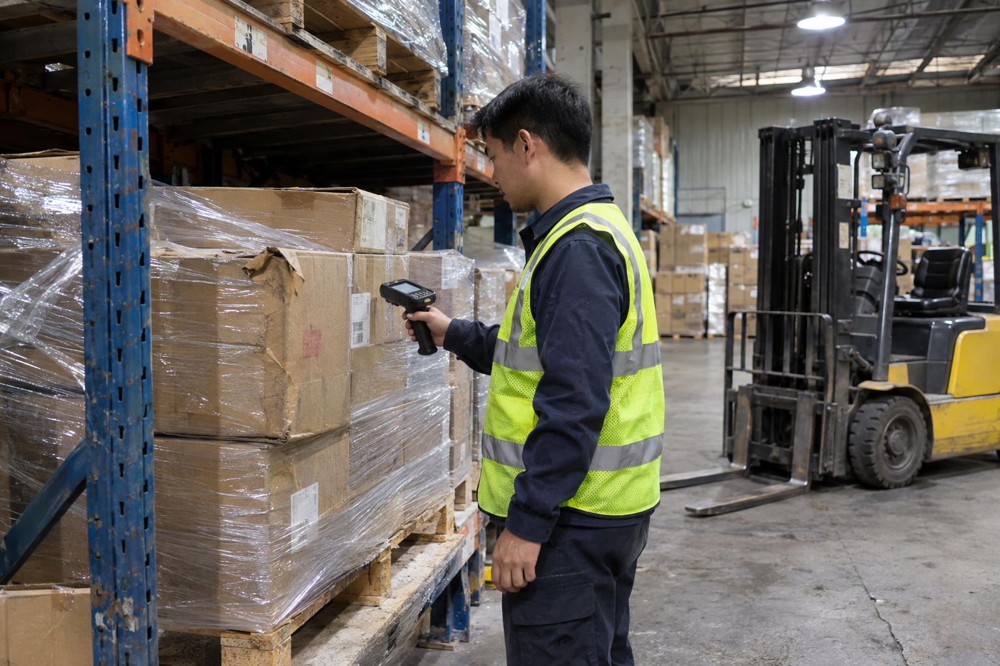
含义：管理员核对托盘箱货，旁边停靠叉车；解释实物与记录关联。
标签：托盘、入库、仓储、扫码、箱货
对应问答：DQA-023, DQA-026, DQA-040, DQA-057

## LOG-IMG-006｜月台回单与货物交接
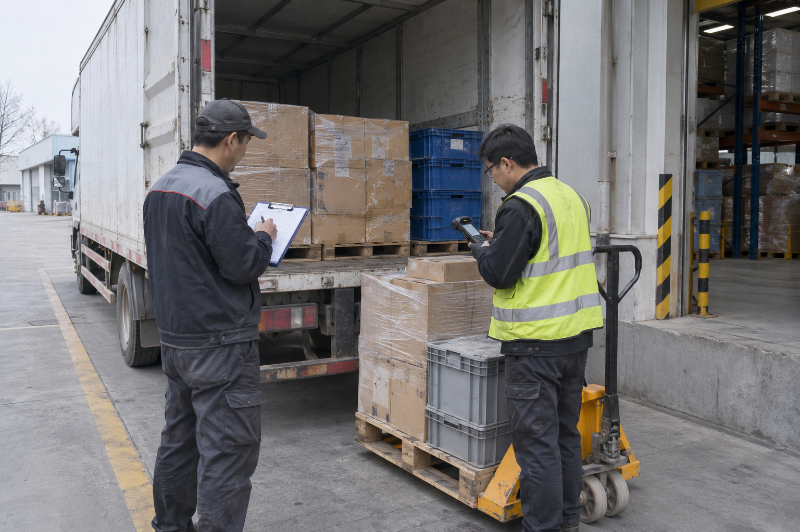
含义：司机与仓库人员核对签收夹板、终端与托盘，解释实物履约和单据闭环。
标签：签收、回单、交接、对账、运段、凭证
对应问答：DQA-056, DQA-057, DQA-058, DQA-072, DQA-078

## POL-IMG-001｜交通事件智能感知
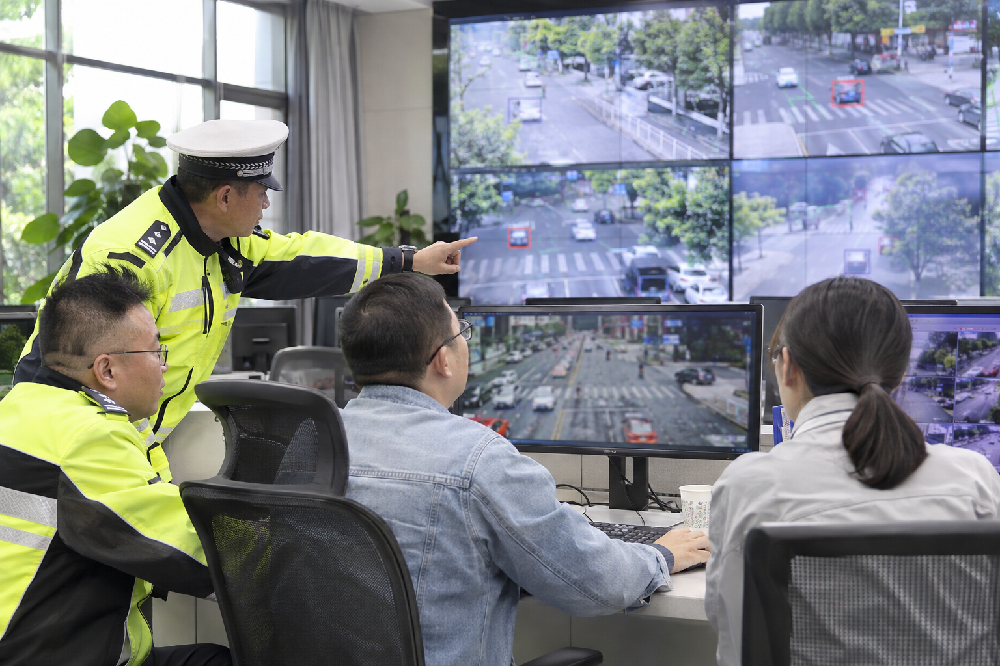
含义：展示交通指挥中心查看道路视频和事件识别的场景
标签：公安政务、交通识别、道路事件、视频监控
对应问答：DQA-009, DQA-010, DQA-014, DQA-048, DQA-049

## POL-IMG-002｜社区安全视频研判
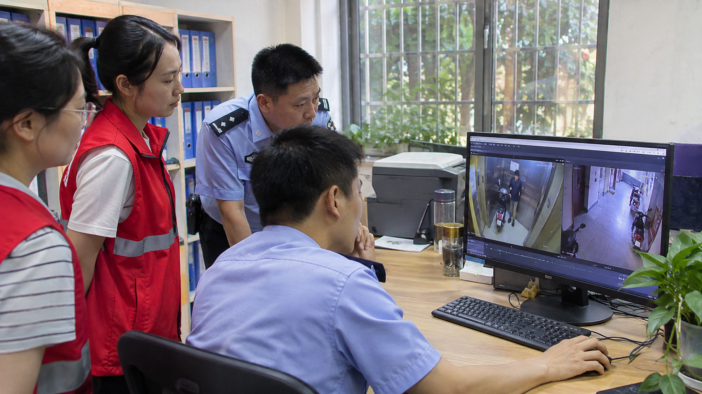
含义：展示警务人员和社区工作人员查看社区监控的场景
标签：社区治理、电动车进电梯、视频研判、人工复核
对应问答：DQA-009, DQA-010, DQA-049

## POL-IMG-003｜警务智能写作
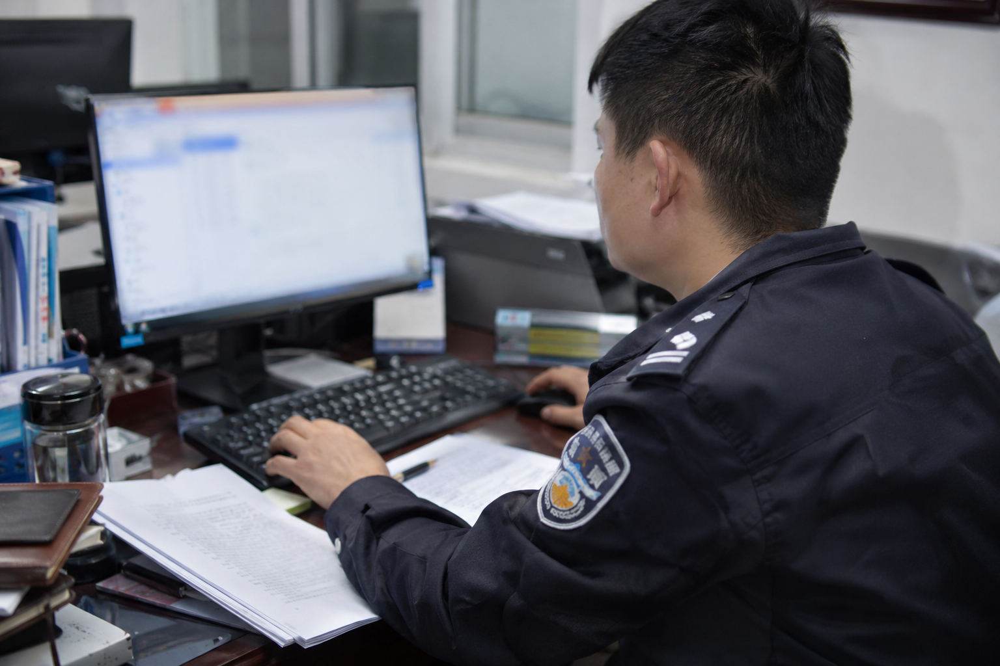
含义：展示警务人员在办公环境中处理公文的场景
标签：智能写作、公文生成、警务办公、知识服务
对应问答：DQA-011, DQA-012, DQA-050, DQA-068

## POL-IMG-004｜楼道消防与电动车巡查
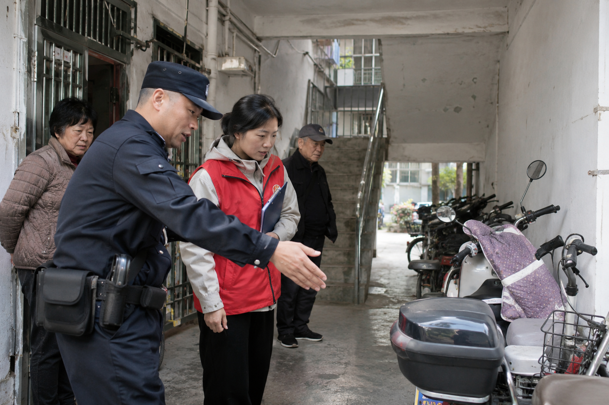
含义：工作人员在真实感楼道空间交流电动车停放与通道问题；解释识别后的现场核查。
标签：消防通道、电动车、社区、人工处置
对应问答：DQA-010, DQA-015, DQA-047

## POL-IMG-005｜事件报告人工复核
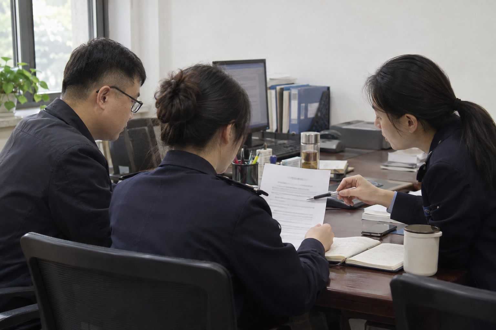
含义：人员共同核对报告；解释模型输出后的人工审核。
标签：人工复核、报告、智能写作、权限、研判
对应问答：DQA-011, DQA-012, DQA-013, DQA-014, DQA-015, DQA-041, DQA-042, DQA-047, DQA-067, DQA-068, DQA-074

## POL-IMG-006｜路口感知设备现场维护
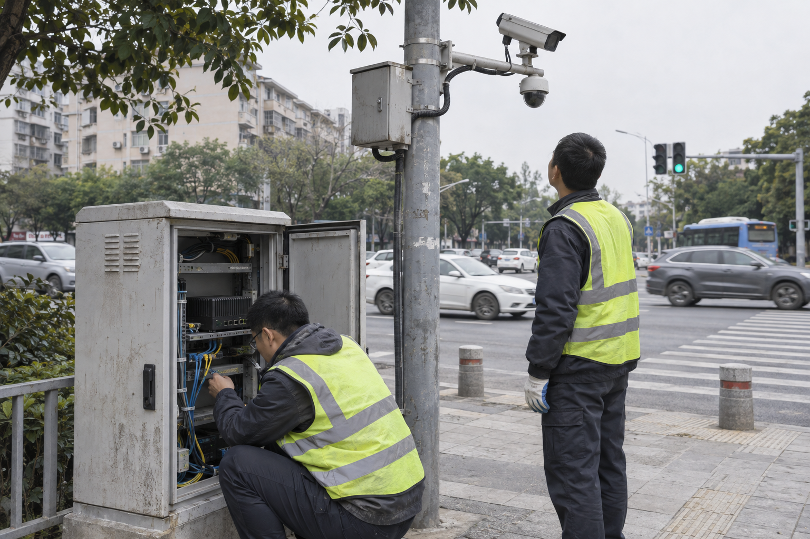
含义：技术人员检查路侧机柜、线缆与视频设备，解释现场感知和计算部署。
标签：边缘计算、摄像头、部署、机柜、运维、国产化
对应问答：DQA-048, DQA-050, DQA-071, DQA-077

## RET-IMG-001｜数字门店顾客互动
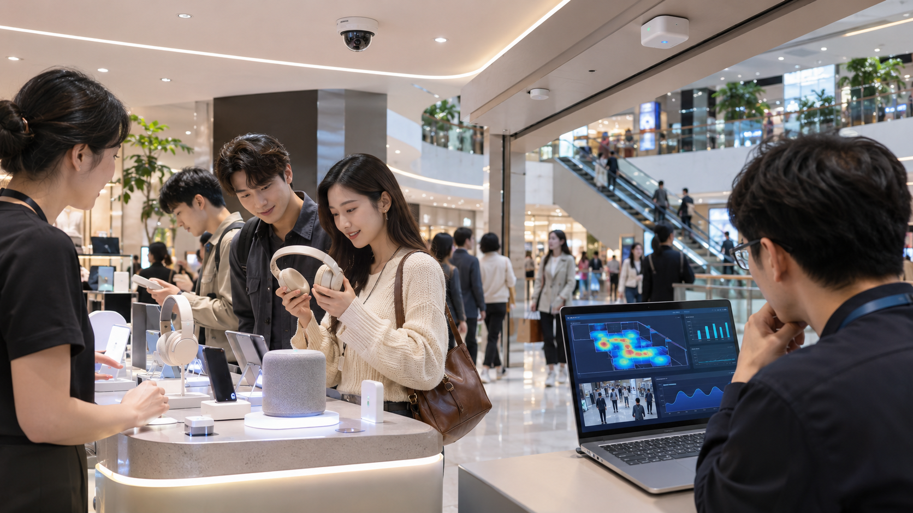
含义：展示顾客在商场展台体验商品和运营人员观察互动
标签：数字门店、展台、注目、触碰、体验
对应问答：DQA-030

## RET-IMG-002｜顾客试用家电
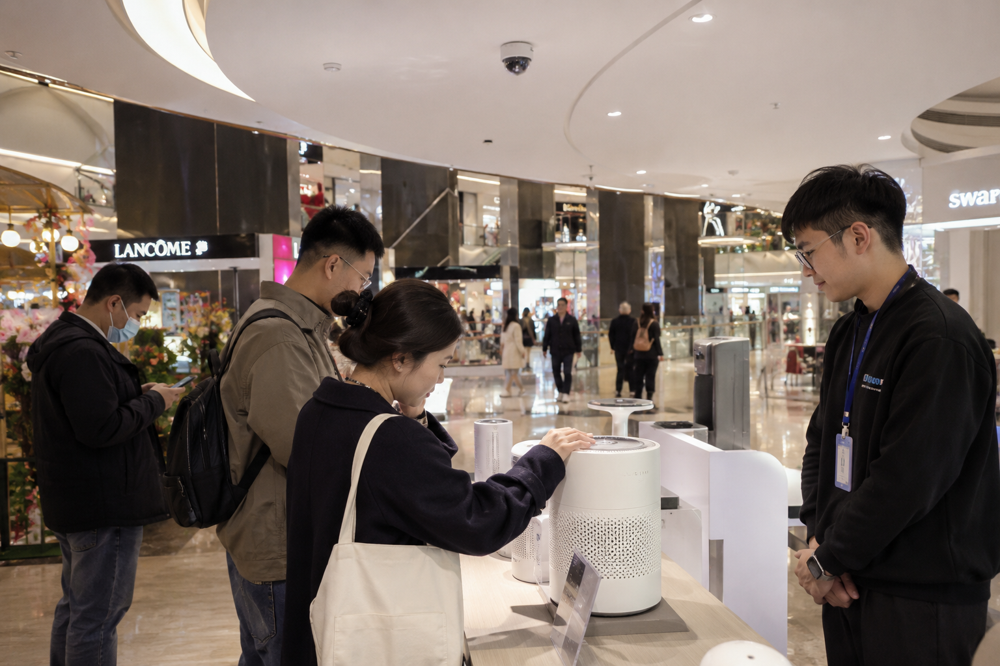
含义：顾客在小型家电展台试用产品；解释商品互动，不能推定成交。
标签：试用、触碰、互动、体验区
对应问答：DQA-029

## RET-IMG-003｜客流热区与运营观察
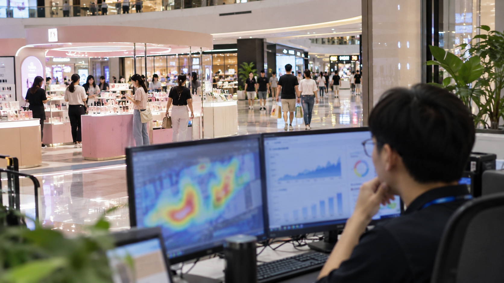
含义：运营人员查看客流与热区界面，背景为商场；画面不承载真实经营指标。
标签：热区、驻留、客流、趋势、运营
对应问答：DQA-028, DQA-031, DQA-033, DQA-040, DQA-059, DQA-060, DQA-061

## RET-IMG-004｜顾客比较商品
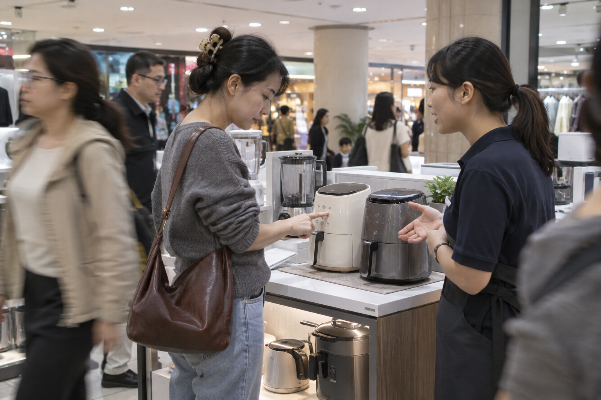
含义：顾客在展台比较产品；说明兴趣与互动信号，不能当作购买证明。
标签：比较、SKU、触碰、体验、顾客
对应问答：DQA-028, DQA-029, DQA-031, DQA-033, DQA-059, DQA-061

## RET-IMG-005｜门店设备与陈列现场
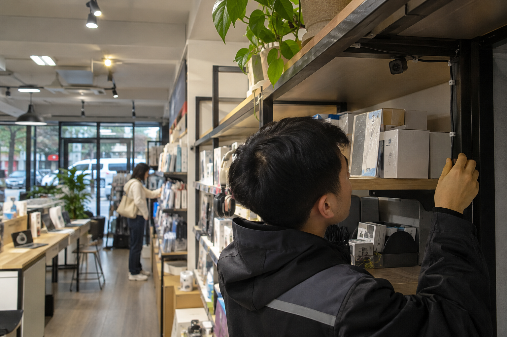
含义：货架安装摄像头与现场检查；解释感知设备如何融入陈列。
标签：摄像头、安装、设备、陈列、货架
对应问答：DQA-030, DQA-032, DQA-060, DQA-062, DQA-070, DQA-071

## RET-IMG-006｜门店陈列与补货核对
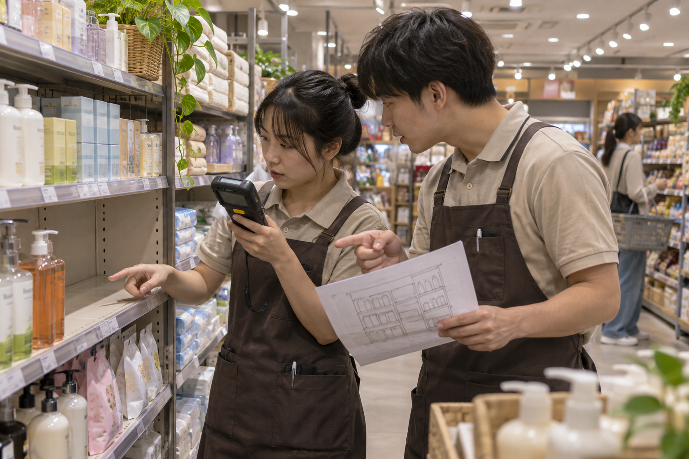
含义：店员核对货架与库存并讨论陈列，解释行为分析到门店行动的衔接。
标签：陈列、库存、补货、SKU、运营、对比
对应问答：DQA-061, DQA-062, DQA-078
