# 小D问答与图片一体化调用手册

## 使用顺序：先选场景，再进入细分问答

用户第一次通常会问：“我想了解某个场景。”小D先回答：**你想了解哪一个场景？可选择：智慧农业、公安政务、时尚产业、智慧物流、数字商业运营、未来教育。**识别到场景后，先输出该场景总定义和核心链路，展示两张总览图；用户继续追问具体问题时，转入下方对应问答，通常展示一张主图，涉及两个操作环节时再补一张备选图。

### 图像层级规则
- 场景总览：固定展示两张总览图，帮助用户快速理解场景边界和主要对象。
- 细分问题：默认展示一张主图；回答同时涉及检测、设备、流程等两个对象时，补充一张备选图。
- 图片是解释性视觉材料，不能用来证明具体项目交付、真实现场、准确率、收益或人物身份。
- 番茄农业图片用于解释当前农业场景；涉及历史规划品种和面积时，以对应文字事实为准。

## 场景入口｜智慧农业

**场景总定义：**以农业生产数据、水土检测、灌溉与作物管理为核心，把水资源利用、番茄种植、田间作业、采后分选和批次管理连接起来的农业智能化场景。

**场景总览回答：**先说明这是一个“农业数据与水土生产管理”场景，再介绍第三师45团项目、淡化与水土改良、番茄生产和智慧装备；番茄图片只用于解释通用农业环节，不代替项目规划中的历史品种和面积数据。

**核心链路：**项目概况｜排碱渠水土评价｜淡化中心与水处理｜番茄种植与田间管理｜采后分选与溯源

**总览图（固定两张）：**
### AG-IMG-001｜番茄田水土现场
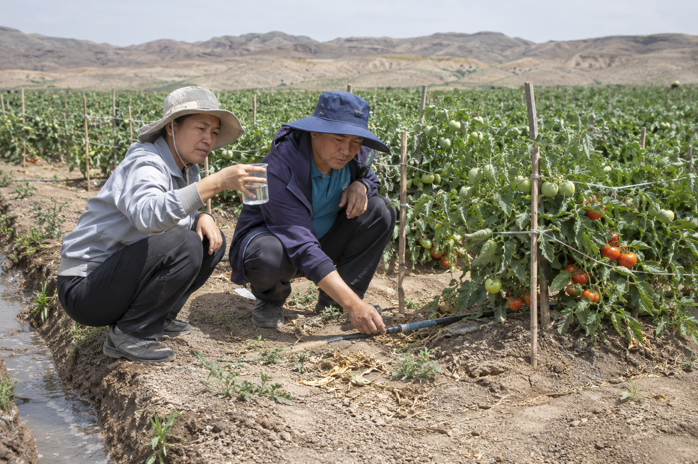
标签：番茄、田间检查、灌溉、水质检测、滴灌
图片含义：番茄田、灌溉渠与农技人员水土检查，展示番茄生产中的水土管理。
调用：介绍该场景的整体定义、核心链路或能力边界时展示。

### AG-IMG-008｜番茄采后分选与周转
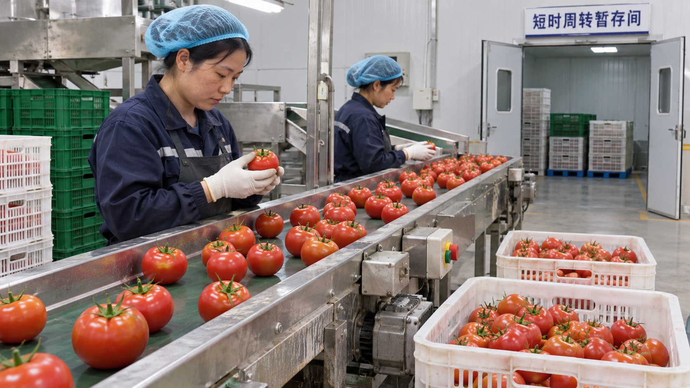
标签：番茄、采收、分选、周转、批次、质量分级
图片含义：红番茄输送带、人工检查与周转筐，解释采后分选和批次交接，不表示特定储藏温度或实际项目设备。
调用：介绍该场景的整体定义、核心链路或能力边界时展示。

**进入细分问答：**
- DQA-001｜第三师45团项目是什么？
- DQA-002｜排碱渠水能直接用于灌溉吗？
- DQA-003｜淡化中心的能力和成本是多少？
- DQA-004｜项目准备种什么？
- DQA-005｜有机种植有什么具体要求？
- DQA-006｜智慧农业设备有哪些？
- DQA-007｜这个项目已经建成了吗？
- DQA-008｜农业项目为什么要做数字溯源？

## 场景入口｜公安政务

**场景总定义：**以视觉感知、事件识别、政务知识库和人工复核为核心，把交通、社区、消防等城市事件转化为可检索、可研判、可处置的信息。

**场景总览回答：**先说明这是“多模态感知驱动的城市智能治理”场景，再介绍事件发现、视频研判、警务写作、人工复核和国产化部署；涉及具体部署状态时按已确认资料回答。

**核心链路：**交通事件感知｜社区与消防巡查｜事件语义抽取｜警务智能写作｜人工复核与部署

**总览图（固定两张）：**
### POL-IMG-001｜交通事件智能感知
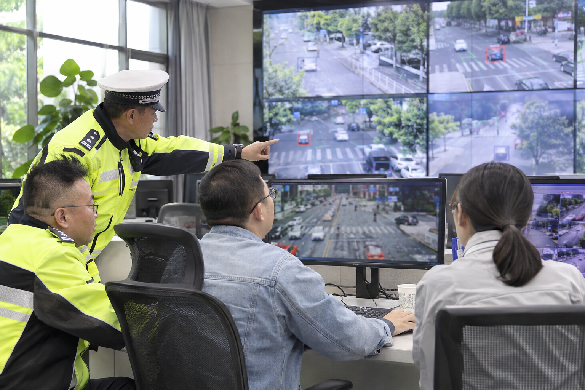
标签：公安政务、交通识别、道路事件、视频监控
图片含义：展示交通指挥中心查看道路视频和事件识别的场景
调用：介绍该场景的整体定义、核心链路或能力边界时展示。

### POL-IMG-002｜社区安全视频研判
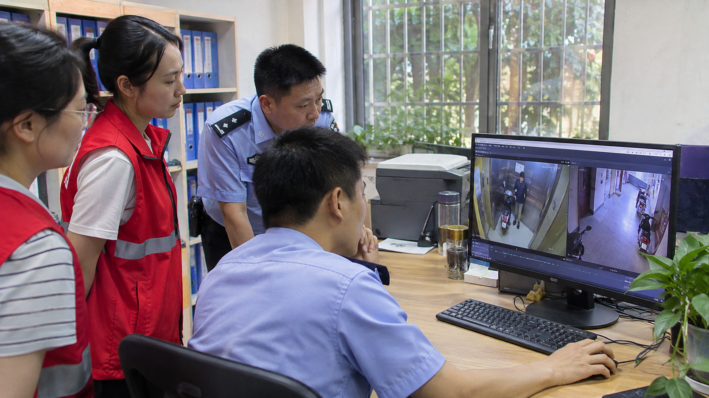
标签：社区治理、电动车进电梯、视频研判、人工复核
图片含义：展示警务人员和社区工作人员查看社区监控的场景
调用：介绍该场景的整体定义、核心链路或能力边界时展示。

**进入细分问答：**
- DQA-009｜公安政务场景包含哪些能力？
- DQA-010｜系统能识别哪些交通和社区事件？
- DQA-011｜警务智能写作能生成什么？
- DQA-012｜知识库问答是不是重新训练模型？
- DQA-013｜110警情预测能不能保证准确？
- DQA-014｜公安视觉模型准确率是多少？
- DQA-015｜AI能否替代警务人员做决定？

## 场景入口｜时尚产业

**场景总定义：**以服装款式、面料、版型和实体样衣数据为基础，把检索、设计生成、打版、试衣、质量检查和商业影像连接起来的时尚智能设计场景。

**场景总览回答：**先说明这是“从时尚数据到设计生产与营销内容生成”场景，再介绍云衣系统、线稿与面料理解、虚拟试穿、样衣验证和AI商业影像。

**核心链路：**云衣系统｜服装检索与标签｜线稿生成与控制｜虚拟试穿｜样衣与质量核对

**总览图（固定两张）：**
### FAS-IMG-004｜服装面料检查
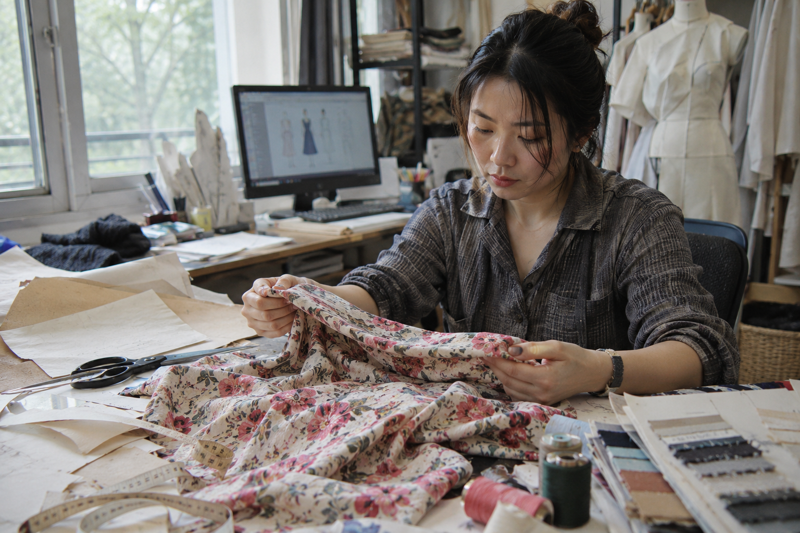
标签：面料理解、花型、材质、生产前检查
图片含义：展示设计师检查真实面料、样本和纹理
调用：介绍该场景的整体定义、核心链路或能力边界时展示。

### FAS-IMG-007｜数字设计与实体样衣核对

标签：线稿、生成控制、样衣、版型、工艺、设计验证
图片含义：打版师比较设计稿与人台样衣，解释视觉设计和实体工艺的衔接。
调用：介绍该场景的整体定义、核心链路或能力边界时展示。

**进入细分问答：**
- DQA-016｜云衣时尚系统是什么？
- DQA-017｜一张线稿可以生成成衣吗？
- DQA-018｜虚拟换装和真实试衣有什么区别？
- DQA-019｜服装数据应该标哪些字段？
- DQA-020｜非标钮扣怎样数字化？
- DQA-021｜面料生成结果能直接用于生产吗？

## 场景入口｜智慧物流

**场景总定义：**以订单、箱、货、车辆、运输段和单据状态为数据对象，把运输组织、仓储协同、车辆调度、履约交接和运营分析连接起来的物流智能化场景。

**场景总览回答：**先说明这是“物流数据与业务规则驱动的运营优化”场景，再介绍凯鸿项目涉及的运输组织、订单与运力结构化、调度协同和回单闭环。

**核心链路：**项目阶段｜物流对象建模｜运输调度｜仓配协同｜回单与履约分析

**总览图（固定两张）：**
### LOG-IMG-001｜物流仓库与运输调度

标签：凯鸿物流、订单、仓储、运输、箱货关系
图片含义：展示仓库、箱货、运输车辆和工作人员核对单据
调用：介绍该场景的整体定义、核心链路或能力边界时展示。

### LOG-IMG-006｜月台回单与货物交接
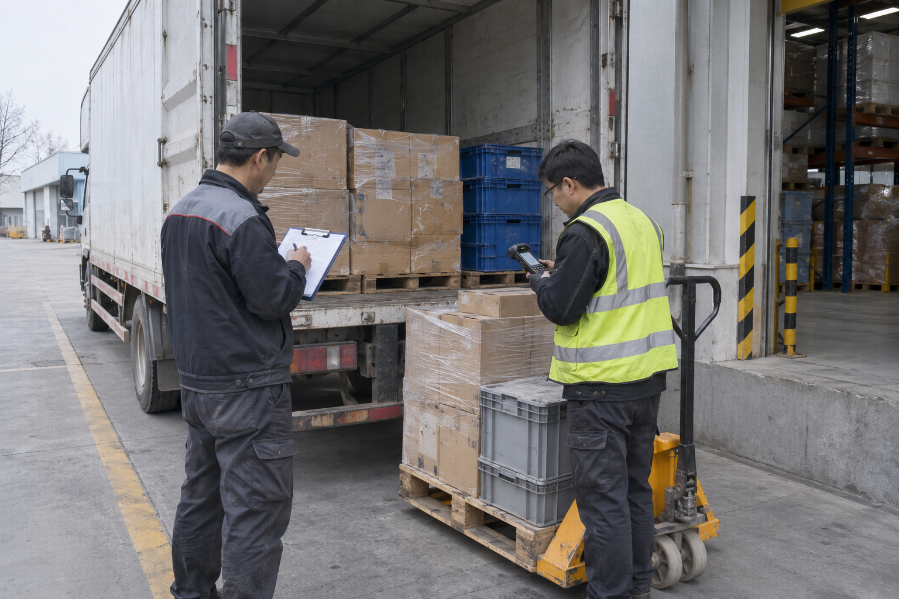
标签：签收、回单、交接、对账、运段、凭证
图片含义：司机与仓库人员核对签收夹板、终端与托盘，解释实物履约和单据闭环。
调用：介绍该场景的整体定义、核心链路或能力边界时展示。

**进入细分问答：**
- DQA-022｜凯鸿项目目前做到哪一步？
- DQA-023｜为什么要区分订单、箱、货、车辆和运输段？
- DQA-024｜服务蓝图解决什么问题？
- DQA-025｜物流系统最突出的痛点是什么？
- DQA-026｜EPCIS能帮助凯鸿解决什么？
- DQA-027｜AI适合先做哪些物流功能？

## 场景入口｜数字商业运营

**场景总定义：**以客流、人体轨迹、热区、驻留、商品互动和经营数据为基础，把商圈感知、门店分析、陈列补货和运营决策连接起来的数字商业场景。

**场景总览回答：**先说明这是“消费者行为感知与门店智能运营决策”场景，再介绍智慧商圈、数字门店、客流统计、行为分析、运营看板和行动建议。

**核心链路：**智慧商圈与数字门店｜客流与热区｜商品互动分析｜陈列补货｜经营看板与决策

**总览图（固定两张）：**
### RET-IMG-003｜客流热区与运营观察
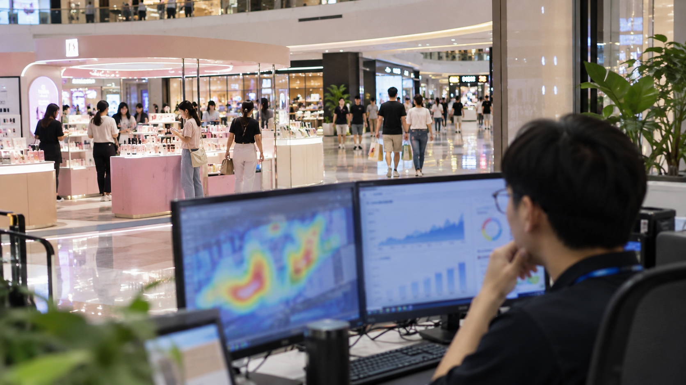
标签：热区、驻留、客流、趋势、运营
图片含义：运营人员查看客流与热区界面，背景为商场；画面不承载真实经营指标。
调用：介绍该场景的整体定义、核心链路或能力边界时展示。

### RET-IMG-006｜门店陈列与补货核对
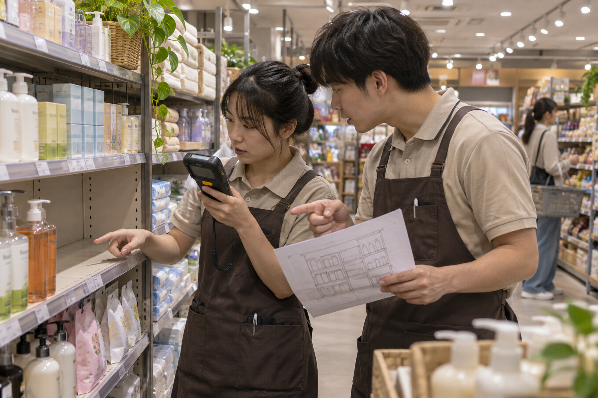
标签：陈列、库存、补货、SKU、运营、对比
图片含义：店员核对货架与库存并讨论陈列，解释行为分析到门店行动的衔接。
调用：介绍该场景的整体定义、核心链路或能力边界时展示。

**进入细分问答：**
- DQA-028｜智慧商圈和数字门店有什么区别？
- DQA-029｜摄像头能判断顾客是否喜欢商品吗？
- DQA-030｜数字门店有多少试点和数据？
- DQA-031｜如何评价门店客流和受众？
- DQA-032｜数字门店设备有什么特点？
- DQA-033｜消费洞察如何形成产品策略？

## 场景入口｜未来教育

**场景总定义：**以课程知识、服饰文化、科学探究和多模态交互为基础，把内容讲解、动手实践、传感反馈和个性化学习连接起来的未来教育场景。

**场景总览回答：**先说明这是“教育知识建模与个性化智能交互”场景，再介绍少年宫项目、服饰文化互动、光影与材料探索、机械花传感课堂和学习反馈。

**核心链路：**场景定义｜服饰文化互动｜光影与材料探索｜传感与机械花｜课程与学习反馈

**总览图（固定两张）：**
### EDU-IMG-004｜服饰纹样手作课堂
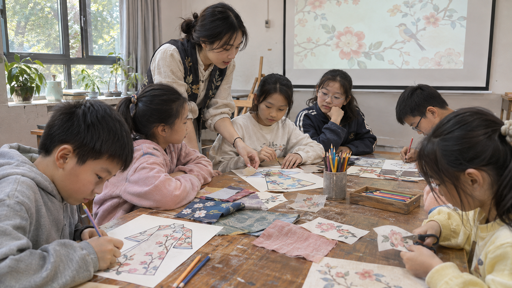
标签：手作、纹样、传统文化、课程、创作
图片含义：日常服装的儿童用纸卡和布样完成纹样拼贴；解释体验向课程任务转化。
调用：介绍该场景的整体定义、核心链路或能力边界时展示。

### EDU-IMG-006｜传感与机械花操作课堂
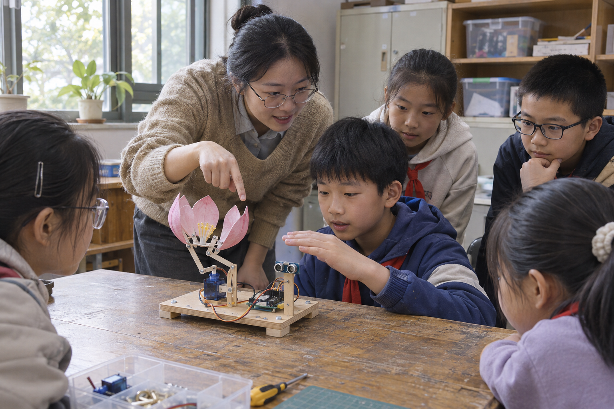
标签：机械花、传感、控制、反馈、科学教育、舵机
图片含义：儿童和教师观察小型机械花的接近触发与开合，解释输入—控制—输出；不是少年宫实际交付记录。
调用：介绍该场景的整体定义、核心链路或能力边界时展示。

**进入细分问答：**
- DQA-034｜未来教育场景具体是什么？
- DQA-035｜AI汉服换装如何用于教育？
- DQA-036｜互动装置和普通展览有什么区别？
- DQA-037｜装置常用哪些技术？
- DQA-038｜少年宫项目已经交付了吗？
- DQA-039｜国际上如何定义学生AI能力？

## DQA-001｜第三师45团项目是什么？

**场景：**智慧农业

**回答指令：**围绕用户问题直接回答。先给结论，再补充以下要点：项目阶段是可行性研究与建设规划；投资主体、建设规模、淡化工程和种植结构分别建档；不能把方案写成竣工运营。回答结束时可提出一个与该主题直接相关的追问：项目的建设地点和用地边界是什么？淡化中心如何布局？

**回答要点：**
- 这是一个面向新疆生产建设兵团第三师图木舒克市45团的1万亩沙漠戈壁综合利用项目，技术链条包括排碱渠水淡化、水土改良、有机特色种植和智慧农业装备。
- 项目阶段是可行性研究与建设规划；投资主体、建设规模、淡化工程和种植结构分别建档；不能把方案写成竣工运营。

**延伸问题：**项目的建设地点和用地边界是什么？淡化中心如何布局？

**选图规则：**一般显示主图1张；解释不同对象、操作或流程时，可再选1—2张备选图。相同问题可在语义相关的备选图中轮换，不跨场景随意凑图。图像只作解释，数值和项目阶段由文字说明。

### 主图：AG-IMG-001｜番茄田水土现场

**标签：**番茄、田间检查、灌溉、水质检测、滴灌
**含义：**番茄田、灌溉渠与农技人员水土检查，展示番茄生产中的水土管理。
**调用条件：**回答涉及番茄田水土现场相应对象或操作时调用。
**使用范围：**用于解释场景、对象与操作，不作为具体项目现场、交付、准确率或收益证明。

### 备选图：AG-IMG-004｜番茄田装备与田间作业
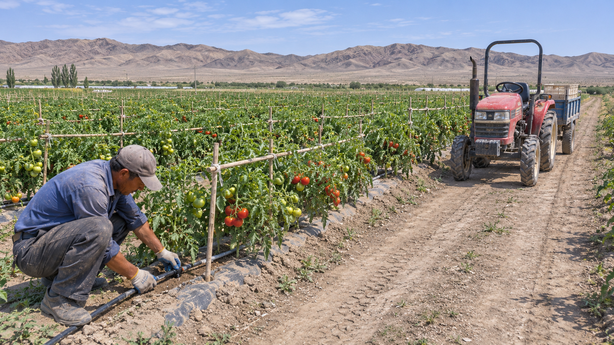
**标签：**番茄、农业装备、拖拉机、滴灌、田间管理
**含义：**番茄田车道上的拖拉机、滴灌设备与作业人员，解释田间管理环节。
**调用条件：**回答涉及番茄田装备与田间作业相应对象或操作时调用。
**使用范围：**用于解释场景、对象与操作，不作为具体项目现场、交付、准确率或收益证明。

## DQA-002｜排碱渠水能直接用于灌溉吗？

**场景：**智慧农业

**回答指令：**围绕用户问题直接回答。先给结论，再补充以下要点：FAO将盐度、钠吸附比、离子毒害和排水条件作为灌溉水评价维度；排碱水再利用必须有水质和土壤监测。回答结束时可提出一个与该主题直接相关的追问：项目有没有EC、SAR、离子检测和排盐监测数据？

**回答要点：**
- 不能只根据“脱盐率”判断。需要同时查看盐度或电导率、钠吸附比SAR、离子组成、土壤排水、淋洗条件和作物耐盐性。
- FAO将盐度、钠吸附比、离子毒害和排水条件作为灌溉水评价维度；排碱水再利用必须有水质和土壤监测。

**延伸问题：**项目有没有EC、SAR、离子检测和排盐监测数据？

**选图规则：**一般显示主图1张；解释不同对象、操作或流程时，可再选1—2张备选图。相同问题可在语义相关的备选图中轮换，不跨场景随意凑图。图像只作解释，数值和项目阶段由文字说明。

### 主图：AG-IMG-006｜灌溉水土样品检测
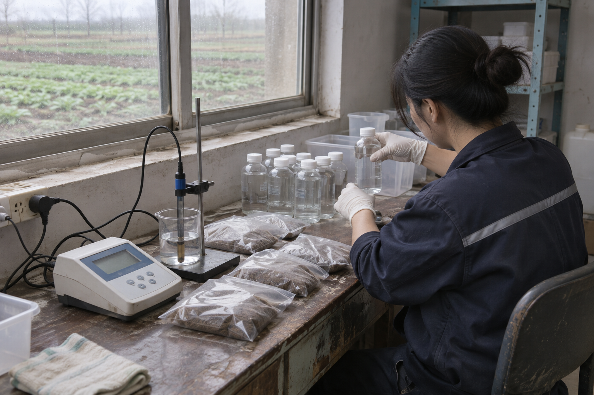
**标签：**水质、电导率、样本、土壤、检测
**含义：**样品瓶、土壤样本和台式仪器；解释水土评价所需检测工作。
**调用条件：**当本条回答涉及“灌溉水土样品检测”相应对象或环节时使用。
**使用范围：**用于解释场景、对象与操作，不作为具体项目现场、交付、准确率或收益证明。

### 备选图：AG-IMG-003｜番茄滴灌水质检测
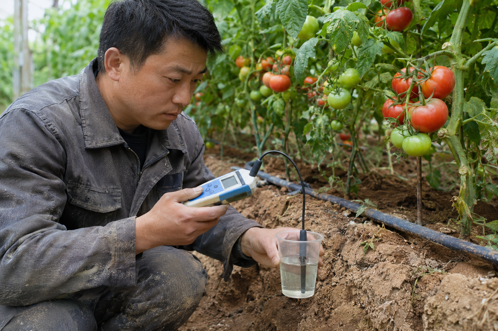
**标签：**番茄、水质检测、滴灌、电导率、根区
**含义：**番茄种植垄旁的手持检测仪、水样与滴灌带，解释灌溉水质检查。
**调用条件：**回答涉及番茄滴灌水质检测相应对象或操作时调用。
**使用范围：**用于解释场景、对象与操作，不作为具体项目现场、交付、准确率或收益证明。

### 备选图：AG-IMG-005｜番茄田灌溉阀门操作

**标签：**番茄、灌溉、阀门、滴灌、田间管理
**含义：**工人在番茄田边操作灌溉阀门，解释灌溉执行环节。
**调用条件：**回答涉及番茄田灌溉阀门操作相应对象或操作时调用。
**使用范围：**用于解释场景、对象与操作，不作为具体项目现场、交付、准确率或收益证明。

## DQA-003｜淡化中心的能力和成本是多少？

**场景：**智慧农业

**回答指令：**围绕用户问题直接回答。先给结论，再补充以下要点：这些是可研方案参数；2000吨/小时尚未统一进水量或产水量口径；成本不是连续运行实测。回答结束时可提出一个与该主题直接相关的追问：进水量与产水量分别是多少？浓水去哪里？

**回答要点：**
- 方案规划两座中心，每座1000吨/小时，总规模2000吨/小时；脱盐率不低于95%，产水率80%—85%，运行成本约0.50元/吨。
- 这些是可研方案参数；2000吨/小时尚未统一进水量或产水量口径；成本不是连续运行实测。

**延伸问题：**进水量与产水量分别是多少？浓水去哪里？

**选图规则：**一般显示主图1张；解释不同对象、操作或流程时，可再选1—2张备选图。相同问题可在语义相关的备选图中轮换，不跨场景随意凑图。图像只作解释，数值和项目阶段由文字说明。

### 主图：AG-IMG-007｜农业水处理设备巡检

**标签：**淡化、水处理、膜组件、泵、巡检
**含义：**水处理站的膜组件与管路巡检；不代表特定iFS结构或2000吨/小时产能。
**调用条件：**当本条回答涉及“农业水处理设备巡检”相应对象或环节时使用。
**使用范围：**用于解释场景、对象与操作，不作为具体项目现场、交付、准确率或收益证明。

### 备选图：AG-IMG-006｜灌溉水土样品检测

**标签：**水质、电导率、样本、土壤、检测
**含义：**样品瓶、土壤样本和台式仪器；解释水土评价所需检测工作。
**调用条件：**当本条回答涉及“灌溉水土样品检测”相应对象或环节时使用。
**使用范围：**用于解释场景、对象与操作，不作为具体项目现场、交付、准确率或收益证明。

## DQA-004｜项目准备种什么？

**场景：**智慧农业

**回答指令：**围绕用户问题直接回答。先给结论，再补充以下要点：苜蓿面积与9500亩果园重叠，不另占1万亩项目面积；品种适应性还要结合低温、需冷量、授粉、土壤和水质。回答结束时可提出一个与该主题直接相关的追问：不同品种需要什么授粉配置和冬季低温条件？

**回答要点：**
- 规划西梅2500亩、味帝3500亩、恐龙蛋3500亩和500亩试验田；苜蓿约5700亩，为果园行间套种。
- 苜蓿面积与9500亩果园重叠，不另占1万亩项目面积；品种适应性还要结合低温、需冷量、授粉、土壤和水质。

**延伸问题：**不同品种需要什么授粉配置和冬季低温条件？

**选图规则：**一般显示主图1张；解释不同对象、操作或流程时，可再选1—2张备选图。相同问题可在语义相关的备选图中轮换，不跨场景随意凑图。图像只作解释，数值和项目阶段由文字说明。

### 主图：AG-IMG-002｜番茄田水质与土壤取样
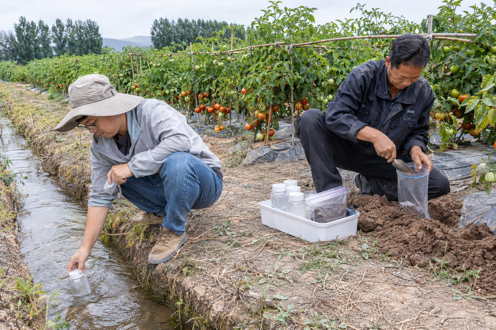
**标签：**番茄、取样、EC、SAR、土壤监测、灌溉水质
**含义：**番茄田边采集灌溉水与土壤样本，解释检测对象与采样工作。
**调用条件：**仅在延伸解释通用水土检测、田间管理或试验方法时调用；回答原项目具体品种和面积时以文字为主，不以番茄图指代历史规划作物。
**使用范围：**用于解释场景、对象与操作，不作为具体项目现场、交付、准确率或收益证明。

### 备选图：AG-IMG-004｜番茄田装备与田间作业

**标签：**番茄、农业装备、拖拉机、滴灌、田间管理
**含义：**番茄田车道上的拖拉机、滴灌设备与作业人员，解释田间管理环节。
**调用条件：**仅在延伸解释通用水土检测、田间管理或试验方法时调用；回答原项目具体品种和面积时以文字为主，不以番茄图指代历史规划作物。
**使用范围：**用于解释场景、对象与操作，不作为具体项目现场、交付、准确率或收益证明。

## DQA-005｜有机种植有什么具体要求？

**场景：**智慧农业

**回答指令：**围绕用户问题直接回答。先给结论，再补充以下要点：“有机种植方案”不等于已经取得有机认证；认证还涉及投入品、生产、加工、标识、运输和追溯记录。回答结束时可提出一个与该主题直接相关的追问：项目是否有认证证书、投入品清单和追溯编码？

**回答要点：**
- 方案包含发酵有机肥、骨粉、矿源钾、中微量元素、滴灌、蜜蜂授粉、黄蓝板、诱捕器、杀虫灯和生物防治。
- “有机种植方案”不等于已经取得有机认证；认证还涉及投入品、生产、加工、标识、运输和追溯记录。

**延伸问题：**项目是否有认证证书、投入品清单和追溯编码？

**选图规则：**一般显示主图1张；解释不同对象、操作或流程时，可再选1—2张备选图。相同问题可在语义相关的备选图中轮换，不跨场景随意凑图。图像只作解释，数值和项目阶段由文字说明。

### 主图：AG-IMG-004｜番茄田装备与田间作业

**标签：**番茄、农业装备、拖拉机、滴灌、田间管理
**含义：**番茄田车道上的拖拉机、滴灌设备与作业人员，解释田间管理环节。
**调用条件：**回答涉及番茄田装备与田间作业相应对象或操作时调用。
**使用范围：**用于解释场景、对象与操作，不作为具体项目现场、交付、准确率或收益证明。

### 备选图：AG-IMG-006｜灌溉水土样品检测

**标签：**水质、电导率、样本、土壤、检测
**含义：**样品瓶、土壤样本和台式仪器；解释水土评价所需检测工作。
**调用条件：**当本条回答涉及“灌溉水土样品检测”相应对象或环节时使用。
**使用范围：**用于解释场景、对象与操作，不作为具体项目现场、交付、准确率或收益证明。

## DQA-006｜智慧农业设备有哪些？

**场景：**智慧农业

**回答指令：**围绕用户问题直接回答。先给结论，再补充以下要点：设备对应的数据对象包括地块、墒情、灌溉、施肥、病虫害、采收批次、库存温度和果品等级。回答结束时可提出一个与该主题直接相关的追问：哪些设备已经采购或部署？哪些仍是规划？

**回答要点：**
- 设备覆盖耕整、种植、田间管理、采收、产后处理和感知决策，包括北斗自动驾驶拖拉机、水肥一体化、植保无人机、除草机器人、采收机、分选线、智能冷库、多光谱遥感和AI巡田。
- 设备对应的数据对象包括地块、墒情、灌溉、施肥、病虫害、采收批次、库存温度和果品等级。

**延伸问题：**哪些设备已经采购或部署？哪些仍是规划？

**选图规则：**一般显示主图1张；解释不同对象、操作或流程时，可再选1—2张备选图。相同问题可在语义相关的备选图中轮换，不跨场景随意凑图。图像只作解释，数值和项目阶段由文字说明。

### 主图：AG-IMG-005｜番茄田灌溉阀门操作

**标签：**番茄、灌溉、阀门、滴灌、田间管理
**含义：**工人在番茄田边操作灌溉阀门，解释灌溉执行环节。
**调用条件：**回答涉及番茄田灌溉阀门操作相应对象或操作时调用。
**使用范围：**用于解释场景、对象与操作，不作为具体项目现场、交付、准确率或收益证明。

### 备选图：AG-IMG-004｜番茄田装备与田间作业

**标签：**番茄、农业装备、拖拉机、滴灌、田间管理
**含义：**番茄田车道上的拖拉机、滴灌设备与作业人员，解释田间管理环节。
**调用条件：**回答涉及番茄田装备与田间作业相应对象或操作时调用。
**使用范围：**用于解释场景、对象与操作，不作为具体项目现场、交付、准确率或收益证明。

### 备选图：AG-IMG-007｜农业水处理设备巡检

**标签：**淡化、水处理、膜组件、泵、巡检
**含义：**水处理站的膜组件与管路巡检；不代表特定iFS结构或2000吨/小时产能。
**调用条件：**当本条回答涉及“农业水处理设备巡检”相应对象或环节时使用。
**使用范围：**用于解释场景、对象与操作，不作为具体项目现场、交付、准确率或收益证明。

## DQA-007｜这个项目已经建成了吗？

**场景：**智慧农业

**回答指令：**围绕用户问题直接回答。先给结论，再补充以下要点：回答必须区分可研、施工、试点、交付、验收和运营；不把预算和预测当成实际效果。回答结束时可提出一个与该主题直接相关的追问：项目有没有施工许可、验收文件和运营数据？

**回答要点：**
- 资料库目前记录为可研和建设规划，包含工程方案、种植方案、装备方案和财务预测；没有完整竣工、连续运营或收益审计记录。
- 回答必须区分可研、施工、试点、交付、验收和运营；不把预算和预测当成实际效果。

**延伸问题：**项目有没有施工许可、验收文件和运营数据？

**选图规则：**一般显示主图1张；解释不同对象、操作或流程时，可再选1—2张备选图。相同问题可在语义相关的备选图中轮换，不跨场景随意凑图。图像只作解释，数值和项目阶段由文字说明。

### 主图：AG-IMG-001｜番茄田水土现场

**标签：**番茄、田间检查、灌溉、水质检测、滴灌
**含义：**番茄田、灌溉渠与农技人员水土检查，展示番茄生产中的水土管理。
**调用条件：**回答涉及番茄田水土现场相应对象或操作时调用。
**使用范围：**用于解释场景、对象与操作，不作为具体项目现场、交付、准确率或收益证明。

### 备选图：AG-IMG-007｜农业水处理设备巡检

**标签：**淡化、水处理、膜组件、泵、巡检
**含义：**水处理站的膜组件与管路巡检；不代表特定iFS结构或2000吨/小时产能。
**调用条件：**当本条回答涉及“农业水处理设备巡检”相应对象或环节时使用。
**使用范围：**用于解释场景、对象与操作，不作为具体项目现场、交付、准确率或收益证明。

## DQA-008｜农业项目为什么要做数字溯源？

**场景：**智慧农业

**回答指令：**围绕用户问题直接回答。先给结论，再补充以下要点：溯源需要统一对象编码、事件时间、地点、责任主体和批次关系；仅有传感器并不等于完整溯源。回答结束时可提出一个与该主题直接相关的追问：如何把淡化水、田块和果品批次关联起来？

**回答要点：**
- 数字溯源把水源、地块、作物、投入品、作业、采收和销售批次关联起来，便于质量管理、问题追溯和经营分析。
- 溯源需要统一对象编码、事件时间、地点、责任主体和批次关系；仅有传感器并不等于完整溯源。

**延伸问题：**如何把淡化水、田块和果品批次关联起来？

**选图规则：**一般显示主图1张；解释不同对象、操作或流程时，可再选1—2张备选图。相同问题可在语义相关的备选图中轮换，不跨场景随意凑图。图像只作解释，数值和项目阶段由文字说明。

### 主图：AG-IMG-006｜灌溉水土样品检测

**标签：**水质、电导率、样本、土壤、检测
**含义：**样品瓶、土壤样本和台式仪器；解释水土评价所需检测工作。
**调用条件：**当本条回答涉及“灌溉水土样品检测”相应对象或环节时使用。
**使用范围：**用于解释场景、对象与操作，不作为具体项目现场、交付、准确率或收益证明。

### 备选图：AG-IMG-005｜番茄田灌溉阀门操作

**标签：**番茄、灌溉、阀门、滴灌、田间管理
**含义：**工人在番茄田边操作灌溉阀门，解释灌溉执行环节。
**调用条件：**回答涉及番茄田灌溉阀门操作相应对象或操作时调用。
**使用范围：**用于解释场景、对象与操作，不作为具体项目现场、交付、准确率或收益证明。

## DQA-009｜公安政务场景包含哪些能力？

**场景：**公安政务

**回答指令：**围绕用户问题直接回答。先给结论，再补充以下要点：不同模块有不同实施状态；回答时区分已交付、验收中、推进中、DEMO和模拟数据。回答结束时可提出一个与该主题直接相关的追问：嘉善、舟山、桐乡分别处于什么阶段？

**回答要点：**
- 包括视频事件感知、交通治理、社区安全识别、警务知识库、智能写作、文档问答、政工关系图谱、警情预测和风险预警。
- 不同模块有不同实施状态；回答时区分已交付、验收中、推进中、DEMO和模拟数据。

**延伸问题：**嘉善、舟山、桐乡分别处于什么阶段？

**选图规则：**一般显示主图1张；解释不同对象、操作或流程时，可再选1—2张备选图。相同问题可在语义相关的备选图中轮换，不跨场景随意凑图。图像只作解释，数值和项目阶段由文字说明。

### 主图：POL-IMG-001｜交通事件智能感知

**标签：**公安政务、交通识别、道路事件、视频监控
**含义：**展示交通指挥中心查看道路视频和事件识别的场景
**调用条件：**当本条回答涉及“交通事件智能感知”相应对象或环节时使用。
**使用范围：**用于解释场景、对象与操作，不作为具体项目现场、交付、准确率或收益证明。

### 备选图：POL-IMG-002｜社区安全视频研判

**标签：**社区治理、电动车进电梯、视频研判、人工复核
**含义：**展示警务人员和社区工作人员查看社区监控的场景
**调用条件：**当本条回答涉及“社区安全视频研判”相应对象或环节时使用。
**使用范围：**用于解释场景、对象与操作，不作为具体项目现场、交付、准确率或收益证明。

## DQA-010｜系统能识别哪些交通和社区事件？

**场景：**公安政务

**回答指令：**围绕用户问题直接回答。先给结论，再补充以下要点：识别结果进入事件、告警或处置流程；检测、追踪、事件判定和人工处置是不同环节。回答结束时可提出一个与该主题直接相关的追问：误报、漏报和人工复核怎么统计？

**回答要点：**
- 交通包括实线变道、闯红灯、逆行、车牌分类、摩托车、未戴头盔和人员超载；社区包括违规横幅、消防通道、电动车进电梯、危险攀爬、乱倒垃圾、烟雾和斗殴。
- 识别结果进入事件、告警或处置流程；检测、追踪、事件判定和人工处置是不同环节。

**延伸问题：**误报、漏报和人工复核怎么统计？

**选图规则：**一般显示主图1张；解释不同对象、操作或流程时，可再选1—2张备选图。相同问题可在语义相关的备选图中轮换，不跨场景随意凑图。图像只作解释，数值和项目阶段由文字说明。

### 主图：POL-IMG-004｜楼道消防与电动车巡查
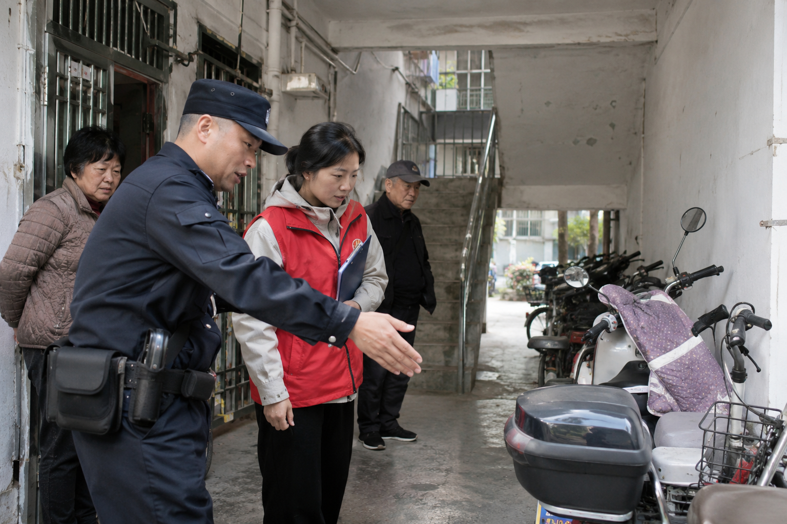
**标签：**消防通道、电动车、社区、人工处置
**含义：**工作人员在真实感楼道空间交流电动车停放与通道问题；解释识别后的现场核查。
**调用条件：**当本条回答涉及“楼道消防与电动车巡查”相应对象或环节时使用。
**使用范围：**用于解释场景、对象与操作，不作为具体项目现场、交付、准确率或收益证明。

### 备选图：POL-IMG-001｜交通事件智能感知

**标签：**公安政务、交通识别、道路事件、视频监控
**含义：**展示交通指挥中心查看道路视频和事件识别的场景
**调用条件：**当本条回答涉及“交通事件智能感知”相应对象或环节时使用。
**使用范围：**用于解释场景、对象与操作，不作为具体项目现场、交付、准确率或收益证明。

### 备选图：POL-IMG-002｜社区安全视频研判

**标签：**社区治理、电动车进电梯、视频研判、人工复核
**含义：**展示警务人员和社区工作人员查看社区监控的场景
**调用条件：**当本条回答涉及“社区安全视频研判”相应对象或环节时使用。
**使用范围：**用于解释场景、对象与操作，不作为具体项目现场、交付、准确率或收益证明。

## DQA-011｜警务智能写作能生成什么？

**场景：**公安政务

**回答指令：**围绕用户问题直接回答。先给结论，再补充以下要点：生成内容需要权限、知识来源、引用和人工审核；不能把模型生成直接视为正式公文。回答结束时可提出一个与该主题直接相关的追问：能否绑定部门知识库并保留引用？

**回答要点：**
- 支持多种公文文体、要素输入、正文生成、多轮润色、文档纠错、模板、格式、下载和流转。
- 生成内容需要权限、知识来源、引用和人工审核；不能把模型生成直接视为正式公文。

**延伸问题：**能否绑定部门知识库并保留引用？

**选图规则：**一般显示主图1张；解释不同对象、操作或流程时，可再选1—2张备选图。相同问题可在语义相关的备选图中轮换，不跨场景随意凑图。图像只作解释，数值和项目阶段由文字说明。

### 主图：POL-IMG-003｜警务智能写作
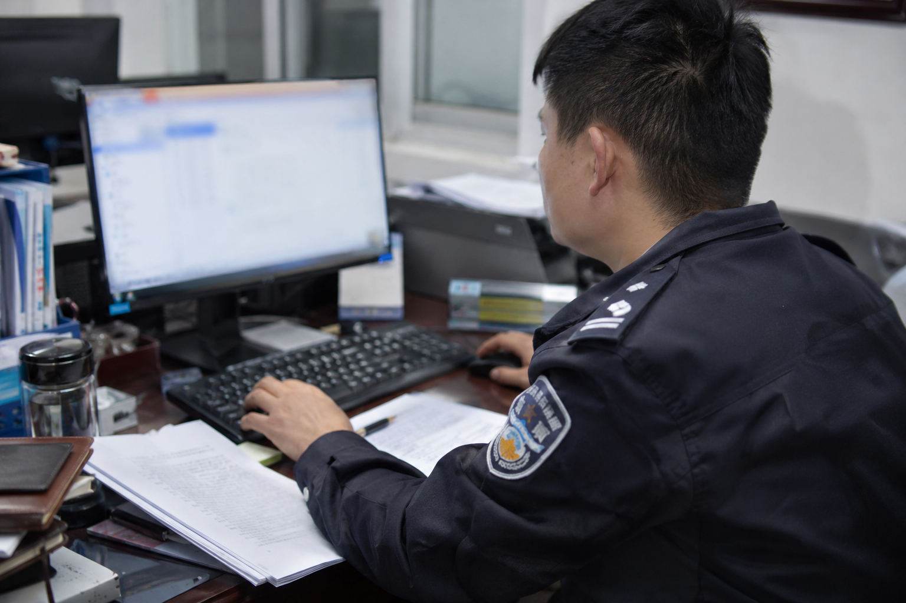
**标签：**智能写作、公文生成、警务办公、知识服务
**含义：**展示警务人员在办公环境中处理公文的场景
**调用条件：**当本条回答涉及“警务智能写作”相应对象或环节时使用。
**使用范围：**用于解释场景、对象与操作，不作为具体项目现场、交付、准确率或收益证明。

### 备选图：POL-IMG-005｜事件报告人工复核

**标签：**人工复核、报告、智能写作、权限、研判
**含义：**人员共同核对报告；解释模型输出后的人工审核。
**调用条件：**当本条回答涉及“事件报告人工复核”相应对象或环节时使用。
**使用范围：**用于解释场景、对象与操作，不作为具体项目现场、交付、准确率或收益证明。

## DQA-012｜知识库问答是不是重新训练模型？

**场景：**公安政务

**回答指令：**围绕用户问题直接回答。先给结论，再补充以下要点：回答要区分知识库、向量检索、提示词、微调和模型训练；资料未明确时不自行指定技术路线。回答结束时可提出一个与该主题直接相关的追问：回答能否显示出处、版本和引用片段？

**回答要点：**
- 不一定。检索增强生成通常先从知识库检索相关内容，再把内容作为生成上下文；这与重新训练模型是不同过程。
- 回答要区分知识库、向量检索、提示词、微调和模型训练；资料未明确时不自行指定技术路线。

**延伸问题：**回答能否显示出处、版本和引用片段？

**选图规则：**一般显示主图1张；解释不同对象、操作或流程时，可再选1—2张备选图。相同问题可在语义相关的备选图中轮换，不跨场景随意凑图。图像只作解释，数值和项目阶段由文字说明。

### 主图：POL-IMG-003｜警务智能写作

**标签：**智能写作、公文生成、警务办公、知识服务
**含义：**展示警务人员在办公环境中处理公文的场景
**调用条件：**当本条回答涉及“警务智能写作”相应对象或环节时使用。
**使用范围：**用于解释场景、对象与操作，不作为具体项目现场、交付、准确率或收益证明。

### 备选图：POL-IMG-005｜事件报告人工复核

**标签：**人工复核、报告、智能写作、权限、研判
**含义：**人员共同核对报告；解释模型输出后的人工审核。
**调用条件：**当本条回答涉及“事件报告人工复核”相应对象或环节时使用。
**使用范围：**用于解释场景、对象与操作，不作为具体项目现场、交付、准确率或收益证明。

## DQA-013｜110警情预测能不能保证准确？

**场景：**公安政务

**回答指令：**围绕用户问题直接回答。先给结论，再补充以下要点：应说明预测时间窗、区域、数据完整性、基线模型和误差指标；预测只能辅助研判。回答结束时可提出一个与该主题直接相关的追问：预测结果如何进入人工研判和处置？

**回答要点：**
- 不能保证。它基于历史接警数据，对区域、类型和数量进行时序分析；资料页面包含模拟数据，未形成统一测试集和上线评测。
- 应说明预测时间窗、区域、数据完整性、基线模型和误差指标；预测只能辅助研判。

**延伸问题：**预测结果如何进入人工研判和处置？

**选图规则：**一般显示主图1张；解释不同对象、操作或流程时，可再选1—2张备选图。相同问题可在语义相关的备选图中轮换，不跨场景随意凑图。图像只作解释，数值和项目阶段由文字说明。

### 主图：POL-IMG-005｜事件报告人工复核

**标签：**人工复核、报告、智能写作、权限、研判
**含义：**人员共同核对报告；解释模型输出后的人工审核。
**调用条件：**当本条回答涉及“事件报告人工复核”相应对象或环节时使用。
**使用范围：**用于解释场景、对象与操作，不作为具体项目现场、交付、准确率或收益证明。

## DQA-014｜公安视觉模型准确率是多少？

**场景：**公安政务

**回答指令：**围绕用户问题直接回答。先给结论，再补充以下要点：应同时说明测试集、分辨率、硬件、并发、置信阈值和误报漏报；没有这些条件，数字只能作为项目记录。回答结束时可提出一个与该主题直接相关的追问：能否提供混淆矩阵、召回率和测试样本？

**回答要点：**
- 资料中有90%—95%的预期指标，也有斗殴识别80%、10—20fps的测试口径。它们对应不同任务和条件，不能合并为一个通用准确率。
- 应同时说明测试集、分辨率、硬件、并发、置信阈值和误报漏报；没有这些条件，数字只能作为项目记录。

**延伸问题：**能否提供混淆矩阵、召回率和测试样本？

**选图规则：**一般显示主图1张；解释不同对象、操作或流程时，可再选1—2张备选图。相同问题可在语义相关的备选图中轮换，不跨场景随意凑图。图像只作解释，数值和项目阶段由文字说明。

### 主图：POL-IMG-001｜交通事件智能感知

**标签：**公安政务、交通识别、道路事件、视频监控
**含义：**展示交通指挥中心查看道路视频和事件识别的场景
**调用条件：**当本条回答涉及“交通事件智能感知”相应对象或环节时使用。
**使用范围：**用于解释场景、对象与操作，不作为具体项目现场、交付、准确率或收益证明。

### 备选图：POL-IMG-005｜事件报告人工复核

**标签：**人工复核、报告、智能写作、权限、研判
**含义：**人员共同核对报告；解释模型输出后的人工审核。
**调用条件：**当本条回答涉及“事件报告人工复核”相应对象或环节时使用。
**使用范围：**用于解释场景、对象与操作，不作为具体项目现场、交付、准确率或收益证明。

## DQA-015｜AI能否替代警务人员做决定？

**场景：**公安政务

**回答指令：**围绕用户问题直接回答。先给结论，再补充以下要点：涉及人员、风险、案件和行政处置时要保留权限、人工复核、日志和责任链。回答结束时可提出一个与该主题直接相关的追问：系统如何记录谁查看、修改和确认了结果？

**回答要点：**
- 资料中的系统定位是感知、检索、生成、预测和处置辅助，不是替代授权人员作最终决定。
- 涉及人员、风险、案件和行政处置时要保留权限、人工复核、日志和责任链。

**延伸问题：**系统如何记录谁查看、修改和确认了结果？

**选图规则：**一般显示主图1张；解释不同对象、操作或流程时，可再选1—2张备选图。相同问题可在语义相关的备选图中轮换，不跨场景随意凑图。图像只作解释，数值和项目阶段由文字说明。

### 主图：POL-IMG-005｜事件报告人工复核

**标签：**人工复核、报告、智能写作、权限、研判
**含义：**人员共同核对报告；解释模型输出后的人工审核。
**调用条件：**当本条回答涉及“事件报告人工复核”相应对象或环节时使用。
**使用范围：**用于解释场景、对象与操作，不作为具体项目现场、交付、准确率或收益证明。

### 备选图：POL-IMG-004｜楼道消防与电动车巡查

**标签：**消防通道、电动车、社区、人工处置
**含义：**工作人员在真实感楼道空间交流电动车停放与通道问题；解释识别后的现场核查。
**调用条件：**当本条回答涉及“楼道消防与电动车巡查”相应对象或环节时使用。
**使用范围：**用于解释场景、对象与操作，不作为具体项目现场、交付、准确率或收益证明。

## DQA-016｜云衣时尚系统是什么？

**场景：**时尚产业

**回答指令：**围绕用户问题直接回答。先给结论，再补充以下要点：公开成果页将其定位为未来设计实验室自主研发产品；项目资料中的10TB图库、200万标签、1000款式和100种场景属于不同统计口径。回答结束时可提出一个与该主题直接相关的追问：云衣的标签体系和检索数据如何管理？

**回答要点：**
- 云衣是面向数智时尚的智能图像可控生成产品，连接服装解析、标签、检索、款式设计、面料融合、虚拟换装和商业影像。
- 公开成果页将其定位为未来设计实验室自主研发产品；项目资料中的10TB图库、200万标签、1000款式和100种场景属于不同统计口径。

**延伸问题：**云衣的标签体系和检索数据如何管理？

**选图规则：**一般显示主图1张；解释不同对象、操作或流程时，可再选1—2张备选图。相同问题可在语义相关的备选图中轮换，不跨场景随意凑图。图像只作解释，数值和项目阶段由文字说明。

### 主图：FAS-IMG-004｜服装面料检查

**标签：**面料理解、花型、材质、生产前检查
**含义：**展示设计师检查真实面料、样本和纹理
**调用条件：**当本条回答涉及“服装面料检查”相应对象或环节时使用。
**使用范围：**用于解释场景、对象与操作，不作为具体项目现场、交付、准确率或收益证明。

### 备选图：FAS-IMG-002｜服装打版与纸样
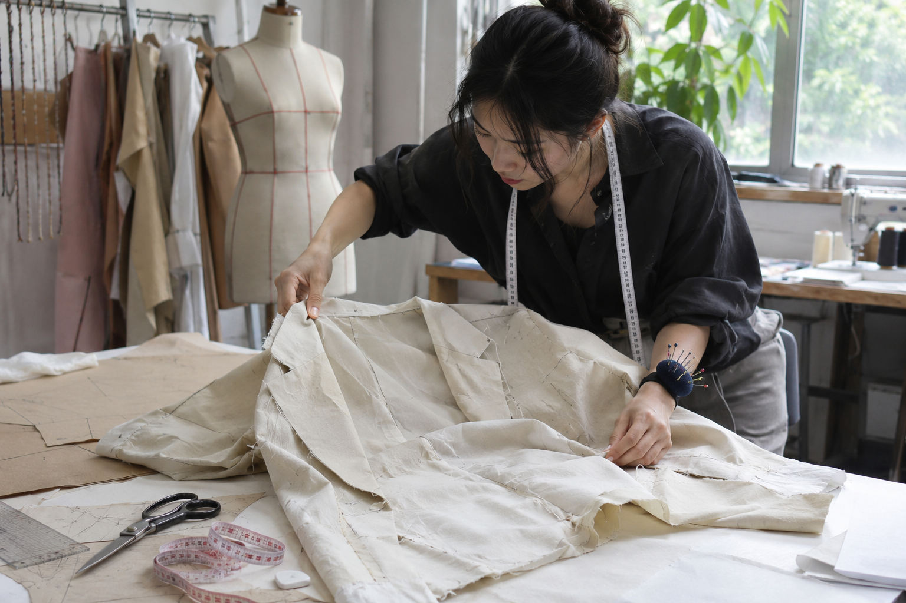
**标签：**服装线稿、版型、打版、样衣、纸样
**含义：**展示打版师在工作台检查半成品版型和纸样
**调用条件：**当本条回答涉及“服装打版与纸样”相应对象或环节时使用。
**使用范围：**用于解释场景、对象与操作，不作为具体项目现场、交付、准确率或收益证明。

## DQA-017｜一张线稿可以生成成衣吗？

**场景：**时尚产业

**回答指令：**围绕用户问题直接回答。先给结论，再补充以下要点：生成图是视觉设计结果，不等于纸样、实物面料、尺码合体或生产样衣；应保留控制条件和人工修改记录。回答结束时可提出一个与该主题直接相关的追问：怎样评估版型保持、姿态保持和生成失败率？

**回答要点：**
- 资料记录了文字、参考图、线稿和版型控制下的款式与成衣视觉生成。
- 生成图是视觉设计结果，不等于纸样、实物面料、尺码合体或生产样衣；应保留控制条件和人工修改记录。

**延伸问题：**怎样评估版型保持、姿态保持和生成失败率？

**选图规则：**一般显示主图1张；解释不同对象、操作或流程时，可再选1—2张备选图。相同问题可在语义相关的备选图中轮换，不跨场景随意凑图。图像只作解释，数值和项目阶段由文字说明。

### 主图：FAS-IMG-002｜服装打版与纸样

**标签：**服装线稿、版型、打版、样衣、纸样
**含义：**展示打版师在工作台检查半成品版型和纸样
**调用条件：**当本条回答涉及“服装打版与纸样”相应对象或环节时使用。
**使用范围：**用于解释场景、对象与操作，不作为具体项目现场、交付、准确率或收益证明。

### 备选图：FAS-IMG-005｜裁剪与纸样细节

**标签：**裁剪、纸样、面料、打版、生产
**含义：**手部、剪刀、纸样和面料的近景；说明数字设计仍需打版裁剪与工艺落实。
**调用条件：**当本条回答涉及“裁剪与纸样细节”相应对象或环节时使用。
**使用范围：**用于解释场景、对象与操作，不作为具体项目现场、交付、准确率或收益证明。

## DQA-018｜虚拟换装和真实试衣有什么区别？

**场景：**时尚产业

**回答指令：**围绕用户问题直接回答。先给结论，再补充以下要点：图像生成结果不能作为物理合体证明；需要独立的尺寸、版型和试穿数据。回答结束时可提出一个与该主题直接相关的追问：换装结果能不能直接用于电商上架？

**回答要点：**
- 虚拟换装生成视觉上的穿着效果，关注人物、姿态和服装细节；真实试衣还涉及尺码、版型、舒适度、面料和人体适配。
- 图像生成结果不能作为物理合体证明；需要独立的尺寸、版型和试穿数据。

**延伸问题：**换装结果能不能直接用于电商上架？

**选图规则：**一般显示主图1张；解释不同对象、操作或流程时，可再选1—2张备选图。相同问题可在语义相关的备选图中轮换，不跨场景随意凑图。图像只作解释，数值和项目阶段由文字说明。

### 主图：FAS-IMG-003｜服装试衣与量体
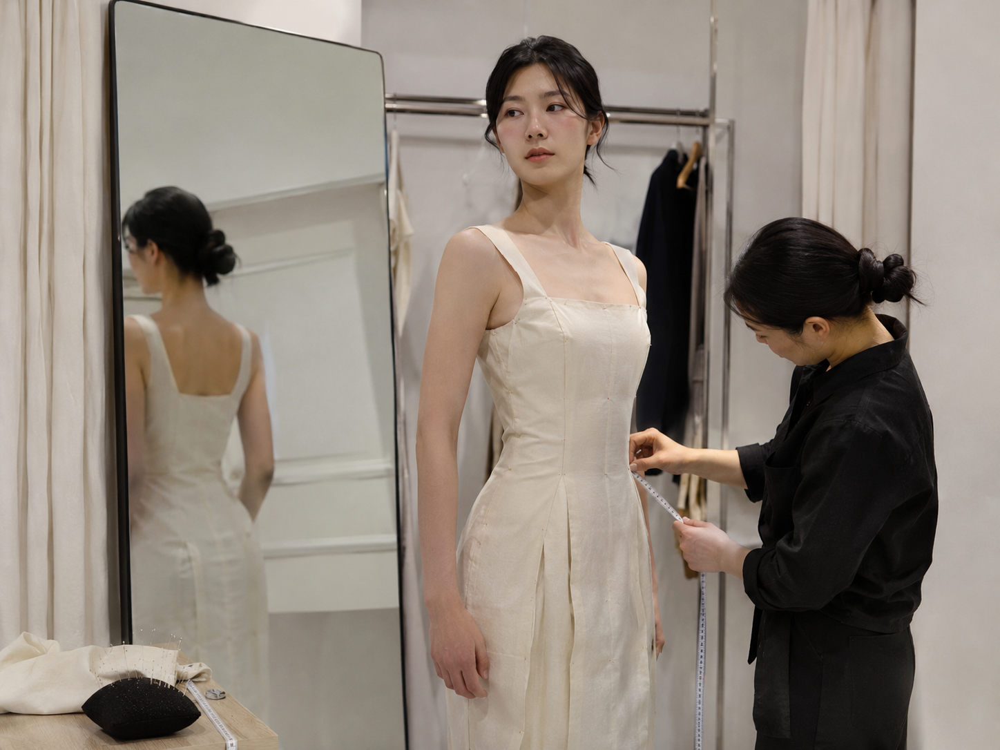
**标签：**虚拟换装、真实试衣、尺码、版型合体
**含义：**展示设计师给模特量体并检查样衣合体度
**调用条件：**当本条回答涉及“服装试衣与量体”相应对象或环节时使用。
**使用范围：**用于解释场景、对象与操作，不作为具体项目现场、交付、准确率或收益证明。

### 备选图：FAS-IMG-002｜服装打版与纸样

**标签：**服装线稿、版型、打版、样衣、纸样
**含义：**展示打版师在工作台检查半成品版型和纸样
**调用条件：**当本条回答涉及“服装打版与纸样”相应对象或环节时使用。
**使用范围：**用于解释场景、对象与操作，不作为具体项目现场、交付、准确率或收益证明。

## DQA-019｜服装数据应该标哪些字段？

**场景：**时尚产业

**回答指令：**围绕用户问题直接回答。先给结论，再补充以下要点：DeepFashion2将服装检测、关键点、分割和消费者到商家检索视为不同任务，标签和评测任务要分开。回答结束时可提出一个与该主题直接相关的追问：当前系统是否支持关键点、分割和消费者图检索？

**回答要点：**
- 可标注类别、版型、领型、袖型、长度、面料、纹样、颜色、风格、场景、模特和拍摄信息。
- DeepFashion2将服装检测、关键点、分割和消费者到商家检索视为不同任务，标签和评测任务要分开。

**延伸问题：**当前系统是否支持关键点、分割和消费者图检索？

**选图规则：**一般显示主图1张；解释不同对象、操作或流程时，可再选1—2张备选图。相同问题可在语义相关的备选图中轮换，不跨场景随意凑图。图像只作解释，数值和项目阶段由文字说明。

### 主图：FAS-IMG-004｜服装面料检查

**标签：**面料理解、花型、材质、生产前检查
**含义：**展示设计师检查真实面料、样本和纹理
**调用条件：**当本条回答涉及“服装面料检查”相应对象或环节时使用。
**使用范围：**用于解释场景、对象与操作，不作为具体项目现场、交付、准确率或收益证明。

### 备选图：FAS-IMG-006｜钮扣光学采集与尺寸检查
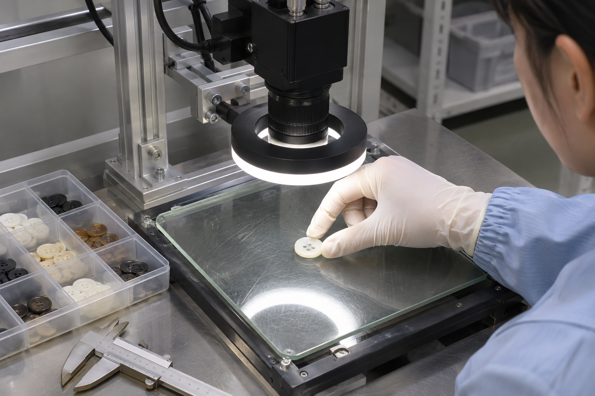
**标签：**钮扣、工业相机、采图、尺寸、标定
**含义：**工业相机、环形灯、检测台和钮扣样本；说明辅料数字化工位。
**调用条件：**当本条回答涉及“钮扣光学采集与尺寸检查”相应对象或环节时使用。
**使用范围：**用于解释场景、对象与操作，不作为具体项目现场、交付、准确率或收益证明。

## DQA-020｜非标钮扣怎样数字化？

**场景：**时尚产业

**回答指令：**围绕用户问题直接回答。先给结论，再补充以下要点：实际尺寸换算需要相机内参、外参、畸变校正和标定板；像素长度不能直接等于毫米。回答结束时可提出一个与该主题直接相关的追问：测量精度、标定周期和误差范围是多少？

**回答要点：**
- 通过正面采图、背光测量尺寸、建立图片和尺寸记录、文字与图片检索、结构化入库，将实物变成可查询的数字对象。
- 实际尺寸换算需要相机内参、外参、畸变校正和标定板；像素长度不能直接等于毫米。

**延伸问题：**测量精度、标定周期和误差范围是多少？

**选图规则：**一般显示主图1张；解释不同对象、操作或流程时，可再选1—2张备选图。相同问题可在语义相关的备选图中轮换，不跨场景随意凑图。图像只作解释，数值和项目阶段由文字说明。

### 主图：FAS-IMG-006｜钮扣光学采集与尺寸检查

**标签：**钮扣、工业相机、采图、尺寸、标定
**含义：**工业相机、环形灯、检测台和钮扣样本；说明辅料数字化工位。
**调用条件：**当本条回答涉及“钮扣光学采集与尺寸检查”相应对象或环节时使用。
**使用范围：**用于解释场景、对象与操作，不作为具体项目现场、交付、准确率或收益证明。

## DQA-021｜面料生成结果能直接用于生产吗？

**场景：**时尚产业

**回答指令：**围绕用户问题直接回答。先给结论，再补充以下要点：回答区分视觉材质和实体材料；保留生成版本、参考图和人工确认。回答结束时可提出一个与该主题直接相关的追问：是否有真实面料打样和色差检测记录？

**回答要点：**
- 不能直接等同。生成结果可以用于创意探索、视觉提案、花型和营销内容；生产还需要色彩、纤维、织造、印染、克重和打样验证。
- 回答区分视觉材质和实体材料；保留生成版本、参考图和人工确认。

**延伸问题：**是否有真实面料打样和色差检测记录？

**选图规则：**一般显示主图1张；解释不同对象、操作或流程时，可再选1—2张备选图。相同问题可在语义相关的备选图中轮换，不跨场景随意凑图。图像只作解释，数值和项目阶段由文字说明。

### 主图：FAS-IMG-001｜样衣缝线质量检查
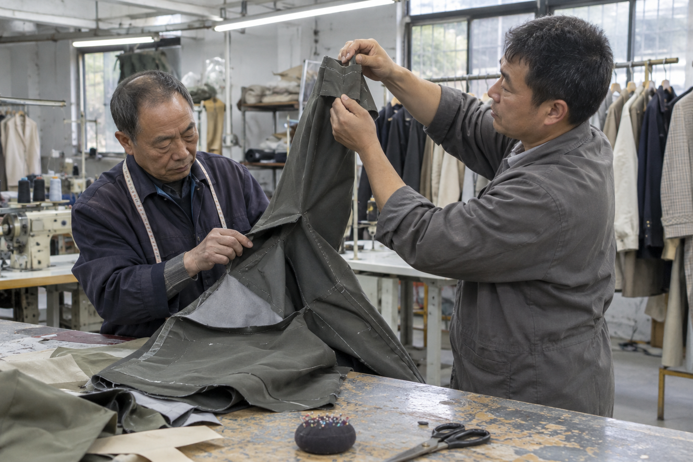
**标签：**样衣、缝线、质检、生产、面料
**含义：**普通样衣间的工艺检查；替换此前广告感较强的设计师画面。
**调用条件：**当本条回答涉及“样衣缝线质量检查”相应对象或环节时使用。
**使用范围：**用于解释场景、对象与操作，不作为具体项目现场、交付、准确率或收益证明。

### 备选图：FAS-IMG-005｜裁剪与纸样细节

**标签：**裁剪、纸样、面料、打版、生产
**含义：**手部、剪刀、纸样和面料的近景；说明数字设计仍需打版裁剪与工艺落实。
**调用条件：**当本条回答涉及“裁剪与纸样细节”相应对象或环节时使用。
**使用范围：**用于解释场景、对象与操作，不作为具体项目现场、交付、准确率或收益证明。

### 备选图：FAS-IMG-004｜服装面料检查

**标签：**面料理解、花型、材质、生产前检查
**含义：**展示设计师检查真实面料、样本和纹理
**调用条件：**当本条回答涉及“服装面料检查”相应对象或环节时使用。
**使用范围：**用于解释场景、对象与操作，不作为具体项目现场、交付、准确率或收益证明。

## DQA-022｜凯鸿项目目前做到哪一步？

**场景：**智慧物流

**回答指令：**围绕用户问题直接回答。先给结论，再补充以下要点：项目阶段是调研与架构规划，不等同于全部系统上线。回答结束时可提出一个与该主题直接相关的追问：哪些模块已有交付、哪些仍是规划？

**回答要点：**
- 资料主要形成访谈、岗位跟踪、问卷、业务痛点、服务蓝图、架构初稿和模块规划。
- 项目阶段是调研与架构规划，不等同于全部系统上线。

**延伸问题：**哪些模块已有交付、哪些仍是规划？

**选图规则：**一般显示主图1张；解释不同对象、操作或流程时，可再选1—2张备选图。相同问题可在语义相关的备选图中轮换，不跨场景随意凑图。图像只作解释，数值和项目阶段由文字说明。

### 主图：LOG-IMG-002｜物流单据与运输状态
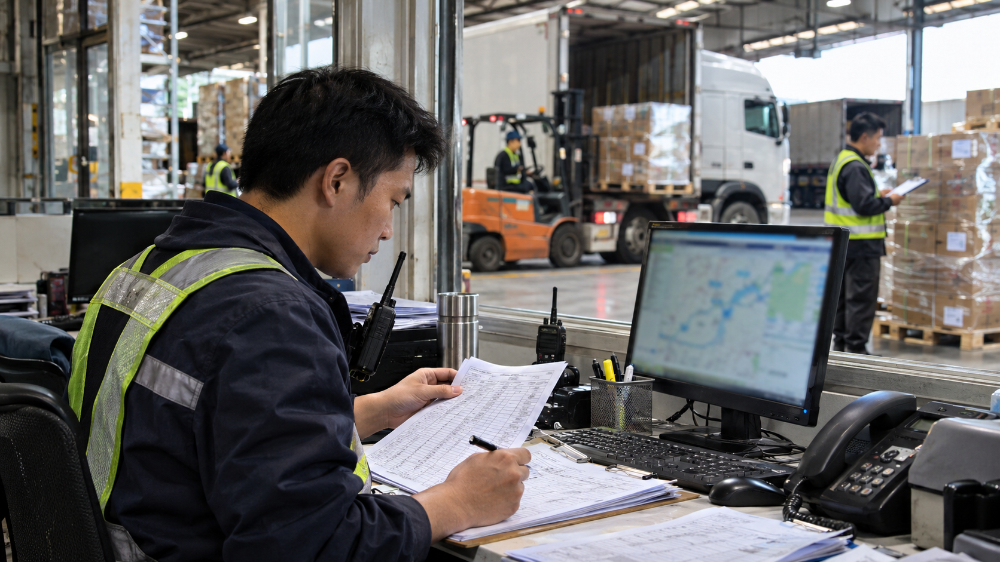
**标签：**订单、运段、运输节点、费用、回单
**含义：**展示物流调度人员核对运输单据和车辆状态
**调用条件：**当本条回答涉及“物流单据与运输状态”相应对象或环节时使用。
**使用范围：**用于解释场景、对象与操作，不作为具体项目现场、交付、准确率或收益证明。

### 备选图：LOG-IMG-004｜电话协调车辆调度

**标签：**调度、电话、运段、运输、单据
**含义：**电话、纸单、电脑与装卸区组合；解释跨系统协调和运输组织。
**调用条件：**当本条回答涉及“电话协调车辆调度”相应对象或环节时使用。
**使用范围：**用于解释场景、对象与操作，不作为具体项目现场、交付、准确率或收益证明。

## DQA-023｜为什么要区分订单、箱、货、车辆和运输段？

**场景：**智慧物流

**回答指令：**围绕用户问题直接回答。先给结论，再补充以下要点：一柜多票、多柜多票、拆箱、转运和多车承运都需要对象关系建模。回答结束时可提出一个与该主题直接相关的追问：系统如何处理一箱货拆给多辆车？

**回答要点：**
- 这些对象承担不同业务语义：订单承载业务需求，货物承载实物，箱承载装载关系，车辆承载运输，运输段承载路线和节点，单据承载凭证。
- 一柜多票、多柜多票、拆箱、转运和多车承运都需要对象关系建模。

**延伸问题：**系统如何处理一箱货拆给多辆车？

**选图规则：**一般显示主图1张；解释不同对象、操作或流程时，可再选1—2张备选图。相同问题可在语义相关的备选图中轮换，不跨场景随意凑图。图像只作解释，数值和项目阶段由文字说明。

### 主图：LOG-IMG-003｜集装箱箱号扫描
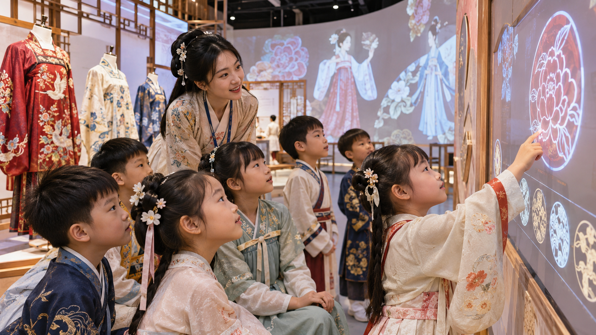
**标签：**集装箱、箱号、装运、提还箱、节点事件
**含义：**工作人员手持扫描终端检查集装箱表面标识；解释箱管与业务事件。
**调用条件：**当本条回答涉及“集装箱箱号扫描”相应对象或环节时使用。
**使用范围：**用于解释场景、对象与操作，不作为具体项目现场、交付、准确率或收益证明。

### 备选图：LOG-IMG-005｜仓库托盘入库核对
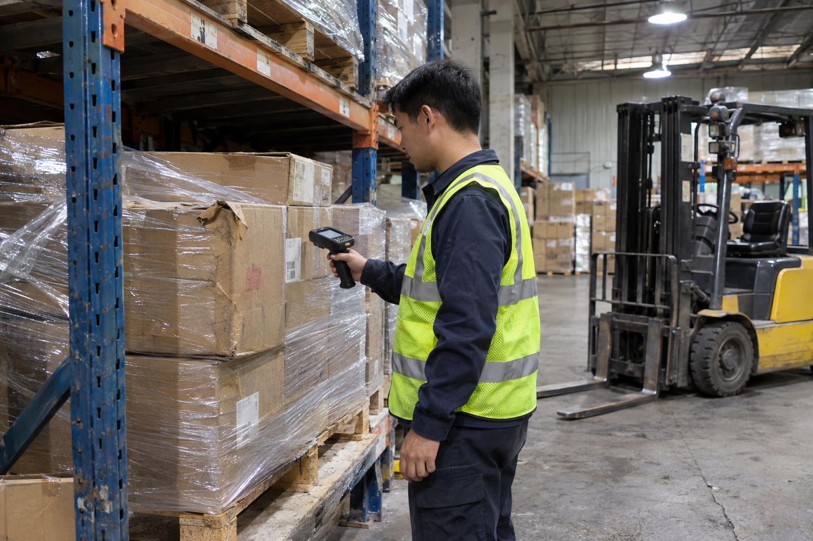
**标签：**托盘、入库、仓储、扫码、箱货
**含义：**管理员核对托盘箱货，旁边停靠叉车；解释实物与记录关联。
**调用条件：**当本条回答涉及“仓库托盘入库核对”相应对象或环节时使用。
**使用范围：**用于解释场景、对象与操作，不作为具体项目现场、交付、准确率或收益证明。

### 备选图：LOG-IMG-001｜物流仓库与运输调度

**标签：**凯鸿物流、订单、仓储、运输、箱货关系
**含义：**展示仓库、箱货、运输车辆和工作人员核对单据
**调用条件：**当本条回答涉及“物流仓库与运输调度”相应对象或环节时使用。
**使用范围：**用于解释场景、对象与操作，不作为具体项目现场、交付、准确率或收益证明。

## DQA-024｜服务蓝图解决什么问题？

**场景：**智慧物流

**回答指令：**围绕用户问题直接回答。先给结论，再补充以下要点：蓝图不是系统上线证明，而是业务知识模型和需求分析产物。回答结束时可提出一个与该主题直接相关的追问：如何把服务蓝图转成数据表和接口？

**回答要点：**
- 服务蓝图把客户动作、前台岗位、后台活动、支持系统和费用结算沿流程组织起来，用于发现断点和定义系统边界。
- 蓝图不是系统上线证明，而是业务知识模型和需求分析产物。

**延伸问题：**如何把服务蓝图转成数据表和接口？

**选图规则：**一般显示主图1张；解释不同对象、操作或流程时，可再选1—2张备选图。相同问题可在语义相关的备选图中轮换，不跨场景随意凑图。图像只作解释，数值和项目阶段由文字说明。

### 主图：LOG-IMG-004｜电话协调车辆调度

**标签：**调度、电话、运段、运输、单据
**含义：**电话、纸单、电脑与装卸区组合；解释跨系统协调和运输组织。
**调用条件：**当本条回答涉及“电话协调车辆调度”相应对象或环节时使用。
**使用范围：**用于解释场景、对象与操作，不作为具体项目现场、交付、准确率或收益证明。

### 备选图：LOG-IMG-001｜物流仓库与运输调度

**标签：**凯鸿物流、订单、仓储、运输、箱货关系
**含义：**展示仓库、箱货、运输车辆和工作人员核对单据
**调用条件：**当本条回答涉及“物流仓库与运输调度”相应对象或环节时使用。
**使用范围：**用于解释场景、对象与操作，不作为具体项目现场、交付、准确率或收益证明。

## DQA-025｜物流系统最突出的痛点是什么？

**场景：**智慧物流

**回答指令：**围绕用户问题直接回答。先给结论，再补充以下要点：问题需要对应业务对象、规则、接口、权限、凭证和人工复核。回答结束时可提出一个与该主题直接相关的追问：哪个痛点最适合先做AI辅助？

**回答要点：**
- 包括多系统切换、客户和地址重复、报价分散、政策查询耗时、拆并单线下处理、箱号船次关联不足、计费单位不一致、库存录入错误、回单归档和财务同步不足。
- 问题需要对应业务对象、规则、接口、权限、凭证和人工复核。

**延伸问题：**哪个痛点最适合先做AI辅助？

**选图规则：**一般显示主图1张；解释不同对象、操作或流程时，可再选1—2张备选图。相同问题可在语义相关的备选图中轮换，不跨场景随意凑图。图像只作解释，数值和项目阶段由文字说明。

### 主图：LOG-IMG-004｜电话协调车辆调度

**标签：**调度、电话、运段、运输、单据
**含义：**电话、纸单、电脑与装卸区组合；解释跨系统协调和运输组织。
**调用条件：**当本条回答涉及“电话协调车辆调度”相应对象或环节时使用。
**使用范围：**用于解释场景、对象与操作，不作为具体项目现场、交付、准确率或收益证明。

### 备选图：LOG-IMG-002｜物流单据与运输状态

**标签：**订单、运段、运输节点、费用、回单
**含义：**展示物流调度人员核对运输单据和车辆状态
**调用条件：**当本条回答涉及“物流单据与运输状态”相应对象或环节时使用。
**使用范围：**用于解释场景、对象与操作，不作为具体项目现场、交付、准确率或收益证明。

## DQA-026｜EPCIS能帮助凯鸿解决什么？

**场景：**智慧物流

**回答指令：**围绕用户问题直接回答。先给结论，再补充以下要点：EPCIS是公开标准背景，不代表凯鸿已经采用；项目落地需要对象编码、事件接口和合作方数据。回答结束时可提出一个与该主题直接相关的追问：如何把装柜、提箱、到港、签收和还箱映射成事件？

**回答要点：**
- EPCIS以事件记录对象发生了什么、何时、何地、为何以及状态和传感条件，可用于订单、箱、货、仓储和运输节点的追踪。
- EPCIS是公开标准背景，不代表凯鸿已经采用；项目落地需要对象编码、事件接口和合作方数据。

**延伸问题：**如何把装柜、提箱、到港、签收和还箱映射成事件？

**选图规则：**一般显示主图1张；解释不同对象、操作或流程时，可再选1—2张备选图。相同问题可在语义相关的备选图中轮换，不跨场景随意凑图。图像只作解释，数值和项目阶段由文字说明。

### 主图：LOG-IMG-003｜集装箱箱号扫描

**标签：**集装箱、箱号、装运、提还箱、节点事件
**含义：**工作人员手持扫描终端检查集装箱表面标识；解释箱管与业务事件。
**调用条件：**当本条回答涉及“集装箱箱号扫描”相应对象或环节时使用。
**使用范围：**用于解释场景、对象与操作，不作为具体项目现场、交付、准确率或收益证明。

### 备选图：LOG-IMG-005｜仓库托盘入库核对

**标签：**托盘、入库、仓储、扫码、箱货
**含义：**管理员核对托盘箱货，旁边停靠叉车；解释实物与记录关联。
**调用条件：**当本条回答涉及“仓库托盘入库核对”相应对象或环节时使用。
**使用范围：**用于解释场景、对象与操作，不作为具体项目现场、交付、准确率或收益证明。

## DQA-027｜AI适合先做哪些物流功能？

**场景：**智慧物流

**回答指令：**围绕用户问题直接回答。先给结论，再补充以下要点：AI输出要保留来源、置信度、人工复核和修改留痕；涉及计费和报关时不能无审计自动改写。回答结束时可提出一个与该主题直接相关的追问：哪些功能需要接入外部船司、海关或银行接口？

**回答要点：**
- 订单字段解析、单据OCR、政策检索、船期运价查询、费用与附件匹配、异常提醒、知识库问答、报表摘要和审核辅助。
- AI输出要保留来源、置信度、人工复核和修改留痕；涉及计费和报关时不能无审计自动改写。

**延伸问题：**哪些功能需要接入外部船司、海关或银行接口？

**选图规则：**一般显示主图1张；解释不同对象、操作或流程时，可再选1—2张备选图。相同问题可在语义相关的备选图中轮换，不跨场景随意凑图。图像只作解释，数值和项目阶段由文字说明。

### 主图：LOG-IMG-002｜物流单据与运输状态

**标签：**订单、运段、运输节点、费用、回单
**含义：**展示物流调度人员核对运输单据和车辆状态
**调用条件：**当本条回答涉及“物流单据与运输状态”相应对象或环节时使用。
**使用范围：**用于解释场景、对象与操作，不作为具体项目现场、交付、准确率或收益证明。

### 备选图：LOG-IMG-004｜电话协调车辆调度

**标签：**调度、电话、运段、运输、单据
**含义：**电话、纸单、电脑与装卸区组合；解释跨系统协调和运输组织。
**调用条件：**当本条回答涉及“电话协调车辆调度”相应对象或环节时使用。
**使用范围：**用于解释场景、对象与操作，不作为具体项目现场、交付、准确率或收益证明。

## DQA-028｜智慧商圈和数字门店有什么区别？

**场景：**数字商业运营

**回答指令：**围绕用户问题直接回答。先给结论，再补充以下要点：前者回答选址，后者回答店内体验和陈列；两类数据不混为同一指标。回答结束时可提出一个与该主题直接相关的追问：数字门店能否和销售、库存、POS关联？

**回答要点：**
- 智慧商圈聚焦点位人流、进店人数、去重统计、人体追踪和开店评估；数字门店聚焦展台和货架中的注目、停留、触碰、试用和互动。
- 前者回答选址，后者回答店内体验和陈列；两类数据不混为同一指标。

**延伸问题：**数字门店能否和销售、库存、POS关联？

**选图规则：**一般显示主图1张；解释不同对象、操作或流程时，可再选1—2张备选图。相同问题可在语义相关的备选图中轮换，不跨场景随意凑图。图像只作解释，数值和项目阶段由文字说明。

### 主图：RET-IMG-003｜客流热区与运营观察

**标签：**热区、驻留、客流、趋势、运营
**含义：**运营人员查看客流与热区界面，背景为商场；画面不承载真实经营指标。
**调用条件：**当本条回答涉及“客流热区与运营观察”相应对象或环节时使用。
**使用范围：**用于解释场景、对象与操作，不作为具体项目现场、交付、准确率或收益证明。

### 备选图：RET-IMG-004｜顾客比较商品
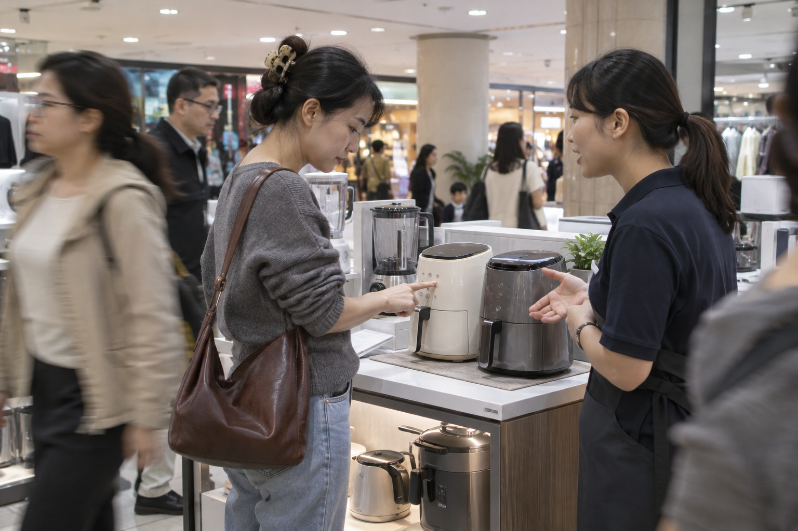
**标签：**比较、SKU、触碰、体验、顾客
**含义：**顾客在展台比较产品；说明兴趣与互动信号，不能当作购买证明。
**调用条件：**当本条回答涉及“顾客比较商品”相应对象或环节时使用。
**使用范围：**用于解释场景、对象与操作，不作为具体项目现场、交付、准确率或收益证明。

## DQA-029｜摄像头能判断顾客是否喜欢商品吗？

**场景：**数字商业运营

**回答指令：**围绕用户问题直接回答。先给结论，再补充以下要点：注目、屏幕暴露、互动和交易是不同统计对象；需要交易数据才能分析销售关联。回答结束时可提出一个与该主题直接相关的追问：能否按SKU、时段和区域比较行为？

**回答要点：**
- 系统可以记录客流、注目、停留、触碰和互动等行为信号，但不能仅凭这些行为断言购买意愿或真实偏好。
- 注目、屏幕暴露、互动和交易是不同统计对象；需要交易数据才能分析销售关联。

**延伸问题：**能否按SKU、时段和区域比较行为？

**选图规则：**一般显示主图1张；解释不同对象、操作或流程时，可再选1—2张备选图。相同问题可在语义相关的备选图中轮换，不跨场景随意凑图。图像只作解释，数值和项目阶段由文字说明。

### 主图：RET-IMG-004｜顾客比较商品

**标签：**比较、SKU、触碰、体验、顾客
**含义：**顾客在展台比较产品；说明兴趣与互动信号，不能当作购买证明。
**调用条件：**当本条回答涉及“顾客比较商品”相应对象或环节时使用。
**使用范围：**用于解释场景、对象与操作，不作为具体项目现场、交付、准确率或收益证明。

### 备选图：RET-IMG-002｜顾客试用家电
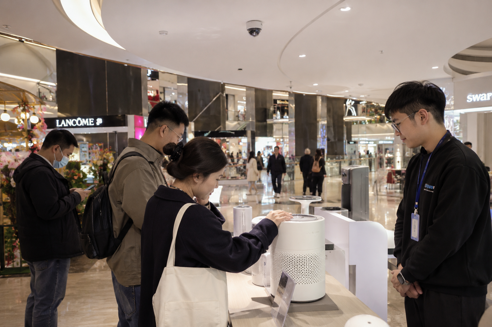
**标签：**试用、触碰、互动、体验区
**含义：**顾客在小型家电展台试用产品；解释商品互动，不能推定成交。
**调用条件：**当本条回答涉及“顾客试用家电”相应对象或环节时使用。
**使用范围：**用于解释场景、对象与操作，不作为具体项目现场、交付、准确率或收益证明。

## DQA-030｜数字门店有多少试点和数据？

**场景：**数字商业运营

**回答指令：**围绕用户问题直接回答。先给结论，再补充以下要点：单位、统计窗口和去重规则未全部载明；千家门店属于拓展计划。回答结束时可提出一个与该主题直接相关的追问：这些数据的统计周期、去重窗口和设备数量是多少？

**回答要点：**
- 资料记录4个试点展台、2.7k以上累计运行周期、1.3k以上视频分析时长、11万以上客流记录、5万以上注目记录和4000以上互动记录。
- 单位、统计窗口和去重规则未全部载明；千家门店属于拓展计划。

**延伸问题：**这些数据的统计周期、去重窗口和设备数量是多少？

**选图规则：**一般显示主图1张；解释不同对象、操作或流程时，可再选1—2张备选图。相同问题可在语义相关的备选图中轮换，不跨场景随意凑图。图像只作解释，数值和项目阶段由文字说明。

### 主图：RET-IMG-001｜数字门店顾客互动
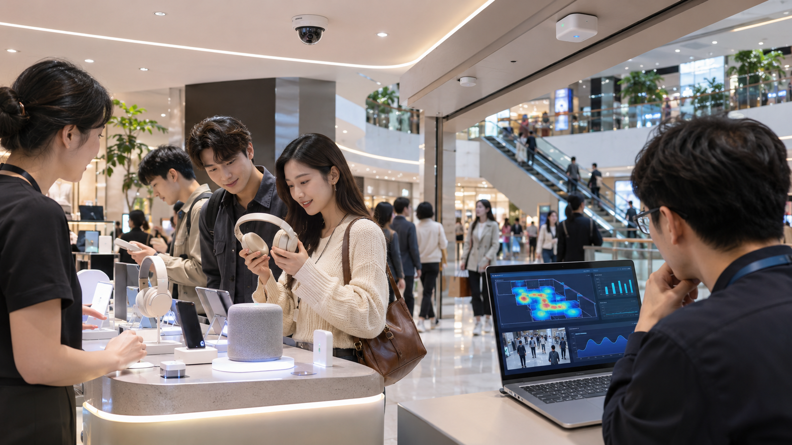
**标签：**数字门店、展台、注目、触碰、体验
**含义：**展示顾客在商场展台体验商品和运营人员观察互动
**调用条件：**当本条回答涉及“数字门店顾客互动”相应对象或环节时使用。
**使用范围：**用于解释场景、对象与操作，不作为具体项目现场、交付、准确率或收益证明。

### 备选图：RET-IMG-005｜门店设备与陈列现场
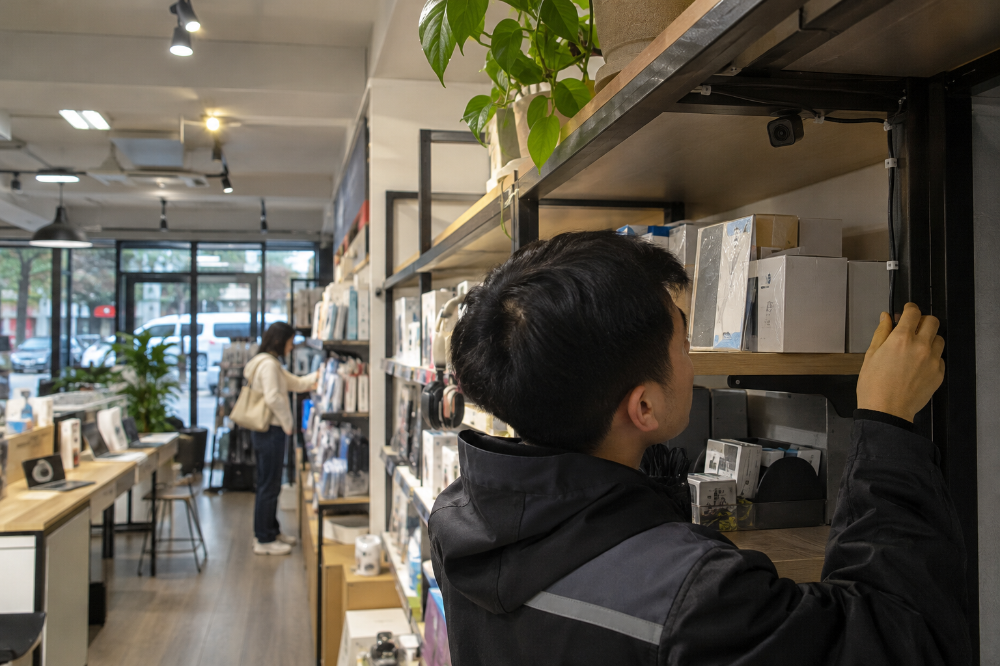
**标签：**摄像头、安装、设备、陈列、货架
**含义：**货架安装摄像头与现场检查；解释感知设备如何融入陈列。
**调用条件：**当本条回答涉及“门店设备与陈列现场”相应对象或环节时使用。
**使用范围：**用于解释场景、对象与操作，不作为具体项目现场、交付、准确率或收益证明。

## DQA-031｜如何评价门店客流和受众？

**场景：**数字商业运营

**回答指令：**围绕用户问题直接回答。先给结论，再补充以下要点：MRC标准要求说明营业时间、屏幕暴露区和质量控制；客流记录不等于广告受众，更不等于购买人数。回答结束时可提出一个与该主题直接相关的追问：系统是否记录营业时间、遮挡和可视条件？

**回答要点：**
- 应区分场所客流、屏幕暴露区内的屏幕流量和符合可视条件的受众。
- MRC标准要求说明营业时间、屏幕暴露区和质量控制；客流记录不等于广告受众，更不等于购买人数。

**延伸问题：**系统是否记录营业时间、遮挡和可视条件？

**选图规则：**一般显示主图1张；解释不同对象、操作或流程时，可再选1—2张备选图。相同问题可在语义相关的备选图中轮换，不跨场景随意凑图。图像只作解释，数值和项目阶段由文字说明。

### 主图：RET-IMG-003｜客流热区与运营观察

**标签：**热区、驻留、客流、趋势、运营
**含义：**运营人员查看客流与热区界面，背景为商场；画面不承载真实经营指标。
**调用条件：**当本条回答涉及“客流热区与运营观察”相应对象或环节时使用。
**使用范围：**用于解释场景、对象与操作，不作为具体项目现场、交付、准确率或收益证明。

### 备选图：RET-IMG-004｜顾客比较商品

**标签：**比较、SKU、触碰、体验、顾客
**含义：**顾客在展台比较产品；说明兴趣与互动信号，不能当作购买证明。
**调用条件：**当本条回答涉及“顾客比较商品”相应对象或环节时使用。
**使用范围：**用于解释场景、对象与操作，不作为具体项目现场、交付、准确率或收益证明。

## DQA-032｜数字门店设备有什么特点？

**场景：**数字商业运营

**回答指令：**围绕用户问题直接回答。先给结论，再补充以下要点：成本降低40%是项目指标；应进一步区分样机、量产和部署成本。回答结束时可提出一个与该主题直接相关的追问：厚度和成本数据的测量基线是什么？

**回答要点：**
- 设备方向包括隐蔽、便携、低功耗采集，附加摄像头、外壳、单面镜和多角度吸附安装。设备厚度由95mm降至56.5mm，降幅约40.5%。
- 成本降低40%是项目指标；应进一步区分样机、量产和部署成本。

**延伸问题：**厚度和成本数据的测量基线是什么？

**选图规则：**一般显示主图1张；解释不同对象、操作或流程时，可再选1—2张备选图。相同问题可在语义相关的备选图中轮换，不跨场景随意凑图。图像只作解释，数值和项目阶段由文字说明。

### 主图：RET-IMG-005｜门店设备与陈列现场

**标签：**摄像头、安装、设备、陈列、货架
**含义：**货架安装摄像头与现场检查；解释感知设备如何融入陈列。
**调用条件：**当本条回答涉及“门店设备与陈列现场”相应对象或环节时使用。
**使用范围：**用于解释场景、对象与操作，不作为具体项目现场、交付、准确率或收益证明。

## DQA-033｜消费洞察如何形成产品策略？

**场景：**数字商业运营

**回答指令：**围绕用户问题直接回答。先给结论，再补充以下要点：样本量、时间窗、基线和归因必须单独记录；Kano分类不能简单等同情感分析。回答结束时可提出一个与该主题直接相关的追问：如何验证洞察是否带来销售或复购变化？

**回答要点：**
- 将社交媒体、电商评论、品类属性、场景需求、声量和满意度组织成用户画像、痛点、需求、定位和营销策略。
- 样本量、时间窗、基线和归因必须单独记录；Kano分类不能简单等同情感分析。

**延伸问题：**如何验证洞察是否带来销售或复购变化？

**选图规则：**一般显示主图1张；解释不同对象、操作或流程时，可再选1—2张备选图。相同问题可在语义相关的备选图中轮换，不跨场景随意凑图。图像只作解释，数值和项目阶段由文字说明。

### 主图：RET-IMG-004｜顾客比较商品

**标签：**比较、SKU、触碰、体验、顾客
**含义：**顾客在展台比较产品；说明兴趣与互动信号，不能当作购买证明。
**调用条件：**当本条回答涉及“顾客比较商品”相应对象或环节时使用。
**使用范围：**用于解释场景、对象与操作，不作为具体项目现场、交付、准确率或收益证明。

### 备选图：RET-IMG-003｜客流热区与运营观察

**标签：**热区、驻留、客流、趋势、运营
**含义：**运营人员查看客流与热区界面，背景为商场；画面不承载真实经营指标。
**调用条件：**当本条回答涉及“客流热区与运营观察”相应对象或环节时使用。
**使用范围：**用于解释场景、对象与操作，不作为具体项目现场、交付、准确率或收益证明。

## DQA-034｜未来教育场景具体是什么？

**场景：**未来教育

**回答指令：**围绕用户问题直接回答。先给结论，再补充以下要点：现有资料包含AI汉服换装、儿童想象课堂、自然感官装置和光学互动空间；少年宫正式交付信息需单独建档。回答结束时可提出一个与该主题直接相关的追问：如何把互动体验变成课程和评价？

**回答要点：**
- 把文化内容、AI生成、虚拟现实、互动装置和学习任务结合，支持观察、操作、生成、表达和反馈。
- 现有资料包含AI汉服换装、儿童想象课堂、自然感官装置和光学互动空间；少年宫正式交付信息需单独建档。

**延伸问题：**如何把互动体验变成课程和评价？

**选图规则：**一般显示主图1张；解释不同对象、操作或流程时，可再选1—2张备选图。相同问题可在语义相关的备选图中轮换，不跨场景随意凑图。图像只作解释，数值和项目阶段由文字说明。

### 主图：EDU-IMG-004｜服饰纹样手作课堂

**标签：**手作、纹样、传统文化、课程、创作
**含义：**日常服装的儿童用纸卡和布样完成纹样拼贴；解释体验向课程任务转化。
**调用条件：**当本条回答涉及“服饰纹样手作课堂”相应对象或环节时使用。
**使用范围：**用于解释场景、对象与操作，不作为具体项目现场、交付、准确率或收益证明。

### 备选图：EDU-IMG-005｜镜面与透光材料探索

**标签：**反射、镜面、透明材料、科学教育、观察
**含义：**儿童用镜子、手电和透明片观察反射；解释动作、反馈和再次观察。
**调用条件：**当本条回答涉及“镜面与透光材料探索”相应对象或环节时使用。
**使用范围：**用于解释场景、对象与操作，不作为具体项目现场、交付、准确率或收益证明。

### 备选图：EDU-IMG-001｜普通终端汉服文化体验
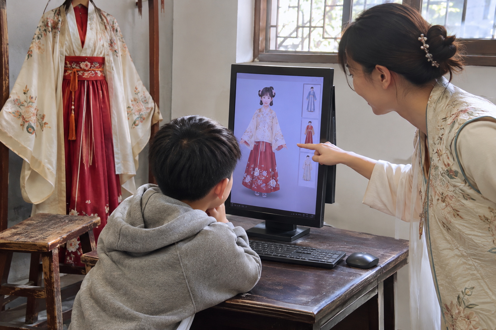
**标签：**汉服、普通显示器、文化体验、教师讲解
**含义：**儿童在实体显示器前观察二维换装画面；解释少儿文化体验，不使用全息场馆表现。
**调用条件：**当本条回答涉及“普通终端汉服文化体验”相应对象或环节时使用。
**使用范围：**用于解释场景、对象与操作，不作为具体项目现场、交付、准确率或收益证明。

## DQA-035｜AI汉服换装如何用于教育？

**场景：**未来教育

**回答指令：**围绕用户问题直接回答。先给结论，再补充以下要点：现有资料证明文化体验和交互形式，不等于已有完整课程大纲、课时和学习评价。回答结束时可提出一个与该主题直接相关的追问：不同年龄段如何设置任务难度？

**回答要点：**
- 可连接服饰结构、纹样、色彩、历史文化和图像生成，形成认识结构、选择主题、观察生成差异、解释文化元素和完成创作的任务链。
- 现有资料证明文化体验和交互形式，不等于已有完整课程大纲、课时和学习评价。

**延伸问题：**不同年龄段如何设置任务难度？

**选图规则：**一般显示主图1张；解释不同对象、操作或流程时，可再选1—2张备选图。相同问题可在语义相关的备选图中轮换，不跨场景随意凑图。图像只作解释，数值和项目阶段由文字说明。

### 主图：EDU-IMG-003｜服饰纹样互动讲解

**标签：**服饰、纹样、汉服、教师指导
**含义：**教师带领儿童观察服饰纹样与墙面投影，解释文化内容与参与。
**调用条件：**当本条回答涉及“服饰纹样互动讲解”相应对象或环节时使用。
**使用范围：**用于解释场景、对象与操作，不作为具体项目现场、交付、准确率或收益证明。

### 备选图：EDU-IMG-004｜服饰纹样手作课堂

**标签：**手作、纹样、传统文化、课程、创作
**含义：**日常服装的儿童用纸卡和布样完成纹样拼贴；解释体验向课程任务转化。
**调用条件：**当本条回答涉及“服饰纹样手作课堂”相应对象或环节时使用。
**使用范围：**用于解释场景、对象与操作，不作为具体项目现场、交付、准确率或收益证明。

### 备选图：EDU-IMG-001｜普通终端汉服文化体验

**标签：**汉服、普通显示器、文化体验、教师讲解
**含义：**儿童在实体显示器前观察二维换装画面；解释少儿文化体验，不使用全息场馆表现。
**调用条件：**当本条回答涉及“普通终端汉服文化体验”相应对象或环节时使用。
**使用范围：**用于解释场景、对象与操作，不作为具体项目现场、交付、准确率或收益证明。

## DQA-036｜互动装置和普通展览有什么区别？

**场景：**未来教育

**回答指令：**围绕用户问题直接回答。先给结论，再补充以下要点：适合承载光学、声音、材料、自然、情绪表达和空间设计主题；参与次数不等于学习效果。回答结束时可提出一个与该主题直接相关的追问：如何记录学生的操作、解释和创作成果？

**回答要点：**
- 互动装置把空间、传感、机械、灯光、声音和观众动作连成动作—响应—再观察的循环。
- 适合承载光学、声音、材料、自然、情绪表达和空间设计主题；参与次数不等于学习效果。

**延伸问题：**如何记录学生的操作、解释和创作成果？

**选图规则：**一般显示主图1张；解释不同对象、操作或流程时，可再选1—2张备选图。相同问题可在语义相关的备选图中轮换，不跨场景随意凑图。图像只作解释，数值和项目阶段由文字说明。

### 主图：EDU-IMG-002｜光影镜面探索

**标签：**镜面、反射、光影、儿童探索
**含义：**儿童通过镜子、透明材料和影子探索光学现象。
**调用条件：**当本条回答涉及“光影镜面探索”相应对象或环节时使用。
**使用范围：**用于解释场景、对象与操作，不作为具体项目现场、交付、准确率或收益证明。

### 备选图：EDU-IMG-005｜镜面与透光材料探索

**标签：**反射、镜面、透明材料、科学教育、观察
**含义：**儿童用镜子、手电和透明片观察反射；解释动作、反馈和再次观察。
**调用条件：**当本条回答涉及“镜面与透光材料探索”相应对象或环节时使用。
**使用范围：**用于解释场景、对象与操作，不作为具体项目现场、交付、准确率或收益证明。

## DQA-037｜装置常用哪些技术？

**场景：**未来教育

**回答指令：**围绕用户问题直接回答。先给结论，再补充以下要点：不同作品硬件不同；传感器只能说明输入方式，不能自动证明学习成效或情绪识别。回答结束时可提出一个与该主题直接相关的追问：哪个装置对应哪个传感器和控制器？

**回答要点：**
- 包括红外人体感应、接近检测、电容触控、重力输入、舵机机械开合、LED像素灯光、声音控制、镜面多次反射和泡膜光学。
- 不同作品硬件不同；传感器只能说明输入方式，不能自动证明学习成效或情绪识别。

**延伸问题：**哪个装置对应哪个传感器和控制器？

**选图规则：**一般显示主图1张；解释不同对象、操作或流程时，可再选1—2张备选图。相同问题可在语义相关的备选图中轮换，不跨场景随意凑图。图像只作解释，数值和项目阶段由文字说明。

### 主图：EDU-IMG-005｜镜面与透光材料探索

**标签：**反射、镜面、透明材料、科学教育、观察
**含义：**儿童用镜子、手电和透明片观察反射；解释动作、反馈和再次观察。
**调用条件：**当本条回答涉及“镜面与透光材料探索”相应对象或环节时使用。
**使用范围：**用于解释场景、对象与操作，不作为具体项目现场、交付、准确率或收益证明。

### 备选图：EDU-IMG-002｜光影镜面探索

**标签：**镜面、反射、光影、儿童探索
**含义：**儿童通过镜子、透明材料和影子探索光学现象。
**调用条件：**当本条回答涉及“光影镜面探索”相应对象或环节时使用。
**使用范围：**用于解释场景、对象与操作，不作为具体项目现场、交付、准确率或收益证明。

## DQA-038｜少年宫项目已经交付了吗？

**场景：**未来教育

**回答指令：**围绕用户问题直接回答。先给结论，再补充以下要点：回答应使用“已有教育关联素材，正式交付信息不完整”，不要写成已验收。回答结束时可提出一个与该主题直接相关的追问：需要补充哪些课程、设备和评价资料？

**回答要点：**
- 现有知识库有教育方向、AI汉服换装、互动装置和少儿文化体验资料，但少年宫专属项目名称、课程体系、知识库、教育智能体、实施学校、交付清单和学习评价尚不完整。
- 回答应使用“已有教育关联素材，正式交付信息不完整”，不要写成已验收。

**延伸问题：**需要补充哪些课程、设备和评价资料？

**选图规则：**一般显示主图1张；解释不同对象、操作或流程时，可再选1—2张备选图。相同问题可在语义相关的备选图中轮换，不跨场景随意凑图。图像只作解释，数值和项目阶段由文字说明。

### 主图：EDU-IMG-004｜服饰纹样手作课堂

**标签：**手作、纹样、传统文化、课程、创作
**含义：**日常服装的儿童用纸卡和布样完成纹样拼贴；解释体验向课程任务转化。
**调用条件：**当本条回答涉及“服饰纹样手作课堂”相应对象或环节时使用。
**使用范围：**用于解释场景、对象与操作，不作为具体项目现场、交付、准确率或收益证明。

## DQA-039｜国际上如何定义学生AI能力？

**场景：**未来教育

**回答指令：**围绕用户问题直接回答。先给结论，再补充以下要点：可作为教育场景的公开知识背景；不能直接当作本项目课程已经采用的标准。回答结束时可提出一个与该主题直接相关的追问：如何把六大场景转成理解、应用、创造三级课程？

**回答要点：**
- UNESCO学生AI能力框架包括以人为本、AI伦理、AI技术与应用、AI系统设计四个维度，进阶层级为理解、应用和创造，共12个能力模块。
- 可作为教育场景的公开知识背景；不能直接当作本项目课程已经采用的标准。

**延伸问题：**如何把六大场景转成理解、应用、创造三级课程？

**选图规则：**一般显示主图1张；解释不同对象、操作或流程时，可再选1—2张备选图。相同问题可在语义相关的备选图中轮换，不跨场景随意凑图。图像只作解释，数值和项目阶段由文字说明。

### 主图：EDU-IMG-004｜服饰纹样手作课堂

**标签：**手作、纹样、传统文化、课程、创作
**含义：**日常服装的儿童用纸卡和布样完成纹样拼贴；解释体验向课程任务转化。
**调用条件：**当本条回答涉及“服饰纹样手作课堂”相应对象或环节时使用。
**使用范围：**用于解释场景、对象与操作，不作为具体项目现场、交付、准确率或收益证明。

### 备选图：EDU-IMG-005｜镜面与透光材料探索

**标签：**反射、镜面、透明材料、科学教育、观察
**含义：**儿童用镜子、手电和透明片观察反射；解释动作、反馈和再次观察。
**调用条件：**当本条回答涉及“镜面与透光材料探索”相应对象或环节时使用。
**使用范围：**用于解释场景、对象与操作，不作为具体项目现场、交付、准确率或收益证明。

## DQA-040｜六个项目的共同技术能力是什么？

**场景：**跨场景

**回答指令：**围绕用户问题直接回答。先给结论，再补充以下要点：不同场景的数据对象和业务规则不同，不能强行使用同一种算法；共同的是对象、关系、规则和反馈的组织方式。回答结束时可提出一个与该主题直接相关的追问：如何把一个行业模型迁移到另一个行业？

**回答要点：**
- 共同能力是数据资产化、知识结构化、模型专业化和应用场景化。
- 不同场景的数据对象和业务规则不同，不能强行使用同一种算法；共同的是对象、关系、规则和反馈的组织方式。

**延伸问题：**如何把一个行业模型迁移到另一个行业？

**选图规则：**一般显示主图1张；解释不同对象、操作或流程时，可再选1—2张备选图。相同问题可在语义相关的备选图中轮换，不跨场景随意凑图。图像只作解释，数值和项目阶段由文字说明。

### 主图：AG-IMG-006｜灌溉水土样品检测

**标签：**水质、电导率、样本、土壤、检测
**含义：**样品瓶、土壤样本和台式仪器；解释水土评价所需检测工作。
**调用条件：**当本条回答涉及“灌溉水土样品检测”相应对象或环节时使用。
**使用范围：**用于解释场景、对象与操作，不作为具体项目现场、交付、准确率或收益证明。

### 备选图：LOG-IMG-005｜仓库托盘入库核对

**标签：**托盘、入库、仓储、扫码、箱货
**含义：**管理员核对托盘箱货，旁边停靠叉车；解释实物与记录关联。
**调用条件：**当本条回答涉及“仓库托盘入库核对”相应对象或环节时使用。
**使用范围：**用于解释场景、对象与操作，不作为具体项目现场、交付、准确率或收益证明。

### 备选图：RET-IMG-003｜客流热区与运营观察

**标签：**热区、驻留、客流、趋势、运营
**含义：**运营人员查看客流与热区界面，背景为商场；画面不承载真实经营指标。
**调用条件：**当本条回答涉及“客流热区与运营观察”相应对象或环节时使用。
**使用范围：**用于解释场景、对象与操作，不作为具体项目现场、交付、准确率或收益证明。

## DQA-041｜哪些信息可以作为确定事实？

**场景：**跨场景

**回答指令：**围绕用户问题直接回答。先给结论，再补充以下要点：来源层级分为实验室资料、项目材料、公开机构页面、论文、标准和政策；冲突数据按版本并列。回答结束时可提出一个与该主题直接相关的追问：如果不同页面数字不一致，小D怎么办？

**回答要点：**
- 项目名称、地点、页面明确写出的规模、产品功能、人员公开履历和公开标准可以按来源记录；规划、预期、模拟、测试和概念界面必须保留状态。
- 来源层级分为实验室资料、项目材料、公开机构页面、论文、标准和政策；冲突数据按版本并列。

**延伸问题：**如果不同页面数字不一致，小D怎么办？

**选图规则：**一般显示主图1张；解释不同对象、操作或流程时，可再选1—2张备选图。相同问题可在语义相关的备选图中轮换，不跨场景随意凑图。图像只作解释，数值和项目阶段由文字说明。

### 主图：POL-IMG-005｜事件报告人工复核

**标签：**人工复核、报告、智能写作、权限、研判
**含义：**人员共同核对报告；解释模型输出后的人工审核。
**调用条件：**当本条回答涉及“事件报告人工复核”相应对象或环节时使用。
**使用范围：**用于解释场景、对象与操作，不作为具体项目现场、交付、准确率或收益证明。

### 备选图：AG-IMG-006｜灌溉水土样品检测

**标签：**水质、电导率、样本、土壤、检测
**含义：**样品瓶、土壤样本和台式仪器；解释水土评价所需检测工作。
**调用条件：**当本条回答涉及“灌溉水土样品检测”相应对象或环节时使用。
**使用范围：**用于解释场景、对象与操作，不作为具体项目现场、交付、准确率或收益证明。

## DQA-042｜如果知识库没有答案，小D怎么回答？

**场景：**跨场景

**回答指令：**围绕用户问题直接回答。先给结论，再补充以下要点：回答要提供可继续查询的字段，例如项目阶段、数据周期、测试集、合同主体或验收文件。回答结束时可提出一个与该主题直接相关的追问：需要补充什么资料才能回答？

**回答要点：**
- 回答“资料库暂未记录完整信息”，列出已有相关事实和缺失字段，不根据图片相似性或常识补造合同、客户、上线状态、效果和准确率。
- 回答要提供可继续查询的字段，例如项目阶段、数据周期、测试集、合同主体或验收文件。

**延伸问题：**需要补充什么资料才能回答？

**选图规则：**一般显示主图1张；解释不同对象、操作或流程时，可再选1—2张备选图。相同问题可在语义相关的备选图中轮换，不跨场景随意凑图。图像只作解释，数值和项目阶段由文字说明。

### 主图：POL-IMG-005｜事件报告人工复核

**标签：**人工复核、报告、智能写作、权限、研判
**含义：**人员共同核对报告；解释模型输出后的人工审核。
**调用条件：**当本条回答涉及“事件报告人工复核”相应对象或环节时使用。
**使用范围：**用于解释场景、对象与操作，不作为具体项目现场、交付、准确率或收益证明。

## DQA-043｜这项农业工程的2.4亿元准备怎么用？

**用户也可能问：**农业项目总投资多少？ / 固定投资和流动资金各占多少？

**场景：**智慧农业

**回答指令：**先给总投资和固定/流动资金分项，再解释钱分别用于水处理、基础设施、种苗及运营。用户追问时补充资金来源。

**回答要点：**
- 投资方案合计24000万元，其中固定投资15000万元、流动资金9000万元；资金拟由企业投入20000万元和专项补贴4000万元构成。
- 基础设施6600万元、淡化中心5500万元、智能装备1000万元、种苗1400万元、试验田500万元，固定投资合计15000万元。
- 流动资金9000万元按运营需求投入；补贴为资金筹措安排。

**延伸问题：**你更想看淡化设备投入，还是种植和运营投入？

**选图规则：**一般显示主图1张；解释不同对象、操作或流程时，可再选1—2张备选图。相同问题可在语义相关的备选图中轮换，不跨场景随意凑图。图像只作解释，数值和项目阶段由文字说明。

### 主图：AG-IMG-007｜农业水处理设备巡检

**标签：**淡化、水处理、膜组件、泵、巡检
**含义：**水处理站的膜组件与管路巡检；不代表特定iFS结构或2000吨/小时产能。
**调用条件：**当本条回答涉及“农业水处理设备巡检”相应对象或环节时使用。
**使用范围：**用于解释场景、对象与操作，不作为具体项目现场、交付、准确率或收益证明。

### 备选图：AG-IMG-008｜番茄采后分选与周转

**标签：**番茄、采收、分选、周转、批次、质量分级
**含义：**红番茄输送带、人工检查与周转筐，解释采后分选和批次交接，不表示特定储藏温度或实际项目设备。
**调用条件：**回答涉及番茄采后分选与周转相应对象或操作时调用。
**使用范围：**用于解释场景、对象与操作，不作为具体项目现场、交付、准确率或收益证明。

## DQA-044｜苜蓿5700亩为什么还能加在1万亩项目里？

**用户也可能问：**果园和苜蓿面积是不是算重了？ / 60%是按什么面积计算的？

**场景：**智慧农业

**回答指令：**直接给计算式，再用“同一块果园地的行间种草”解释叠加面积。

**回答要点：**
- 5700亩苜蓿为9500亩果园的行间套种，9500×60%=5700；它不是新增的独立用地。
- 果树面积9500亩，试验田500亩，合计10000亩。
- 苜蓿与果园面积重叠；规划为前1—4年套种。

**延伸问题：**需要一起了解果树和试验田的面积分配吗？

**选图规则：**一般显示主图1张；解释不同对象、操作或流程时，可再选1—2张备选图。相同问题可在语义相关的备选图中轮换，不跨场景随意凑图。图像只作解释，数值和项目阶段由文字说明。

### 主图：AG-IMG-004｜番茄田装备与田间作业

**标签：**番茄、农业装备、拖拉机、滴灌、田间管理
**含义：**番茄田车道上的拖拉机、滴灌设备与作业人员，解释田间管理环节。
**调用条件：**仅在延伸解释通用水土检测、田间管理或试验方法时调用；回答原项目具体品种和面积时以文字为主，不以番茄图指代历史规划作物。
**使用范围：**用于解释场景、对象与操作，不作为具体项目现场、交付、准确率或收益证明。

### 备选图：AG-IMG-005｜番茄田灌溉阀门操作

**标签：**番茄、灌溉、阀门、滴灌、田间管理
**含义：**工人在番茄田边操作灌溉阀门，解释灌溉执行环节。
**调用条件：**仅在延伸解释通用水土检测、田间管理或试验方法时调用；回答原项目具体品种和面积时以文字为主，不以番茄图指代历史规划作物。
**使用范围：**用于解释场景、对象与操作，不作为具体项目现场、交付、准确率或收益证明。

## DQA-045｜500亩试验田是做什么用的？

**用户也可能问：**试验田也算收入吗？ / 试验田有什么品种？

**场景：**智慧农业

**回答指令：**先解释验证目的，再列三组面积，最后说明没有计入营收。

**回答要点：**
- 试验田用于品种筛选和技术验证，规划为100亩尾水生态养殖、100亩芦笋或山药试种、300亩水稻、开心果、巴旦木等试验。
- 试验田合计500亩。
- 试验田产出未计入项目收入预测。

**延伸问题：**你更关心品种适应性，还是水土条件验证？

**选图规则：**一般显示主图1张；解释不同对象、操作或流程时，可再选1—2张备选图。相同问题可在语义相关的备选图中轮换，不跨场景随意凑图。图像只作解释，数值和项目阶段由文字说明。

### 主图：AG-IMG-006｜灌溉水土样品检测

**标签：**水质、电导率、样本、土壤、检测
**含义：**样品瓶、土壤样本和台式仪器；解释水土评价所需检测工作。
**调用条件：**当本条回答涉及“灌溉水土样品检测”相应对象或环节时使用。
**使用范围：**用于解释场景、对象与操作，不作为具体项目现场、交付、准确率或收益证明。

### 备选图：AG-IMG-002｜番茄田水质与土壤取样

**标签：**番茄、取样、EC、SAR、土壤监测、灌溉水质
**含义：**番茄田边采集灌溉水与土壤样本，解释检测对象与采样工作。
**调用条件：**仅在延伸解释通用水土检测、田间管理或试验方法时调用；回答原项目具体品种和面积时以文字为主，不以番茄图指代历史规划作物。
**使用范围：**用于解释场景、对象与操作，不作为具体项目现场、交付、准确率或收益证明。

## DQA-046｜水果采下来以后，智慧农业还会管什么？

**用户也可能问：**采后处理怎么做？ / 为什么还要分选和冷库？

**场景：**智慧农业

**回答指令：**按采收到入库顺序讲清设备和数据，图片主用分选与冷库交接。

**回答要点：**
- 规划覆盖采收、转运、分级、预冷、冷藏和批次管理，相关装备包括振动采收、轨道运输、光电分选、智能冷库与真空预冷。
- 田间生产与采后处理属于同一产业链的不同环节。
- 质量等级、温度、批次和库存是不同记录对象。

**延伸问题：**要看采收运输设备，还是果品分级与保鲜？

**选图规则：**一般显示主图1张；解释不同对象、操作或流程时，可再选1—2张备选图。相同问题可在语义相关的备选图中轮换，不跨场景随意凑图。图像只作解释，数值和项目阶段由文字说明。

### 主图：AG-IMG-008｜番茄采后分选与周转

**标签：**番茄、采收、分选、周转、批次、质量分级
**含义：**红番茄输送带、人工检查与周转筐，解释采后分选和批次交接，不表示特定储藏温度或实际项目设备。
**调用条件：**回答涉及番茄采后分选与周转相应对象或操作时调用。
**使用范围：**用于解释场景、对象与操作，不作为具体项目现场、交付、准确率或收益证明。

### 备选图：AG-IMG-004｜番茄田装备与田间作业

**标签：**番茄、农业装备、拖拉机、滴灌、田间管理
**含义：**番茄田车道上的拖拉机、滴灌设备与作业人员，解释田间管理环节。
**调用条件：**回答涉及番茄田装备与田间作业相应对象或操作时调用。
**使用范围：**用于解释场景、对象与操作，不作为具体项目现场、交付、准确率或收益证明。

## DQA-047｜识别到异常事件以后，系统会怎么处理？

**用户也可能问：**告警之后谁来管？ / 识别和处置怎么衔接？

**场景：**公安政务

**回答指令：**按“发现—告警—人工确认—处理—反馈”解释一般链路，再说明各模块实施阶段不同。

**回答要点：**
- 识别结果形成事件线索，再通过规则、告警、派单、人工研判和反馈接入处置流程。具体节点取决于应用模块。
- 事件识别、人工确认和正式处置分别承担不同任务。
- 交管治理包含隐患排查、派单、处理；预警系统围绕监测、预警、处置组织。

**延伸问题：**你想了解交通事件的处理，还是社区告警的处理？

**选图规则：**一般显示主图1张；解释不同对象、操作或流程时，可再选1—2张备选图。相同问题可在语义相关的备选图中轮换，不跨场景随意凑图。图像只作解释，数值和项目阶段由文字说明。

### 主图：POL-IMG-004｜楼道消防与电动车巡查

**标签：**消防通道、电动车、社区、人工处置
**含义：**工作人员在真实感楼道空间交流电动车停放与通道问题；解释识别后的现场核查。
**调用条件：**当本条回答涉及“楼道消防与电动车巡查”相应对象或环节时使用。
**使用范围：**用于解释场景、对象与操作，不作为具体项目现场、交付、准确率或收益证明。

### 备选图：POL-IMG-005｜事件报告人工复核

**标签：**人工复核、报告、智能写作、权限、研判
**含义：**人员共同核对报告；解释模型输出后的人工审核。
**调用条件：**当本条回答涉及“事件报告人工复核”相应对象或环节时使用。
**使用范围：**用于解释场景、对象与操作，不作为具体项目现场、交付、准确率或收益证明。

## DQA-048｜边缘计算和中心平台分别干什么？

**用户也可能问：**视频都要传回中心吗？ / 边缘盒子有什么作用？

**场景：**公安政务

**回答指令：**先用“现场处理”和“集中管理”解释分工，再说明网络、算力和任务会影响部署选择。

**回答要点：**
- 边缘设备靠近现场组织采集与推理，中心侧承担资源管理、业务服务和数据汇聚；具体计算分工取决于部署配置。
- 架构包含边缘设备、中心服务、视频流、计算框架与k3s调度等组件。
- K3s区分控制平面/数据存储所在的server和工作负载agent。

**延伸问题：**你更关心现场时延，还是统一部署管理？

**选图规则：**一般显示主图1张；解释不同对象、操作或流程时，可再选1—2张备选图。相同问题可在语义相关的备选图中轮换，不跨场景随意凑图。图像只作解释，数值和项目阶段由文字说明。

### 主图：POL-IMG-006｜路口感知设备现场维护
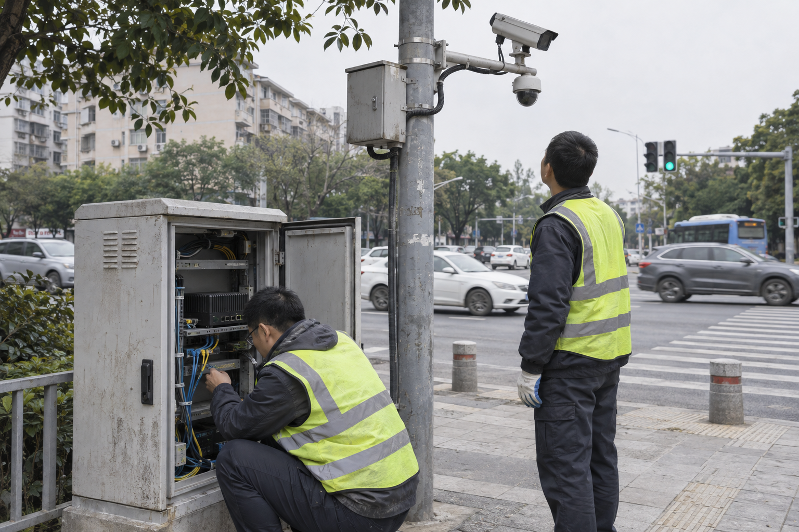
**标签：**边缘计算、摄像头、部署、机柜、运维、国产化
**含义：**技术人员检查路侧机柜、线缆与视频设备，解释现场感知和计算部署。
**调用条件：**当本条回答涉及“路口感知设备现场维护”相应对象或环节时使用。
**使用范围：**用于解释场景、对象与操作，不作为具体项目现场、交付、准确率或收益证明。

### 备选图：POL-IMG-001｜交通事件智能感知

**标签：**公安政务、交通识别、道路事件、视频监控
**含义：**展示交通指挥中心查看道路视频和事件识别的场景
**调用条件：**当本条回答涉及“交通事件智能感知”相应对象或环节时使用。
**使用范围：**用于解释场景、对象与操作，不作为具体项目现场、交付、准确率或收益证明。

## DQA-049｜目标检测、轨迹追踪和事件识别有什么区别？

**用户也可能问：**能看到人就能识别打架吗？ / 检测框和事件有什么关系？

**场景：**公安政务

**回答指令：**用道路或社区例子逐层解释，最后说明事件判断更依赖上下文。

**回答要点：**
- 目标检测找出一帧中的人或车，追踪关联连续帧中的目标，事件识别还需要时间、动作、场景和规则来判断发生了什么。
- 同一目标连续出现不代表某类事件成立。
- 斗殴识别还要区分跳舞、争吵等混淆情况。

**延伸问题：**需要继续了解误报和漏报如何评价吗？

**选图规则：**一般显示主图1张；解释不同对象、操作或流程时，可再选1—2张备选图。相同问题可在语义相关的备选图中轮换，不跨场景随意凑图。图像只作解释，数值和项目阶段由文字说明。

### 主图：POL-IMG-001｜交通事件智能感知

**标签：**公安政务、交通识别、道路事件、视频监控
**含义：**展示交通指挥中心查看道路视频和事件识别的场景
**调用条件：**当本条回答涉及“交通事件智能感知”相应对象或环节时使用。
**使用范围：**用于解释场景、对象与操作，不作为具体项目现场、交付、准确率或收益证明。

### 备选图：POL-IMG-002｜社区安全视频研判

**标签：**社区治理、电动车进电梯、视频研判、人工复核
**含义：**展示警务人员和社区工作人员查看社区监控的场景
**调用条件：**当本条回答涉及“社区安全视频研判”相应对象或环节时使用。
**使用范围：**用于解释场景、对象与操作，不作为具体项目现场、交付、准确率或收益证明。

## DQA-050｜国产化适配是不是换台国产电脑就可以？

**用户也可能问：**信创适配涉及什么？ / 国产化部署要看哪些条件？

**场景：**公安政务

**回答指令：**先解释适配对象，再说明只有硬件名称不足以判断可运行；将产品能力与具体配置区分。

**回答要点：**
- 国产化部署涉及芯片架构、操作系统、计算框架、模型格式、驱动和业务系统等条件，不能只看设备品牌。
- 项目存在国产化适配方向。
- 具体型号、框架版本和性能条件没有在现有条目中统一列明。

**延伸问题：**你需要核对某套具体环境，还是了解整体适配流程？

**选图规则：**一般显示主图1张；解释不同对象、操作或流程时，可再选1—2张备选图。相同问题可在语义相关的备选图中轮换，不跨场景随意凑图。图像只作解释，数值和项目阶段由文字说明。

### 主图：POL-IMG-006｜路口感知设备现场维护

**标签：**边缘计算、摄像头、部署、机柜、运维、国产化
**含义：**技术人员检查路侧机柜、线缆与视频设备，解释现场感知和计算部署。
**调用条件：**当本条回答涉及“路口感知设备现场维护”相应对象或环节时使用。
**使用范围：**用于解释场景、对象与操作，不作为具体项目现场、交付、准确率或收益证明。

### 备选图：POL-IMG-003｜警务智能写作

**标签：**智能写作、公文生成、警务办公、知识服务
**含义：**展示警务人员在办公环境中处理公文的场景
**调用条件：**当本条回答涉及“警务智能写作”相应对象或环节时使用。
**使用范围：**用于解释场景、对象与操作，不作为具体项目现场、交付、准确率或收益证明。

## DQA-051｜为什么服装生成要同时提供线稿、姿态和面料？

**用户也可能问：**一句描述不能直接出图吗？ / 可控生成具体控制什么？

**场景：**时尚产业

**回答指令：**按输入分别回答“控制什么”，用同款服装换面料或换姿势举例，不必展开算法细节。

**回答要点：**
- 文字表达风格和需求，线稿约束款式结构，姿态约束人物动作，面料参考约束纹理外观。多种条件共同减少不符合设计意图的变化。
- 条件输入和生成结果应对应检查。
- 可控生成仍需评估结构、纹理、遮挡和人物一致性。

**延伸问题：**你更想控制款式轮廓、面料纹样，还是人物姿态？

**选图规则：**一般显示主图1张；解释不同对象、操作或流程时，可再选1—2张备选图。相同问题可在语义相关的备选图中轮换，不跨场景随意凑图。图像只作解释，数值和项目阶段由文字说明。

### 主图：FAS-IMG-007｜数字设计与实体样衣核对

**标签：**线稿、生成控制、样衣、版型、工艺、设计验证
**含义：**打版师比较设计稿与人台样衣，解释视觉设计和实体工艺的衔接。
**调用条件：**当本条回答涉及“数字设计与实体样衣核对”相应对象或环节时使用。
**使用范围：**用于解释场景、对象与操作，不作为具体项目现场、交付、准确率或收益证明。

### 备选图：FAS-IMG-004｜服装面料检查

**标签：**面料理解、花型、材质、生产前检查
**含义：**展示设计师检查真实面料、样本和纹理
**调用条件：**当本条回答涉及“服装面料检查”相应对象或环节时使用。
**使用范围：**用于解释场景、对象与操作，不作为具体项目现场、交付、准确率或收益证明。

## DQA-052｜生成效果很好看，为什么还要做样衣？

**用户也可能问：**AI图可以替代打版吗？ / 设计图到生产还差什么？

**场景：**时尚产业

**回答指令：**先给结论，再按“视觉意图—打版—样衣—工艺检查”解释衔接。

**回答要点：**
- 生成图表达视觉方案，实体样衣验证结构、尺寸、缝制、面料和实际穿着，二者解决的问题不同。
- 设计流程包含面料、款式、上身等环节。
- 实体检查涉及版型与工艺，图像不能证明材料物性。

**延伸问题：**需要了解版型检查，还是面料与缝制验证？

**选图规则：**一般显示主图1张；解释不同对象、操作或流程时，可再选1—2张备选图。相同问题可在语义相关的备选图中轮换，不跨场景随意凑图。图像只作解释，数值和项目阶段由文字说明。

### 主图：FAS-IMG-007｜数字设计与实体样衣核对

**标签：**线稿、生成控制、样衣、版型、工艺、设计验证
**含义：**打版师比较设计稿与人台样衣，解释视觉设计和实体工艺的衔接。
**调用条件：**当本条回答涉及“数字设计与实体样衣核对”相应对象或环节时使用。
**使用范围：**用于解释场景、对象与操作，不作为具体项目现场、交付、准确率或收益证明。

### 备选图：FAS-IMG-001｜样衣缝线质量检查

**标签：**样衣、缝线、质检、生产、面料
**含义：**普通样衣间的工艺检查；替换此前广告感较强的设计师画面。
**调用条件：**当本条回答涉及“样衣缝线质量检查”相应对象或环节时使用。
**使用范围：**用于解释场景、对象与操作，不作为具体项目现场、交付、准确率或收益证明。

### 备选图：FAS-IMG-005｜裁剪与纸样细节

**标签：**裁剪、纸样、面料、打版、生产
**含义：**手部、剪刀、纸样和面料的近景；说明数字设计仍需打版裁剪与工艺落实。
**调用条件：**当本条回答涉及“裁剪与纸样细节”相应对象或环节时使用。
**使用范围：**用于解释场景、对象与操作，不作为具体项目现场、交付、准确率或收益证明。

## DQA-053｜相似款检索和生成新款是一回事吗？

**用户也可能问：**搜衣服和设计衣服有什么区别？ / 系统会找现有款还是创造新图？

**场景：**时尚产业

**回答指令：**先分别定义，再用“找库里相近衣款”和“按线稿产生效果”作对比。

**回答要点：**
- 检索从已有数据中查找匹配对象，生成依据文字、图像或条件产生新的视觉结果。前者侧重找到，后者侧重构造。
- 服装、面料和辅料可作为检索对象。
- 检索命中与生成质量是不同评价目标。

**延伸问题：**你需要查库存相似款，还是做新款视觉探索？

**选图规则：**一般显示主图1张；解释不同对象、操作或流程时，可再选1—2张备选图。相同问题可在语义相关的备选图中轮换，不跨场景随意凑图。图像只作解释，数值和项目阶段由文字说明。

### 主图：FAS-IMG-004｜服装面料检查

**标签：**面料理解、花型、材质、生产前检查
**含义：**展示设计师检查真实面料、样本和纹理
**调用条件：**当本条回答涉及“服装面料检查”相应对象或环节时使用。
**使用范围：**用于解释场景、对象与操作，不作为具体项目现场、交付、准确率或收益证明。

### 备选图：FAS-IMG-007｜数字设计与实体样衣核对

**标签：**线稿、生成控制、样衣、版型、工艺、设计验证
**含义：**打版师比较设计稿与人台样衣，解释视觉设计和实体工艺的衔接。
**调用条件：**当本条回答涉及“数字设计与实体样衣核对”相应对象或环节时使用。
**使用范围：**用于解释场景、对象与操作，不作为具体项目现场、交付、准确率或收益证明。

## DQA-054｜钮扣为什么要同时拍正面和测背光？

**用户也可能问：**一张照片不能测大小吗？ / 外观和尺寸怎么入库？

**场景：**时尚产业

**回答指令：**先讲两种照明的任务差别，再解释图片、尺寸、对象编码与入库关系。

**回答要点：**
- 正面采图记录颜色、纹理和孔形等外观，背光突出轮廓以辅助尺寸测量，再将外观图与尺寸关联到同一库存对象。
- 真实长度换算依赖成像几何与标定。
- 测量精度由整体装置与条件决定，非仅看相机像素。

**延伸问题：**需要了解采图流程，还是标定与测量误差？

**选图规则：**一般显示主图1张；解释不同对象、操作或流程时，可再选1—2张备选图。相同问题可在语义相关的备选图中轮换，不跨场景随意凑图。图像只作解释，数值和项目阶段由文字说明。

### 主图：FAS-IMG-006｜钮扣光学采集与尺寸检查

**标签：**钮扣、工业相机、采图、尺寸、标定
**含义：**工业相机、环形灯、检测台和钮扣样本；说明辅料数字化工位。
**调用条件：**当本条回答涉及“钮扣光学采集与尺寸检查”相应对象或环节时使用。
**使用范围：**用于解释场景、对象与操作，不作为具体项目现场、交付、准确率或收益证明。

## DQA-055｜凯鸿调研问卷108份具体覆盖了谁？

**用户也可能问：**物流调研有多少样本？ / 问卷是不是全公司统计？

**场景：**智慧物流

**回答指令：**先列总量和岗位分布，强调这是调研样本，不是全员规模或全行业结论。

**回答要点：**
- 回收问卷共108份：普运业务18、普运司机27、集运业务13、集运司机31、财务10、审计9。
- 总样本与具体题项的有效样本可能不同。
- 问卷之外还采用访谈与岗位跟踪。

**延伸问题：**你想看司机反馈，还是业务和财务审计痛点？

**选图规则：**一般显示主图1张；解释不同对象、操作或流程时，可再选1—2张备选图。相同问题可在语义相关的备选图中轮换，不跨场景随意凑图。图像只作解释，数值和项目阶段由文字说明。

### 主图：LOG-IMG-002｜物流单据与运输状态

**标签：**订单、运段、运输节点、费用、回单
**含义：**展示物流调度人员核对运输单据和车辆状态
**调用条件：**当本条回答涉及“物流单据与运输状态”相应对象或环节时使用。
**使用范围：**用于解释场景、对象与操作，不作为具体项目现场、交付、准确率或收益证明。

### 备选图：LOG-IMG-004｜电话协调车辆调度

**标签：**调度、电话、运段、运输、单据
**含义：**电话、纸单、电脑与装卸区组合；解释跨系统协调和运输组织。
**调用条件：**当本条回答涉及“电话协调车辆调度”相应对象或环节时使用。
**使用范围：**用于解释场景、对象与操作，不作为具体项目现场、交付、准确率或收益证明。

## DQA-056｜为什么同一单货还会有不同计费单位？

**用户也可能问：**铁路按箱，汽运按车，怎么对账？ / 签收吨位和订单数量不同怎么办？

**场景：**智慧物流

**回答指令：**用一单多段运输说明单位差异，再解释原始作业量、换算和对账记录。

**回答要点：**
- 不同运输段与服务可能按箱、车辆、吨位、件数、面积或时长计费，需要把计量单位、数量转换、规则版本和凭证关联起来。
- 运输计费与仓储计费有不同规则。
- 实际签收量、作业次数和预录数量可能不同。

**延伸问题：**需要看运输段计费，还是仓储费用计算？

**选图规则：**一般显示主图1张；解释不同对象、操作或流程时，可再选1—2张备选图。相同问题可在语义相关的备选图中轮换，不跨场景随意凑图。图像只作解释，数值和项目阶段由文字说明。

### 主图：LOG-IMG-006｜月台回单与货物交接

**标签：**签收、回单、交接、对账、运段、凭证
**含义：**司机与仓库人员核对签收夹板、终端与托盘，解释实物履约和单据闭环。
**调用条件：**当本条回答涉及“月台回单与货物交接”相应对象或环节时使用。
**使用范围：**用于解释场景、对象与操作，不作为具体项目现场、交付、准确率或收益证明。

### 备选图：LOG-IMG-002｜物流单据与运输状态

**标签：**订单、运段、运输节点、费用、回单
**含义：**展示物流调度人员核对运输单据和车辆状态
**调用条件：**当本条回答涉及“物流单据与运输状态”相应对象或环节时使用。
**使用范围：**用于解释场景、对象与操作，不作为具体项目现场、交付、准确率或收益证明。

## DQA-057｜拆箱、拼箱和转运怎么保证能追踪？

**用户也可能问：**一柜多票还能追到每批货吗？ / 物理对象拆开以后系统怎么记？

**场景：**智慧物流

**回答指令：**先讲对象身份和关系，再用“整托拆成散箱”解释状态变化；涉及实施时回到已知项目阶段。

**回答要点：**
- 以明确的箱、托盘、货物和批次标识记录装入、拆出、交接和转运事件，保留关系变化的时间、地点和业务对象。
- EPCIS聚合事件可描述父子对象关系的增加或解除。
- 标准原理与项目实际采用情况分别回答。

**延伸问题：**要继续看事件字段，还是箱货关系建模？

**选图规则：**一般显示主图1张；解释不同对象、操作或流程时，可再选1—2张备选图。相同问题可在语义相关的备选图中轮换，不跨场景随意凑图。图像只作解释，数值和项目阶段由文字说明。

### 主图：LOG-IMG-005｜仓库托盘入库核对

**标签：**托盘、入库、仓储、扫码、箱货
**含义：**管理员核对托盘箱货，旁边停靠叉车；解释实物与记录关联。
**调用条件：**当本条回答涉及“仓库托盘入库核对”相应对象或环节时使用。
**使用范围：**用于解释场景、对象与操作，不作为具体项目现场、交付、准确率或收益证明。

### 备选图：LOG-IMG-003｜集装箱箱号扫描

**标签：**集装箱、箱号、装运、提还箱、节点事件
**含义：**工作人员手持扫描终端检查集装箱表面标识；解释箱管与业务事件。
**调用条件：**当本条回答涉及“集装箱箱号扫描”相应对象或环节时使用。
**使用范围：**用于解释场景、对象与操作，不作为具体项目现场、交付、准确率或收益证明。

### 备选图：LOG-IMG-006｜月台回单与货物交接

**标签：**签收、回单、交接、对账、运段、凭证
**含义：**司机与仓库人员核对签收夹板、终端与托盘，解释实物履约和单据闭环。
**调用条件：**当本条回答涉及“月台回单与货物交接”相应对象或环节时使用。
**使用范围：**用于解释场景、对象与操作，不作为具体项目现场、交付、准确率或收益证明。

## DQA-058｜为什么回单也会影响物流结算？

**用户也可能问：**签收完为什么还不能马上结算？ / 回单电子化有什么作用？

**场景：**智慧物流

**回答指令：**按运输完成到结算顺序回答，说明货已到和凭证齐全是两件事。

**回答要点：**
- 签收、回单接收、归档、对账和付款是不同环节。回单缺失或延迟会影响业务确认和结算，因此需要记录归属、接收状态和逾期信息。
- 现状包含纸质回单与Excel登记。
- 电子回单是否有效要看客户接受方式和业务流程。

**延伸问题：**需要了解回单追踪，还是回单与订单匹配？

**选图规则：**一般显示主图1张；解释不同对象、操作或流程时，可再选1—2张备选图。相同问题可在语义相关的备选图中轮换，不跨场景随意凑图。图像只作解释，数值和项目阶段由文字说明。

### 主图：LOG-IMG-006｜月台回单与货物交接

**标签：**签收、回单、交接、对账、运段、凭证
**含义：**司机与仓库人员核对签收夹板、终端与托盘，解释实物履约和单据闭环。
**调用条件：**当本条回答涉及“月台回单与货物交接”相应对象或环节时使用。
**使用范围：**用于解释场景、对象与操作，不作为具体项目现场、交付、准确率或收益证明。

### 备选图：LOG-IMG-002｜物流单据与运输状态

**标签：**订单、运段、运输节点、费用、回单
**含义：**展示物流调度人员核对运输单据和车辆状态
**调用条件：**当本条回答涉及“物流单据与运输状态”相应对象或环节时使用。
**使用范围：**用于解释场景、对象与操作，不作为具体项目现场、交付、准确率或收益证明。

## DQA-059｜有效客流、注目和互动的转化率怎么算？

**用户也可能问：**店内漏斗为什么不等于成交率？ / 注目率和互动率分母一样吗？

**场景：**数字商业运营

**回答指令：**先解释漏斗含义，再明确“哪个分子除以哪个分母”需要产品口径；不把行为转化写成销售转化。

**回答要点：**
- 三个层级依次描述进入统计范围、产生关注和发生互动。计算比率前必须说明事件定义、去重窗口、时段和分母，交易成交另需POS等销售数据。
- 行为记录量与独立人数不同。
- 界面的两级比率可能采用不同分母，不能只凭名字代入。

**延伸问题：**你希望按展台、SKU还是时段看漏斗？

**选图规则：**一般显示主图1张；解释不同对象、操作或流程时，可再选1—2张备选图。相同问题可在语义相关的备选图中轮换，不跨场景随意凑图。图像只作解释，数值和项目阶段由文字说明。

### 主图：RET-IMG-003｜客流热区与运营观察

**标签：**热区、驻留、客流、趋势、运营
**含义：**运营人员查看客流与热区界面，背景为商场；画面不承载真实经营指标。
**调用条件：**当本条回答涉及“客流热区与运营观察”相应对象或环节时使用。
**使用范围：**用于解释场景、对象与操作，不作为具体项目现场、交付、准确率或收益证明。

### 备选图：RET-IMG-004｜顾客比较商品

**标签：**比较、SKU、触碰、体验、顾客
**含义：**顾客在展台比较产品；说明兴趣与互动信号，不能当作购买证明。
**调用条件：**当本条回答涉及“顾客比较商品”相应对象或环节时使用。
**使用范围：**用于解释场景、对象与操作，不作为具体项目现场、交付、准确率或收益证明。

## DQA-060｜同一个人在店里来回走，会被算多次吗？

**用户也可能问：**客流去重是什么意思？ / 一条轨迹就是一个消费者吗？

**场景：**数字商业运营

**回答指令：**先解释为什么会重复，再说明需要明确场景口径，不承诺绝对去重。

**回答要点：**
- 是否重复计数取决于统计区域、过线规则、轨迹关联和去重时窗。追踪ID只是系统中的目标编号，不自动等于长期个人身份。
- 单帧检测、轨迹持续和最终计数是不同任务。
- 现有记录量不能直接换算为独立消费者。

**延伸问题：**你关心当天去重，还是同一个区域的往返计数？

**选图规则：**一般显示主图1张；解释不同对象、操作或流程时，可再选1—2张备选图。相同问题可在语义相关的备选图中轮换，不跨场景随意凑图。图像只作解释，数值和项目阶段由文字说明。

### 主图：RET-IMG-005｜门店设备与陈列现场

**标签：**摄像头、安装、设备、陈列、货架
**含义：**货架安装摄像头与现场检查；解释感知设备如何融入陈列。
**调用条件：**当本条回答涉及“门店设备与陈列现场”相应对象或环节时使用。
**使用范围：**用于解释场景、对象与操作，不作为具体项目现场、交付、准确率或收益证明。

### 备选图：RET-IMG-003｜客流热区与运营观察

**标签：**热区、驻留、客流、趋势、运营
**含义：**运营人员查看客流与热区界面，背景为商场；画面不承载真实经营指标。
**调用条件：**当本条回答涉及“客流热区与运营观察”相应对象或环节时使用。
**使用范围：**用于解释场景、对象与操作，不作为具体项目现场、交付、准确率或收益证明。

## DQA-061｜换了陈列以后，怎样判断是否有效？

**用户也可能问：**热区变红就说明卖得好吗？ / 怎么比较两个展台？

**场景：**数字商业运营

**回答指令：**先给需要比较的指标，再说明保持条件可比；有交易数据时另讲销售关联。

**回答要点：**
- 比较前后或不同SKU的注目、停留和互动时，要同时考虑时段、流量、活动、陈列位置和设备条件；销售效果还要关联交易。
- 热区表示行为分布，不直接表示利润。
- 观察到变化与证明陈列导致变化是不同结论。

**延伸问题：**你想比较SKU关注度，还是陈列调整前后表现？

**选图规则：**一般显示主图1张；解释不同对象、操作或流程时，可再选1—2张备选图。相同问题可在语义相关的备选图中轮换，不跨场景随意凑图。图像只作解释，数值和项目阶段由文字说明。

### 主图：RET-IMG-006｜门店陈列与补货核对

**标签：**陈列、库存、补货、SKU、运营、对比
**含义：**店员核对货架与库存并讨论陈列，解释行为分析到门店行动的衔接。
**调用条件：**当本条回答涉及“门店陈列与补货核对”相应对象或环节时使用。
**使用范围：**用于解释场景、对象与操作，不作为具体项目现场、交付、准确率或收益证明。

### 备选图：RET-IMG-003｜客流热区与运营观察

**标签：**热区、驻留、客流、趋势、运营
**含义：**运营人员查看客流与热区界面，背景为商场；画面不承载真实经营指标。
**调用条件：**当本条回答涉及“客流热区与运营观察”相应对象或环节时使用。
**使用范围：**用于解释场景、对象与操作，不作为具体项目现场、交付、准确率或收益证明。

### 备选图：RET-IMG-004｜顾客比较商品

**标签：**比较、SKU、触碰、体验、顾客
**含义：**顾客在展台比较产品；说明兴趣与互动信号，不能当作购买证明。
**调用条件：**当本条回答涉及“顾客比较商品”相应对象或环节时使用。
**使用范围：**用于解释场景、对象与操作，不作为具体项目现场、交付、准确率或收益证明。

## DQA-062｜55个文件、40个API能证明门店效果好吗？

**用户也可能问：**工程规模和业务成绩有什么区别？ / 算法很多就一定有效吗？

**场景：**数字商业运营

**回答指令：**先解释这些数字证明了什么，再列出判断业务价值需要的另一类证据。

**回答要点：**
- 文件、接口、组件和平台数说明工程构成；稳定性、识别质量与运营收益需要各自的运行和评测数据。
- 技术成果包括核心算法、平台、组件、接口和运行监控。
- 试点数量、行为记录和收益不是同一指标。

**延伸问题：**你更想看系统能力，还是试点运行和经营指标？

**选图规则：**一般显示主图1张；解释不同对象、操作或流程时，可再选1—2张备选图。相同问题可在语义相关的备选图中轮换，不跨场景随意凑图。图像只作解释，数值和项目阶段由文字说明。

### 主图：RET-IMG-005｜门店设备与陈列现场

**标签：**摄像头、安装、设备、陈列、货架
**含义：**货架安装摄像头与现场检查；解释感知设备如何融入陈列。
**调用条件：**当本条回答涉及“门店设备与陈列现场”相应对象或环节时使用。
**使用范围：**用于解释场景、对象与操作，不作为具体项目现场、交付、准确率或收益证明。

### 备选图：RET-IMG-006｜门店陈列与补货核对

**标签：**陈列、库存、补货、SKU、运营、对比
**含义：**店员核对货架与库存并讨论陈列，解释行为分析到门店行动的衔接。
**调用条件：**当本条回答涉及“门店陈列与补货核对”相应对象或环节时使用。
**使用范围：**用于解释场景、对象与操作，不作为具体项目现场、交付、准确率或收益证明。

## DQA-063｜红外感应是不是就在识别孩子是谁？

**用户也可能问：**机械花会做人脸识别吗？ / 有人靠近就亮是怎么回事？

**场景：**未来教育

**回答指令：**用孩子靠近机械花的例子解释“动作—传感—控制—开合”，避免把一般感应说成智能认人。

**回答要点：**
- 接近或红外感应可以检测输入变化并触发灯光或机械反馈，身份识别则是另一种任务，不能由“能触发装置”推断出来。
- 作品采用不同交互方式，具体传感器按装置确定。
- 输入、控制与输出可以作为教学主题。

**延伸问题：**你想了解感应方式，还是机械动作如何控制？

**选图规则：**一般显示主图1张；解释不同对象、操作或流程时，可再选1—2张备选图。相同问题可在语义相关的备选图中轮换，不跨场景随意凑图。图像只作解释，数值和项目阶段由文字说明。

### 主图：EDU-IMG-006｜传感与机械花操作课堂

**标签：**机械花、传感、控制、反馈、科学教育、舵机
**含义：**儿童和教师观察小型机械花的接近触发与开合，解释输入—控制—输出；不是少年宫实际交付记录。
**调用条件：**当本条回答涉及“传感与机械花操作课堂”相应对象或环节时使用。
**使用范围：**用于解释场景、对象与操作，不作为具体项目现场、交付、准确率或收益证明。

### 备选图：EDU-IMG-005｜镜面与透光材料探索

**标签：**反射、镜面、透明材料、科学教育、观察
**含义：**儿童用镜子、手电和透明片观察反射；解释动作、反馈和再次观察。
**调用条件：**当本条回答涉及“镜面与透光材料探索”相应对象或环节时使用。
**使用范围：**用于解释场景、对象与操作，不作为具体项目现场、交付、准确率或收益证明。

## DQA-064｜情绪主题装置能判断孩子心理状态吗？

**用户也可能问：**流浪的树是不是情绪识别系统？ / 互动艺术能做心理诊断吗？

**场景：**未来教育

**回答指令：**先解释艺术与交互的作用，再明确不能从灯光反应推断心理状态。

**回答要点：**
- 情绪主题用于艺术叙事和表达，接近触发灯光用于交互；它们不能单独构成心理状态识别或医学诊断。
- 作品包含孤独、悲伤、热爱、快乐、勇敢等情绪主题。
- 情绪主题名称和模型测得的情绪是不同概念。

**延伸问题：**你更想看艺术叙事，还是儿童表达与讨论活动？

**选图规则：**一般显示主图1张；解释不同对象、操作或流程时，可再选1—2张备选图。相同问题可在语义相关的备选图中轮换，不跨场景随意凑图。图像只作解释，数值和项目阶段由文字说明。

### 主图：EDU-IMG-002｜光影镜面探索

**标签：**镜面、反射、光影、儿童探索
**含义：**儿童通过镜子、透明材料和影子探索光学现象。
**调用条件：**当本条回答涉及“光影镜面探索”相应对象或环节时使用。
**使用范围：**用于解释场景、对象与操作，不作为具体项目现场、交付、准确率或收益证明。

### 备选图：EDU-IMG-004｜服饰纹样手作课堂

**标签：**手作、纹样、传统文化、课程、创作
**含义：**日常服装的儿童用纸卡和布样完成纹样拼贴；解释体验向课程任务转化。
**调用条件：**当本条回答涉及“服饰纹样手作课堂”相应对象或环节时使用。
**使用范围：**用于解释场景、对象与操作，不作为具体项目现场、交付、准确率或收益证明。

## DQA-065｜怎样把一次好玩的互动变成学习任务？

**用户也可能问：**体验装置以后还能学什么？ / 教师该怎样组织活动？

**场景：**未来教育

**回答指令：**按一种具体装置给出短任务链，用“可以这样组织”表明是教学设计，不冒充已交付课程。

**回答要点：**
- 可围绕观察现象、提出猜想、操作验证、解释结果和完成创作安排任务；这是课程设计方法，不等于项目已有整套教案。
- 服饰纹样可连接文化表达，镜面可连接光学，机械花可连接输入控制输出。
- 年龄和难度需要在课程实施中具体设置。

**延伸问题：**想把汉服、镜面还是机械花做成课程？

**选图规则：**一般显示主图1张；解释不同对象、操作或流程时，可再选1—2张备选图。相同问题可在语义相关的备选图中轮换，不跨场景随意凑图。图像只作解释，数值和项目阶段由文字说明。

### 主图：EDU-IMG-004｜服饰纹样手作课堂

**标签：**手作、纹样、传统文化、课程、创作
**含义：**日常服装的儿童用纸卡和布样完成纹样拼贴；解释体验向课程任务转化。
**调用条件：**当本条回答涉及“服饰纹样手作课堂”相应对象或环节时使用。
**使用范围：**用于解释场景、对象与操作，不作为具体项目现场、交付、准确率或收益证明。

### 备选图：EDU-IMG-005｜镜面与透光材料探索

**标签：**反射、镜面、透明材料、科学教育、观察
**含义：**儿童用镜子、手电和透明片观察反射；解释动作、反馈和再次观察。
**调用条件：**当本条回答涉及“镜面与透光材料探索”相应对象或环节时使用。
**使用范围：**用于解释场景、对象与操作，不作为具体项目现场、交付、准确率或收益证明。

### 备选图：EDU-IMG-006｜传感与机械花操作课堂

**标签：**机械花、传感、控制、反馈、科学教育、舵机
**含义：**儿童和教师观察小型机械花的接近触发与开合，解释输入—控制—输出；不是少年宫实际交付记录。
**调用条件：**当本条回答涉及“传感与机械花操作课堂”相应对象或环节时使用。
**使用范围：**用于解释场景、对象与操作，不作为具体项目现场、交付、准确率或收益证明。

## DQA-066｜参与人数很多，能说明学习效果好吗？

**用户也可能问：**打卡量能当课程效果吗？ / 怎样评价互动学习？

**场景：**未来教育

**回答指令：**先肯定参与指标的用途，再解释为何还需任务作品、操作记录或表达结果；不编造现有效果。

**回答要点：**
- 人数、停留和互动次数说明参与情况；学习评价还需要围绕目标观察理解、解释、应用和创作等表现。
- 学习目标与活动内容对应。
- 理解、应用、创造是不同层级的表现。

**延伸问题：**你希望评价知识理解、操作能力还是创作成果？

**选图规则：**一般显示主图1张；解释不同对象、操作或流程时，可再选1—2张备选图。相同问题可在语义相关的备选图中轮换，不跨场景随意凑图。图像只作解释，数值和项目阶段由文字说明。

### 主图：EDU-IMG-004｜服饰纹样手作课堂

**标签：**手作、纹样、传统文化、课程、创作
**含义：**日常服装的儿童用纸卡和布样完成纹样拼贴；解释体验向课程任务转化。
**调用条件：**当本条回答涉及“服饰纹样手作课堂”相应对象或环节时使用。
**使用范围：**用于解释场景、对象与操作，不作为具体项目现场、交付、准确率或收益证明。

### 备选图：EDU-IMG-006｜传感与机械花操作课堂

**标签：**机械花、传感、控制、反馈、科学教育、舵机
**含义：**儿童和教师观察小型机械花的接近触发与开合，解释输入—控制—输出；不是少年宫实际交付记录。
**调用条件：**当本条回答涉及“传感与机械花操作课堂”相应对象或环节时使用。
**使用范围：**用于解释场景、对象与操作，不作为具体项目现场、交付、准确率或收益证明。

## DQA-067｜智能体和固定工作流有什么区别？

**用户也可能问：**有对话框就是智能体吗？ / 小D能自己决定下一步吗？

**场景：**跨场景

**回答指令：**用录单或写报告举例解释路径差别，具体小D执行能力以已接入工具为准。

**回答要点：**
- 固定工作流按预设节点组织任务；智能体可以在允许的范围内选择工具和步骤。界面有对话框本身不能证明后端具备这些能力。
- 技术体系包含提示词、指令、工作流、协作、多智能体和工具。
- 工具执行还要有权限、参数、回执与失败处理。

**延伸问题：**你需要问答解释，还是希望系统执行一个已接入的操作？

**选图规则：**一般显示主图1张；解释不同对象、操作或流程时，可再选1—2张备选图。相同问题可在语义相关的备选图中轮换，不跨场景随意凑图。图像只作解释，数值和项目阶段由文字说明。

### 主图：LOG-IMG-004｜电话协调车辆调度

**标签：**调度、电话、运段、运输、单据
**含义：**电话、纸单、电脑与装卸区组合；解释跨系统协调和运输组织。
**调用条件：**当本条回答涉及“电话协调车辆调度”相应对象或环节时使用。
**使用范围：**用于解释场景、对象与操作，不作为具体项目现场、交付、准确率或收益证明。

### 备选图：POL-IMG-005｜事件报告人工复核

**标签：**人工复核、报告、智能写作、权限、研判
**含义：**人员共同核对报告；解释模型输出后的人工审核。
**调用条件：**当本条回答涉及“事件报告人工复核”相应对象或环节时使用。
**使用范围：**用于解释场景、对象与操作，不作为具体项目现场、交付、准确率或收益证明。

## DQA-068｜知识更新是改资料库，还是重新训练模型？

**用户也可能问：**更新政策需要重训吗？ / RAG和微调各适合什么？

**场景：**跨场景

**回答指令：**先解释信息放在哪里、更新什么，再说明如何选择取决于任务和工程设计。

**回答要点：**
- 知识检索可以通过更新文档和索引改变生成上下文；微调则调整模型参数以适配任务或表现，两者可以分别采用或组合。
- 内容更新与模型权重更新不同。
- 具体项目路线不能只由“知识库”一词推断。

**延伸问题：**你要更新事实内容，还是调整模型完成任务的方式？

**选图规则：**一般显示主图1张；解释不同对象、操作或流程时，可再选1—2张备选图。相同问题可在语义相关的备选图中轮换，不跨场景随意凑图。图像只作解释，数值和项目阶段由文字说明。

### 主图：POL-IMG-003｜警务智能写作

**标签：**智能写作、公文生成、警务办公、知识服务
**含义：**展示警务人员在办公环境中处理公文的场景
**调用条件：**当本条回答涉及“警务智能写作”相应对象或环节时使用。
**使用范围：**用于解释场景、对象与操作，不作为具体项目现场、交付、准确率或收益证明。

### 备选图：POL-IMG-005｜事件报告人工复核

**标签：**人工复核、报告、智能写作、权限、研判
**含义：**人员共同核对报告；解释模型输出后的人工审核。
**调用条件：**当本条回答涉及“事件报告人工复核”相应对象或环节时使用。
**使用范围：**用于解释场景、对象与操作，不作为具体项目现场、交付、准确率或收益证明。

## DQA-069｜为什么家居生成会有很多节点连线？

**用户也可能问：**ComfyUI是不是一段提示词？ / 节点图为什么复杂？

**场景：**跨场景

**回答指令：**先解释节点和连线，再用“加载—条件—生成—编辑—保存”讲清任务链。

**回答要点：**
- 节点表示独立操作，连线传递数据。模型加载、条件输入、采样、局部编辑和保存可以组合成一条工作流。
- 节点有输入、输出和参数。
- 品牌、空间、结构和材质等控制要求会影响工作流设计。

**延伸问题：**你想了解输入控制，还是生成后的局部修改？

**选图规则：**一般显示主图1张；解释不同对象、操作或流程时，可再选1—2张备选图。相同问题可在语义相关的备选图中轮换，不跨场景随意凑图。图像只作解释，数值和项目阶段由文字说明。

### 主图：FAS-IMG-007｜数字设计与实体样衣核对

**标签：**线稿、生成控制、样衣、版型、工艺、设计验证
**含义：**打版师比较设计稿与人台样衣，解释视觉设计和实体工艺的衔接。
**调用条件：**当本条回答涉及“数字设计与实体样衣核对”相应对象或环节时使用。
**使用范围：**用于解释场景、对象与操作，不作为具体项目现场、交付、准确率或收益证明。

## DQA-070｜一个行业项目从调研到应用一般怎么推进？

**用户也可能问：**做企业AI要先训练模型吗？ / 实验室怎样组织产业合作？

**场景：**跨场景

**回答指令：**结合两种场景说明每一步的目的，再追问用户关注的业务问题。

**回答要点：**
- 案例反映的路径包括理解业务、整理数据与规则、建立原型、验证效果、接入流程、试点反馈与迭代，不必一开始就训练新模型。
- 凯鸿重调研蓝图，门店有硬件与试点，云衣有设计与生成产品。
- 这是案例归纳的方法，不是统一合同服务承诺。

**延伸问题：**你更想了解物流、门店，还是设计生成的推进过程？

**选图规则：**一般显示主图1张；解释不同对象、操作或流程时，可再选1—2张备选图。相同问题可在语义相关的备选图中轮换，不跨场景随意凑图。图像只作解释，数值和项目阶段由文字说明。

### 主图：LOG-IMG-004｜电话协调车辆调度

**标签：**调度、电话、运段、运输、单据
**含义：**电话、纸单、电脑与装卸区组合；解释跨系统协调和运输组织。
**调用条件：**当本条回答涉及“电话协调车辆调度”相应对象或环节时使用。
**使用范围：**用于解释场景、对象与操作，不作为具体项目现场、交付、准确率或收益证明。

### 备选图：RET-IMG-005｜门店设备与陈列现场

**标签：**摄像头、安装、设备、陈列、货架
**含义：**货架安装摄像头与现场检查；解释感知设备如何融入陈列。
**调用条件：**当本条回答涉及“门店设备与陈列现场”相应对象或环节时使用。
**使用范围：**用于解释场景、对象与操作，不作为具体项目现场、交付、准确率或收益证明。

### 备选图：FAS-IMG-007｜数字设计与实体样衣核对

**标签：**线稿、生成控制、样衣、版型、工艺、设计验证
**含义：**打版师比较设计稿与人台样衣，解释视觉设计和实体工艺的衔接。
**调用条件：**当本条回答涉及“数字设计与实体样衣核对”相应对象或环节时使用。
**使用范围：**用于解释场景、对象与操作，不作为具体项目现场、交付、准确率或收益证明。

## DQA-071｜系统上线后还需要管理什么？

**用户也可能问：**模型有了为什么还要做平台？ / 权限、日志和回滚有什么用？

**场景：**跨场景

**回答指令：**按访问控制、运行监控、版本恢复三组解释，强调实际交付看具体项目。

**回答要点：**
- 模型之外还需要数据、用户角色与权限、资产、日志、接口、服务器、版本发布和回滚等运行管理。
- 管理端与业务端承担不同职责。
- 开发规划里的模块不能一概视为已全部上线。

**延伸问题：**你更关注权限管理，还是版本更新与故障恢复？

**选图规则：**一般显示主图1张；解释不同对象、操作或流程时，可再选1—2张备选图。相同问题可在语义相关的备选图中轮换，不跨场景随意凑图。图像只作解释，数值和项目阶段由文字说明。

### 主图：POL-IMG-006｜路口感知设备现场维护

**标签：**边缘计算、摄像头、部署、机柜、运维、国产化
**含义：**技术人员检查路侧机柜、线缆与视频设备，解释现场感知和计算部署。
**调用条件：**当本条回答涉及“路口感知设备现场维护”相应对象或环节时使用。
**使用范围：**用于解释场景、对象与操作，不作为具体项目现场、交付、准确率或收益证明。

### 备选图：RET-IMG-005｜门店设备与陈列现场

**标签：**摄像头、安装、设备、陈列、货架
**含义：**货架安装摄像头与现场检查；解释感知设备如何融入陈列。
**调用条件：**当本条回答涉及“门店设备与陈列现场”相应对象或环节时使用。
**使用范围：**用于解释场景、对象与操作，不作为具体项目现场、交付、准确率或收益证明。

## DQA-072｜这些配图可以当成项目现场照片吗？

**用户也可能问：**图片里的设备就是项目实际设备吗？ / 配图能证明项目已经落地吗？

**场景：**跨场景

**回答指令：**明确图片性质，再解释图中对应的工作环节；用户要项目证据时区分真实归档与展示插图。

**回答要点：**
- 这套配图是按回答主题生成的写实场景示意，用于帮助理解对象和操作，不是具体项目的现场实拍或交付证明。
- 设备外观、人物和场景不能作为产能、准确率或收益证据。
- 回答中的项目事实和实施状态由知识内容决定。

**延伸问题：**你想看场景解释图，还是了解项目的实际实施状态？

**选图规则：**一般显示主图1张；解释不同对象、操作或流程时，可再选1—2张备选图。相同问题可在语义相关的备选图中轮换，不跨场景随意凑图。图像只作解释，数值和项目阶段由文字说明。

### 主图：AG-IMG-007｜农业水处理设备巡检

**标签：**淡化、水处理、膜组件、泵、巡检
**含义：**水处理站的膜组件与管路巡检；不代表特定iFS结构或2000吨/小时产能。
**调用条件：**当本条回答涉及“农业水处理设备巡检”相应对象或环节时使用。
**使用范围：**用于解释场景、对象与操作，不作为具体项目现场、交付、准确率或收益证明。

### 备选图：FAS-IMG-006｜钮扣光学采集与尺寸检查

**标签：**钮扣、工业相机、采图、尺寸、标定
**含义：**工业相机、环形灯、检测台和钮扣样本；说明辅料数字化工位。
**调用条件：**当本条回答涉及“钮扣光学采集与尺寸检查”相应对象或环节时使用。
**使用范围：**用于解释场景、对象与操作，不作为具体项目现场、交付、准确率或收益证明。

### 备选图：LOG-IMG-006｜月台回单与货物交接

**标签：**签收、回单、交接、对账、运段、凭证
**含义：**司机与仓库人员核对签收夹板、终端与托盘，解释实物履约和单据闭环。
**调用条件：**当本条回答涉及“月台回单与货物交接”相应对象或环节时使用。
**使用范围：**用于解释场景、对象与操作，不作为具体项目现场、交付、准确率或收益证明。

## DQA-073｜未来设计实验室属于什么机构？

**用户也可能问：**实验室和智慧绿洲是什么关系？ / 你们是哪个学校的？

**场景：**实验室概况

**回答指令：**先说明机构全名和归属，再简述研究与产业转化职能。

**回答要点：**
- 未来设计实验室是浙江大学长三角智慧绿洲创新中心的未来实验室之一；智慧绿洲由浙江大学与嘉兴市、嘉善县共同建设。
- 浙江大学为学科和人才依托。
- 实验室、创新中心和高校属于不同组织层级。

**延伸问题：**你更想了解研究方向，还是行业应用？

**选图规则：**一般显示主图1张；解释不同对象、操作或流程时，可再选1—2张备选图。相同问题可在语义相关的备选图中轮换，不跨场景随意凑图。图像只作解释，数值和项目阶段由文字说明。

### 主图：FAS-IMG-007｜数字设计与实体样衣核对

**标签：**线稿、生成控制、样衣、版型、工艺、设计验证
**含义：**打版师比较设计稿与人台样衣，解释视觉设计和实体工艺的衔接。
**调用条件：**当本条回答涉及“数字设计与实体样衣核对”相应对象或环节时使用。
**使用范围：**用于解释场景、对象与操作，不作为具体项目现场、交付、准确率或收益证明。

### 备选图：AG-IMG-006｜灌溉水土样品检测

**标签：**水质、电导率、样本、土壤、检测
**含义：**样品瓶、土壤样本和台式仪器；解释水土评价所需检测工作。
**调用条件：**当本条回答涉及“灌溉水土样品检测”相应对象或环节时使用。
**使用范围：**用于解释场景、对象与操作，不作为具体项目现场、交付、准确率或收益证明。

## DQA-074｜实验室有哪些核心老师？

**用户也可能问：**谁负责实验室？ / 实验室主任是谁？

**场景：**实验室概况

**回答指令：**按职务列出六位成员，用户问到某位再展开研究方向；不要用生成图冒充本人照片。

**回答要点：**
- 核心团队包括主任孙守迁、执行主任柴春雷、副主任黄琦，以及主任助理徐雯洁、邹宁和邵家伟。
- 组织职务、教师职称与场景联系人分别理解。
- 黄琦职称存在资料版本差异，不自行推断最新任命。

**延伸问题：**你希望继续了解哪位老师的研究方向？

**选图规则：**一般显示主图1张；解释不同对象、操作或流程时，可再选1—2张备选图。相同问题可在语义相关的备选图中轮换，不跨场景随意凑图。图像只作解释，数值和项目阶段由文字说明。

### 主图：POL-IMG-005｜事件报告人工复核

**标签：**人工复核、报告、智能写作、权限、研判
**含义：**人员共同核对报告；解释模型输出后的人工审核。
**调用条件：**仅可作为团队协作方式的生成场景示意；介绍老师姓名与职务时文字优先，不以图中人物指代任何老师。
**使用范围：**用于解释场景、对象与操作，不作为具体项目现场、交付、准确率或收益证明。

## DQA-075｜有哪些企业或联合机构合作？

**用户也可能问：**力通、邻汇和实验室是什么关系？ / 有哪些产业合作方向？

**场景：**实验室概况

**回答指令：**先讲联合机构，再按用户关心行业举案例，不将所有Logo等同合同客户。

**回答要点：**
- 联合研究机构包括力通无限、芯驰数字及LOCATION联合研究中心；案例方向涉及农业、物流、服装、门店、家居、工业产品和治理等。
- 合作品牌、具体项目、法定合同主体是不同字段。
- 蓝图伙伴的客户和GMV不能归为实验室营收。

**延伸问题：**你更想了解联合机构，还是某个行业的合作案例？

**选图规则：**一般显示主图1张；解释不同对象、操作或流程时，可再选1—2张备选图。相同问题可在语义相关的备选图中轮换，不跨场景随意凑图。图像只作解释，数值和项目阶段由文字说明。

### 主图：LOG-IMG-004｜电话协调车辆调度

**标签：**调度、电话、运段、运输、单据
**含义：**电话、纸单、电脑与装卸区组合；解释跨系统协调和运输组织。
**调用条件：**当本条回答涉及“电话协调车辆调度”相应对象或环节时使用。
**使用范围：**用于解释场景、对象与操作，不作为具体项目现场、交付、准确率或收益证明。

### 备选图：FAS-IMG-007｜数字设计与实体样衣核对

**标签：**线稿、生成控制、样衣、版型、工艺、设计验证
**含义：**打版师比较设计稿与人台样衣，解释视觉设计和实体工艺的衔接。
**调用条件：**当本条回答涉及“数字设计与实体样衣核对”相应对象或环节时使用。
**使用范围：**用于解释场景、对象与操作，不作为具体项目现场、交付、准确率或收益证明。

## DQA-076｜实验室有哪些荣誉和教学成果？

**用户也可能问：**国家级教学成果是什么？ / 红点奖是谁获得的？

**场景：**实验室概况

**回答指令：**先分类，再举已明确名称和年份的例子；更具体的设计奖不补造作品名和等级。

**回答要点：**
- 成果分为依托平台认定、共同教学成果、教师个人奖项、指导学生成果、人才计划和课程建设；介绍时分别说明主体。
- 共同教学成果包含2022年本科国家级教学成果二等奖。
- 孙守迁个人荣誉包含2012年光华龙腾奖中国设计贡献奖金质奖章。

**延伸问题：**你想看平台认定，还是教师和教学成果？

**选图规则：**一般显示主图1张；解释不同对象、操作或流程时，可再选1—2张备选图。相同问题可在语义相关的备选图中轮换，不跨场景随意凑图。图像只作解释，数值和项目阶段由文字说明。

### 主图：EDU-IMG-004｜服饰纹样手作课堂

**标签：**手作、纹样、传统文化、课程、创作
**含义：**日常服装的儿童用纸卡和布样完成纹样拼贴；解释体验向课程任务转化。
**调用条件：**当本条回答涉及“服饰纹样手作课堂”相应对象或环节时使用。
**使用范围：**用于解释场景、对象与操作，不作为具体项目现场、交付、准确率或收益证明。

## DQA-077｜实验室除了软件，还做硬件和材料吗？

**用户也可能问：**为什么会同时有膜材料和机器人？ / 有哪些标志产品？

**场景：**实验室概况

**回答指令：**按软件、材料、装备、交互四组回答，结合实际案例解释。

**回答要点：**
- 研究覆盖数据智能与产品创新、绿色设计与智能装备、数字文旅创新，既有模型和软件，也有膜材料、水处理、采摘分选、配送和互动装备。
- 标志产品包括智能设计引擎、云衣、智慧城市视觉感知、离子精筛膜及淡化设备等。
- 设备图示与自有固定资产清单不同。

**延伸问题：**你更关心水处理装备、服装系统，还是互动体验？

**选图规则：**一般显示主图1张；解释不同对象、操作或流程时，可再选1—2张备选图。相同问题可在语义相关的备选图中轮换，不跨场景随意凑图。图像只作解释，数值和项目阶段由文字说明。

### 主图：AG-IMG-007｜农业水处理设备巡检

**标签：**淡化、水处理、膜组件、泵、巡检
**含义：**水处理站的膜组件与管路巡检；不代表特定iFS结构或2000吨/小时产能。
**调用条件：**当本条回答涉及“农业水处理设备巡检”相应对象或环节时使用。
**使用范围：**用于解释场景、对象与操作，不作为具体项目现场、交付、准确率或收益证明。

### 备选图：POL-IMG-006｜路口感知设备现场维护

**标签：**边缘计算、摄像头、部署、机柜、运维、国产化
**含义：**技术人员检查路侧机柜、线缆与视频设备，解释现场感知和计算部署。
**调用条件：**当本条回答涉及“路口感知设备现场维护”相应对象或环节时使用。
**使用范围：**用于解释场景、对象与操作，不作为具体项目现场、交付、准确率或收益证明。

### 备选图：EDU-IMG-006｜传感与机械花操作课堂

**标签：**机械花、传感、控制、反馈、科学教育、舵机
**含义：**儿童和教师观察小型机械花的接近触发与开合，解释输入—控制—输出；不是少年宫实际交付记录。
**调用条件：**当本条回答涉及“传感与机械花操作课堂”相应对象或环节时使用。
**使用范围：**用于解释场景、对象与操作，不作为具体项目现场、交付、准确率或收益证明。

## DQA-078｜为什么农业、公安和物流也叫智能设计？

**用户也可能问：**这里的设计是不是只指画图？ / 六大场景怎样连接起来？

**场景：**实验室概况

**回答指令：**先扩展设计的含义，再用两个不同行业举例，最后落到共同技术链条。

**回答要点：**
- 这里的智能设计包含行业数据、知识、模型和业务系统的设计，图像和产品外观生成只是其中一部分。
- 农业设计水土作业协同，公安组织目标事件与流程，物流表达订单运段箱货。
- 共同链条是数据资产化、知识结构化、模型专业化和应用场景化。

**延伸问题：**想从农业、公安还是物流的例子继续看？

**选图规则：**一般显示主图1张；解释不同对象、操作或流程时，可再选1—2张备选图。相同问题可在语义相关的备选图中轮换，不跨场景随意凑图。图像只作解释，数值和项目阶段由文字说明。

### 主图：AG-IMG-008｜番茄采后分选与周转

**标签：**番茄、采收、分选、周转、批次、质量分级
**含义：**红番茄输送带、人工检查与周转筐，解释采后分选和批次交接，不表示特定储藏温度或实际项目设备。
**调用条件：**回答涉及番茄采后分选与周转相应对象或操作时调用。
**使用范围：**用于解释场景、对象与操作，不作为具体项目现场、交付、准确率或收益证明。

### 备选图：LOG-IMG-006｜月台回单与货物交接

**标签：**签收、回单、交接、对账、运段、凭证
**含义：**司机与仓库人员核对签收夹板、终端与托盘，解释实物履约和单据闭环。
**调用条件：**当本条回答涉及“月台回单与货物交接”相应对象或环节时使用。
**使用范围：**用于解释场景、对象与操作，不作为具体项目现场、交付、准确率或收益证明。

### 备选图：RET-IMG-006｜门店陈列与补货核对

**标签：**陈列、库存、补货、SKU、运营、对比
**含义：**店员核对货架与库存并讨论陈列，解释行为分析到门店行动的衔接。
**调用条件：**当本条回答涉及“门店陈列与补货核对”相应对象或环节时使用。
**使用范围：**用于解释场景、对象与操作，不作为具体项目现场、交付、准确率或收益证明。
